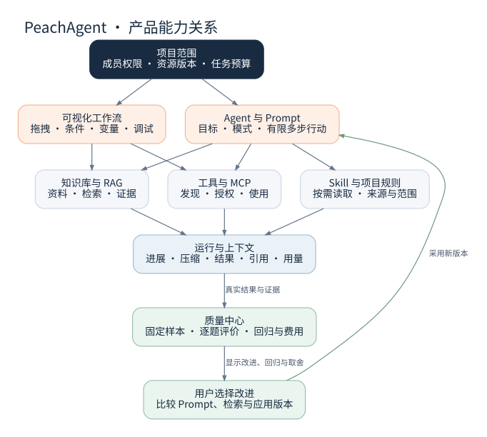
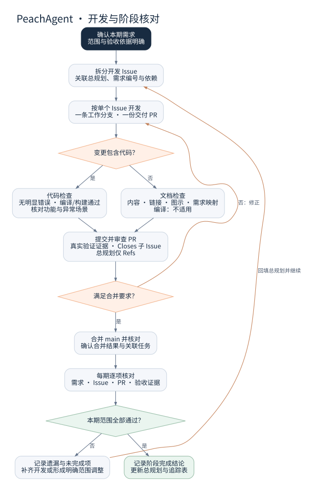

# PeachAgent

[简体中文](README.md) | [English](README_EN.md)

<!-- doc-section:overview -->
## 面向完整任务的 AI 智能体开发平台

PeachAgent 计划提供从 Agent 与工作流设计，到执行、知识检索、质量评测、资源共享和应用部署的完整开发平台。每个个人用户是独立租户，可使用全部产品功能，并自行配置模型和外部服务凭证。

**当前状态：v0.2 规划、架构文档与交互原型阶段。** 本仓库目前交付需求、技术蓝图、可编辑图示、AI 开发流程模板及 [HTML/CSS/JS 交互原型](prototype/README.md)。原型使用本地模拟调用；正式平台应用尚未实现，也没有可运行的 Docker Compose 安装包。下文描述的是七阶段交付目标，不是已经上线的功能。

<!-- doc-section:capabilities -->
## 四个产品域

| 产品域 | 规划能力 |
|---|---|
| **Agent Studio** | 工作流节点拖拽、Agent 设计、Prompt、MCP、Skill、项目规则、知识库、插件开发与调试 |
| **Agent Runtime** | 工作流和 Agent Loop、工具与受控代码执行、上下文预算/压缩、记忆、人工介入、长任务恢复与多 Agent |
| **Agent Quality** | RAG 召回与证据评测、任务质量、Skill/压缩/插件评测、Prompt 优化、版本比较、回归和人工复核 |
| **Agent Operations** | 个人租户、Sa-Token 权限、BYOK 凭证、Token 面板与预算、应用发布、公共审核仓库和部署运维 |

### 本版明确包含的能力

- **可扩展插件**：配置与真实代码能力、统一表单和自定义前端都支持；提供作者开发/调试/打包/安装路径。插件变更不要求重启主平台或全部 Runtime，旧应用与在途任务保留版本依据。
- **可共享资源仓库**：应用模板、插件、Skill、MCP 配置和 Prompt 模板均可提交；管理员审核具体版本后，所有正常用户可见。新版本重新审核，公共资源不携带作者密钥或私有数据。
- **可核查的 RAG 与质量**：区分候选召回、排序、最终上下文、回答与引用；用固定条件、原文标注和逐题结果判断改进，记录回归与开销。
- **统一 Token 面板**：覆盖对话、Agent、RAG、压缩、评测、优化和插件模型调用，区分已报告/估算/未知，避免父子任务及缓存/推理子项重复统计。
- **完整应用与部署**：发布 Web/API/Webhook 应用，明确执行身份和用量归属；最终交付 Docker Compose 包，默认挂载与初始化准备好，操作者只需填写数据库和中间件密码。

内置基础能力必须能独立完成主要路径，插件用于增加能力。完整范围见 [产品架构](requirements/06-product-architecture.md) 和 [能力矩阵](requirements/07-capability-matrix.md)。

<!-- doc-section:roadmap -->
## 七阶段路线图

前六阶段全部属于完整产品，第七阶段完成部署与上线验收。

| 阶段 | 主要结果 | 详细需求 |
|---|---|---|
| 1 | 个人空间、模型配置、项目、对话、Prompt、初始 Token 面板、插件声明 | [阶段 1](requirements/phases/phase-01-project-and-chat.md) |
| 2 | 可视化工作流、变量/条件/子流程、调试、插件节点和两类界面 | [阶段 2](requirements/phases/phase-02-visual-workflow.md) |
| 3 | Agent、MCP、Skill、AGENTS.md 等规则、渐进披露、上下文与受控代码热变更 | [阶段 3](requirements/phases/phase-03-agent-skills-context.md) |
| 4 | 知识资料版本、切分、检索策略、重排、引用、检索基线 | [阶段 4](requirements/phases/phase-04-knowledge-and-rag.md) |
| 5 | 数据集、质量中心、召回依据、Prompt 优化、完整 Token 与费用分析 | [阶段 5](requirements/phases/phase-05-quality-prompt-cost.md) |
| 6 | 协作/恢复、扫描/表格/跨文档知识、应用发布、公共仓库和个人租户运营 | [阶段 6](requirements/phases/phase-06-publishing-and-operations.md) |
| 7 | Docker Compose 一键部署、预设挂载、初始化、备份恢复与最终核对 | [阶段 7](requirements/phases/phase-07-docker-compose-deployment.md) |

阶段依赖、横向能力和退出条件见 [完整路线图](requirements/02-roadmap.md)；需求到 Issue、PR 和验收证据的映射见 [验收追踪](requirements/04-acceptance-and-traceability.md)。

<!-- doc-section:reading -->
## 从这里开始

| 想了解什么 | 阅读入口 |
|---|---|
| 直接体验界面、工作流、MCP 调试和 Agent 调用 | [交互原型与打开方式](prototype/README.md) |
| 为什么做、面向谁、哪些能力必须交付 | [项目背景与范围](requirements/01-product-background-and-scope.md) / [需求目录](requirements/README.md) |
| 产品域、资源关系、页面和用户完整旅程 | [产品架构](requirements/06-product-architecture.md) / [能力矩阵](requirements/07-capability-matrix.md) |
| 插件开发与公共资源审核 | [插件需求专题](requirements/topics/01-plugin-system.md) / [公共仓库需求专题](requirements/topics/02-public-repositories.md) |
| 服务、数据、运行和隔离如何设计 | [技术文档目录](technical/README.md) / [技术总架构](technical/01-platform-architecture.md) |
| 动态插件与自定义界面 | [插件技术设计](technical/02-plugin-runtime-and-ui.md) |
| MCP、Skill、项目规则、压缩与权限 | [执行与上下文设计](technical/03-execution-context-and-security.md) |
| RAG 策略、评测依据和 Token 口径 | [知识、质量与用量设计](technical/04-knowledge-quality-and-usage.md) |
| 共享仓库、在线应用的执行身份和版本 | [公共仓库与发布设计](technical/05-public-repository-and-application-release.md) |
| 未来部署包、默认服务、挂载和恢复 | [部署技术设计](technical/06-docker-compose-deployment.md) |
| 已确认约束与后续变更 | [决策记录](requirements/05-decisions-and-change-log.md) / [共性需求](requirements/03-cross-cutting-requirements.md) |

<!-- doc-section:repository -->
## 仓库目录

| 路径 | 内容 |
|---|---|
| [prototype/](prototype/README.md) | 离线 HTML 入口、完整 HTML/CSS/JS 源码、原型规划、运行契约与验证说明 |
| [requirements/](requirements/README.md) | 背景、产品蓝图、能力矩阵、七阶段详细需求、插件/公共仓库专题、验收与决策 |
| [technical/](technical/README.md) | 总架构与五份专题技术设计；推荐实现方案和后续验证边界 |
| [image/](image/README.md) | 产品、路线图、开发流程、架构、插件生命周期、审核和部署图；SVG 与可编辑 DOT 同步保存 |
| [ci/](ci/README.md) | AI 按模板执行的需求拆分、Issue、PR、阶段核对与上线验收流程 |

技术实现建议为 Java/Spring 生态、Vue/LogicFlow、模块化控制服务、独立执行与插件隔离，配合事务数据、缓存、检索和 S3 兼容存储。除用户已指定的 Sa-Token 与 Docker Compose 外，具体组件和兼容版本需按技术蓝图验证后锁定，不表示当前仓库已有相关工程。

<!-- doc-section:development -->
## 开发与交付

1. AI 读取已确认需求、技术蓝图、总 Issue 以及现有 Issues/PR/main，按 [需求拆分模板](ci/requirement-decomposition-template.md) 查重并差量拆分。
2. 按 [Issue 模板](ci/issue-template.md) 指定需求、验收项、依赖和明确范围，围绕单个 Issue 开发并提交对应 PR。
3. 按 [PR 模板](ci/pull-request-template.md) 提供真实检查证据。应用代码合并 main 前至少能正常编译/构建，且无已知明显错误；文档变更检查链接、编号、图示和一致性，不编造应用构建结果。
4. 每期按 [阶段核对模板](ci/phase-review-template.md) 对照全部功能核对并更新总 Issue；第七期再执行 [上线验收模板](ci/release-acceptance-template.md)。

执行细节见 [AI 执行指南](ci/ai-execution-guide.md)。ci 是开发流程与模板目录，本版不配置提交后自动批量创建 Issue 的自动化。

<!-- doc-section:status -->
## 当前进度与部署目标

[总规划 Issue #1](https://github.com/Ryan-Guizhou/PeachAgent/issues/1) 持续追踪七个阶段；[Issue #4](https://github.com/Ryan-Guizhou/PeachAgent/issues/4) 追踪本次完整规划与文档修订。文档合并与功能实现分别记录，各功能仍需要开发和真实验收。

目前请从需求和技术目录开始阅读，**不要将部署设计中的未来命令当作当前可运行安装步骤**。第七阶段目标是在受支持的 Linux 主机上提供可获取镜像、Docker Compose 编排、密码配置样例、自动生成内部密钥、预设挂载和完整恢复说明。用户模型/工具凭证在部署后由本人通过界面配置；自定义插件界面默认可用，无额外 DNS 必填项。

<!-- doc-section:license -->
## 许可证

本项目采用 [MIT License](LICENSE)。公共资源需另外保留作者和第三方依赖的许可信息；仓库许可证不替所有用户上传内容授予再分发权。
