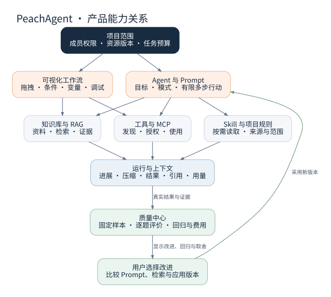
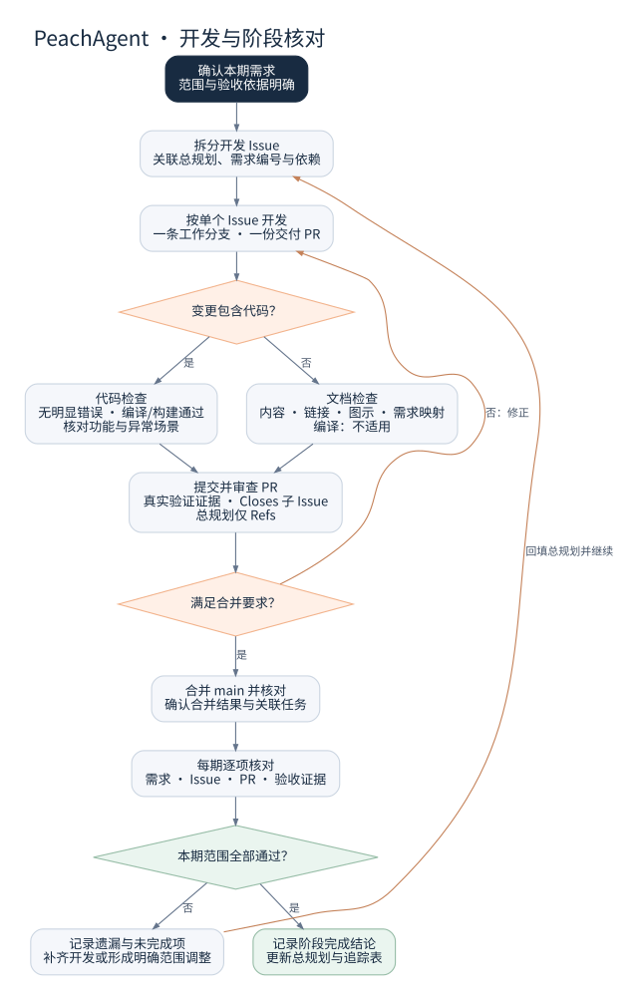

# PeachAgent

[简体中文](README.md) | [English](README_EN.md)

<!-- doc-section:overview -->
## An AI agent development platform for complete tasks

PeachAgent is planned as a complete platform for designing agents and workflows, executing tasks, retrieving knowledge, evaluating quality, sharing resources, and deploying applications. Each individual user is an isolated tenant with access to all product features and supplies their own model and external-service credentials.

**Current status: v0.2 planning, architecture documentation, and an interactive prototype.** This repository currently delivers requirements, technical blueprints, editable diagrams, AI development-process templates, and an [HTML/CSS/JS prototype](prototype/README.md). External calls in the prototype use local mock adapters. The production platform and a runnable Docker Compose installation package have not been implemented. The capabilities below are targets for seven delivery phases, not live features.

<!-- doc-section:capabilities -->
## Four product domains

| Domain | Planned capabilities |
|---|---|
| **Agent Studio** | Drag-and-drop workflows, agent design, prompts, MCP, Skills, project instructions, knowledge, plugin authoring and debugging |
| **Agent Runtime** | Workflows and agent loops, tools and controlled code execution, context budgets/compression, memory, human intervention, durable tasks and multiple agents |
| **Agent Quality** | RAG retrieval and evidence evaluation, task quality, Skill/compression/plugin evaluation, prompt optimization, version comparisons, regression analysis and human review |
| **Agent Operations** | Personal tenants, Sa-Token authorization, BYOK credentials, Token dashboards and budgets, application releases, reviewed public repositories and deployment operations |

### Explicitly included in this version

- **Extensible plugins:** configuration and executable code, generated forms and custom frontends, with authoring, debugging, packaging and installation. Plugin changes do not require restarting the main platform or all Runtime processes; existing applications and unfinished runs retain their version references.
- **Shared resource repositories:** application templates, plugins, Skills, MCP configurations and prompt templates can be submitted. Administrators approve specific versions before all active users can discover them. Updates require another review, and public packages exclude author credentials and private data.
- **Verifiable RAG and quality:** candidate retrieval, ranking, final context, answers and citations are measured separately. Fixed comparison conditions, source annotations and per-case results support improvement claims, including regressions and costs.
- **A unified Token dashboard:** chat, agents, RAG, compression, evaluation, optimization and plugin model calls are included. Reported, estimated and unknown usage remain distinct, without double counting parent/child runs or cache/reasoning subsets.
- **Complete applications and deployment:** Web/API/Webhook releases with explicit execution identity and usage ownership, followed by a Docker Compose package with preset mounts and initialization. Operators only supply database and middleware passwords for the default setup.

Built-in core capabilities must support the main journeys on their own; plugins extend them. See the [product architecture](requirements/06-product-architecture.md) and [capability matrix](requirements/07-capability-matrix.md) for the complete scope.

<!-- doc-section:roadmap -->
## Seven-phase roadmap

All first six phases are required for the complete product. Phase seven delivers deployment and release acceptance.

| Phase | Main result | Detailed requirements |
|---|---|---|
| 1 | Personal space, model configuration, projects, chat, prompts, initial Token dashboard and plugin declarations | [Phase 1](requirements/phases/phase-01-project-and-chat.md) |
| 2 | Visual workflows, variables/conditions/subflows, debugging, plugin nodes and both UI modes | [Phase 2](requirements/phases/phase-02-visual-workflow.md) |
| 3 | Agents, MCP, Skills, AGENTS.md and mapped instructions, progressive disclosure, context and dynamic controlled code | [Phase 3](requirements/phases/phase-03-agent-skills-context.md) |
| 4 | Knowledge versions, chunking, retrieval strategies, reranking, citations and retrieval baselines | [Phase 4](requirements/phases/phase-04-knowledge-and-rag.md) |
| 5 | Datasets, quality center, retrieval evidence, prompt optimization and complete Token/cost analysis | [Phase 5](requirements/phases/phase-05-quality-prompt-cost.md) |
| 6 | Collaboration/recovery, scanned/table/cross-document knowledge, application releases, public repositories and personal-tenant operations | [Phase 6](requirements/phases/phase-06-publishing-and-operations.md) |
| 7 | One-command Docker Compose deployment, preset mounts, initialization, backup/restore and final acceptance | [Phase 7](requirements/phases/phase-07-docker-compose-deployment.md) |

See the [full roadmap](requirements/02-roadmap.md) for dependencies and exit criteria, and [acceptance traceability](requirements/04-acceptance-and-traceability.md) for links between requirements, Issues, PRs and actual evidence.

<!-- doc-section:reading -->
## Start here

| Question | Reading entry |
|---|---|
| How can I try workflows, MCP debugging, and Agent interactions? | [Interactive prototype and opening instructions](prototype/README.md) |
| Why this project, for whom, and what must be delivered? | [Background and scope](requirements/01-product-background-and-scope.md) / [requirements index](requirements/README.md) |
| How do domains, resources, pages and user journeys connect? | [Product architecture](requirements/06-product-architecture.md) / [capability matrix](requirements/07-capability-matrix.md) |
| How do plugin authoring and public reviews work? | [Plugin requirements](requirements/topics/01-plugin-system.md) / [public repository requirements](requirements/topics/02-public-repositories.md) |
| How are services, data, execution and isolation designed? | [Technical index](technical/README.md) / [platform architecture](technical/01-platform-architecture.md) |
| How do dynamic plugins and custom frontends work? | [Plugin technical design](technical/02-plugin-runtime-and-ui.md) |
| How do MCP, Skills, project instructions, compression and permissions interact? | [Execution and context design](technical/03-execution-context-and-security.md) |
| What supports RAG improvements, evaluations and Token accounting? | [Knowledge, quality and usage design](technical/04-knowledge-quality-and-usage.md) |
| How do shared repositories and hosted application identities differ? | [Public repository and release design](technical/05-public-repository-and-application-release.md) |
| What will the deployment package, mounts and recovery include? | [Deployment design](technical/06-docker-compose-deployment.md) |
| Which constraints are confirmed, and how can they change? | [Decision record](requirements/05-decisions-and-change-log.md) / [cross-cutting requirements](requirements/03-cross-cutting-requirements.md) |

<!-- doc-section:repository -->
## Repository layout

| Path | Contents |
|---|---|
| [prototype/](prototype/README.md) | Offline HTML entry, complete HTML/CSS/JS sources, prototype plan, runtime contract, and verification notes |
| [requirements/](requirements/README.md) | Background, product blueprint, capability matrix, seven detailed phases, plugin/public-repository topics, acceptance and decisions |
| [technical/](technical/README.md) | Overall architecture and five technical topics, recommended implementation choices and validation boundaries |
| [image/](image/README.md) | Product, roadmap, development flow, architecture, plugin lifecycle, review and deployment diagrams; SVG with editable DOT sources |
| [ci/](ci/README.md) | Templates and instructions for AI-led requirement decomposition, Issues, PRs, phase reviews and release acceptance |

The recommended implementation uses the Java/Spring ecosystem, Vue/LogicFlow, a modular control service, independent execution and isolated plugins, plus transactional storage, caching, retrieval and S3-compatible storage. Apart from the user-specified Sa-Token and Docker Compose constraints, components and compatible versions require validation before being locked. Their corresponding application projects do not yet exist here.

<!-- doc-section:development -->
## Development and delivery

1. AI reads confirmed requirements, architecture, the master Issue and existing Issues/PRs/main, then uses the [decomposition template](ci/requirement-decomposition-template.md) to identify gaps without creating duplicates.
2. Each development Issue follows the [Issue template](ci/issue-template.md), defining requirements, acceptance items, dependencies and scope, and receives its own branch and PR.
3. The [PR template](ci/pull-request-template.md) requires actual evidence. Application changes must compile/build successfully and have no known obvious errors before merging into main. Documentation changes check links, identifiers, diagrams and consistency instead of inventing application build results.
4. Each phase uses the [phase review template](ci/phase-review-template.md) to check the full functional scope and update the master Issue. Phase seven also uses the [release acceptance template](ci/release-acceptance-template.md).

See the [AI execution guide](ci/ai-execution-guide.md). The ci directory contains processes and templates; this version does not configure automation that bulk-creates Issues after every commit.

<!-- doc-section:status -->
## Current progress and deployment target

[Master Issue #1](https://github.com/Ryan-Guizhou/PeachAgent/issues/1) tracks all seven phases. [Issue #4](https://github.com/Ryan-Guizhou/PeachAgent/issues/4) tracks this planning and documentation revision. Merged documentation and implemented product features are recorded separately; all product capabilities still require implementation and actual acceptance.

Start with the requirements and technical documents. **Future commands in the deployment design are not currently runnable installation instructions.** Phase seven targets a supported Linux host with obtainable images, Compose definitions, password configuration examples, generated internal secrets, preset mounts and complete restore guidance. Individual model/tool credentials are entered through the UI after deployment. The default custom-plugin UI will work without mandatory extra DNS configuration.

<!-- doc-section:license -->
## License

This project uses the [MIT License](LICENSE). Shared resources must retain author and third-party dependency licensing information; the repository license does not grant redistribution rights for every user-uploaded package.
