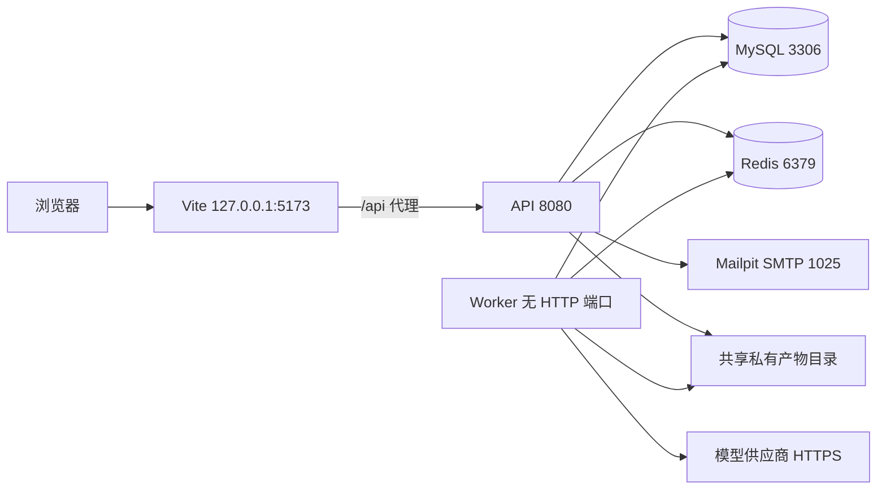

# PeachAgent 服务端

[English](README_EN.md) | [产品需求](../requirements/PRD-PeachAgent.md) | [P1 技术方案](../technical/P1-TECHNICAL-DESIGN.md) | [前端启动](../frontend/README.md)

P1 采用 JDK 21、Spring Boot 4.1.3、Maven 七模块及 MySQL 8.4 / Redis 7.4。API 提供鉴权、资源管理和 SSE；Worker 独立消费 MySQL 持久运行队列，调用模型并结算用量。前端为 Vue 3 + Vite。当前是开发环境，不是 P7 生产部署包；供应商真实调用及整期验收见 [#18](https://github.com/Ryan-Guizhou/PeachAgent/issues/18)。

## 1. 拓扑与前置条件



安装 Git、JDK 21、Maven 3.9+、Node.js 22（至少 22.12）、npm、Docker Desktop（Windows/macOS）或 Docker Engine 与 Compose v2。所有后端命令从仓库根目录执行；确认以下命令正常：

```bash
java -version
mvn -version
node -v
npm -v
docker version
docker compose version
```

端口：MySQL 3306、Redis 6379、Mailpit SMTP 1025 / 邮箱页面 8025、API 8080、Vite 5173。Compose 中间件仅映射 127.0.0.1；Worker 无 Web 服务。端口冲突应先释放或同步修改映射及连接配置。

## 2. 首次配置

复制根目录 [.env.example](../.env.example) 为 .env（Windows：`Copy-Item .env.example .env`；Bash：`cp .env.example .env`）。用自己生成的随机值填入 MYSQL_ROOT_PASSWORD、DB_PASSWORD、REDIS_PASSWORD 和 CREDENTIAL_KEK，禁止提交 .env。建议数据库/Redis 密码使用随机十六进制，避免 Shell/Compose 特殊字符歧义。KEK 必须是 32 字节随机数据的 Base64 编码，不是 32 个字符的密码。Bash 可执行 `openssl rand -base64 32`；PowerShell：

```powershell
$bytes = New-Object byte[] 32
$rng = [System.Security.Cryptography.RandomNumberGenerator]::Create()
$rng.GetBytes($bytes)
[Convert]::ToBase64String($bytes)
$rng.Dispose()
```

将输出保存到 .env 的 CREDENTIAL_KEK；生成后妥善备份，API/Worker 使用完全相同的值和版本。不要每次启动重新生成。已加密凭证依赖原 KEK；修改版本号并不会自动迁移旧密文。

### 配置项（以 application.yml、各 profile 及 Compose 为准）

| 环境变量 | 默认值 / 示例 | 说明 |
| --- | --- | --- |
| MYSQL_ROOT_PASSWORD | 必填（Compose） | MySQL root 初始化密码；应用不使用 root |
| DB_USER / DB_PASSWORD | 必填 | MySQL 应用用户和密码；与 Compose 一致 |
| DB_URL | 必填；jdbc:mysql://127.0.0.1:3306/peachagent | JDBC URL；已有数据库需满足初始化契约 |
| REDIS_HOST / REDIS_PORT | localhost / 6379 | Redis 地址 |
| REDIS_PASSWORD | 空（应用）/ Compose 必填 | Sa-Token Session、限流；与 Compose 一致 |
| SMTP_HOST / SMTP_PORT | localhost / 1025 | 邮件挑战及密码恢复；开发使用 Mailpit |
| SMTP_USER / SMTP_PASSWORD | 空 | 外部 SMTP 凭证 |
| SMTP_AUTH / SMTP_TLS | false / false | SMTP AUTH / STARTTLS；外部 SMTP 按服务商配置 |
| MAIL_FROM | no-reply@peachagent.local | 发件地址 |
| SERVER_PORT | 8080 | API 监听端口；改动须同步 Vite 代理 |
| PUBLIC_ORIGIN | http://localhost:8080 | 允许的浏览器 Origin；Vite 开发为 http://127.0.0.1:5173；同源静态模式为 http://localhost:8080 |
| COOKIE_SECURE | true | 只在本地 HTTP 开发设 false；HTTPS 应保持 true |
| CREDENTIAL_KEK | 空 | 空时允许应用启动，但凭证创建/解密被拒绝；实际使用模型密钥必配 |
| CREDENTIAL_KEK_VERSION | 1 | 当前 KEK 标识，API/Worker 一致 |
| PEACHAGENT_ALLOWED_INTERNAL_ORIGINS | 空 | 部署者明确允许的内部模型 origin，逗号分隔，例如 http://127.0.0.1:11434；默认只允许公共 HTTPS:443，禁止元数据地址 |
| PEACHAGENT_ARTIFACT_DIRECTORY | ./data/artifacts | API/Worker 同一受保护目录；不同工作目录应使用绝对路径，非公开 Web 根目录 |
| ADMIN_EMAIL / ADMIN_PASSWORD | admin-init 必填 | 可选首次管理员初始化；密码至少 12 字符，无默认管理员 |

重要：MySQL 初始化为 UTF8MB4 / UTF8MB4_0900_AI_CI，LOWER_CASE_TABLE_NAMES=1 必须在空数据目录初始化时确定。不能在已有卷上直接修改。Flyway V1 创建 25 张业务表；业务时间以 UTC CHAR(14) yyyyMMddHHmmss 存储。SQL 标识符、关键字大写，密钥及外部模型 ID 保持精确原值。

## 3. 启动中间件并构建

```bash
docker compose --env-file .env -f compose.dev.yml up -d --wait mysql redis mailpit
docker compose --env-file .env -f compose.dev.yml ps
mvn -B -f backend/pom.xml verify
```

Compose 只自动读取 .env 用于变量插值，**不会给宿主机 java 进程加载变量**。启动每个 JVM 的终端都须先加载 .env。不要把真实密码放进命令行或日志。

Windows PowerShell（每个新终端，在仓库根目录执行）：

```powershell
Get-Content .env | ForEach-Object {
    if ($_ -match '^([A-Z_][A-Z0-9_]*)=(.*)$') {
        [Environment]::SetEnvironmentVariable($Matches[1], $Matches[2], 'Process')
    }
}
```

Linux/macOS Bash（只 source 自己编辑且可信的 .env，使用模板约定的无空格、无 shell 特殊字符值）：

```bash
set -a
. ./.env
set +a
```

## 4. 启动 API、Worker 与前端

**终端 A**（已加载 .env）：API 执行 Flyway 初始化和校验，等待健康检查 UP。

```bash
java -jar backend/peachagent-bootstrap/target/peachagent-bootstrap-1.0.0-SNAPSHOT.jar --spring.profiles.active=api
```

另一个终端验证：`curl http://127.0.0.1:8080/actuator/health`（Windows PowerShell 使用 `Invoke-RestMethod http://127.0.0.1:8080/actuator/health`）。期望 status=UP；数据库及 SMTP 不可用时排查真实依赖。

**终端 B**（重复加载同一 .env，工作目录为仓库根目录）：在 API 已健康后启动 Worker。Worker 禁用 Flyway、无 HTTP 端口，通过日志 Started PeachAgentApplication 及实际运行任务确认。

```bash
java -jar backend/peachagent-bootstrap/target/peachagent-bootstrap-1.0.0-SNAPSHOT.jar --spring.profiles.active=worker
```

**终端 C**：

```bash
cd frontend
npm install
npm run dev
```

打开 http://127.0.0.1:5173（不要改为 localhost，除非同步配置 PUBLIC_ORIGIN）。此模式不需要 API 提供静态文件；Vite 将 /api 代理至 127.0.0.1:8080，保留原 Origin。邮件页面 http://127.0.0.1:8025。详细前端说明见 [frontend/README.md](../frontend/README.md)。

### IntelliJ IDEA

打开 backend/pom.xml 为 Maven 工程，Project SDK / Maven Runner JRE 均设 JDK 21。创建两个 Spring Boot/Application 运行配置，主类 com.peachsoft.peachagent.PeachAgentApplication、classpath 模块 peachagent-bootstrap、Working directory 为仓库根目录；Program arguments 分别为 --spring.profiles.active=api 和 --spring.profiles.active=worker。Environment variables 中导入同一 .env（IDE 支持时）或手动填入键值；不要共享含秘密的运行配置。先启动 API，再启动 Worker。前端可使用独立 npm dev 运行配置，目录 frontend。

### 同源构建模式（可选）

```bash
cd frontend
npm install
npm run build
cd ..
```

API 终端重新加载配置，将 PUBLIC_ORIGIN 改为 http://localhost:8080（Bash：`export PUBLIC_ORIGIN=http://localhost:8080`；PowerShell：`$env:PUBLIC_ORIGIN='http://localhost:8080'`）。从根目录执行：

```bash
java -jar backend/peachagent-bootstrap/target/peachagent-bootstrap-1.0.0-SNAPSHOT.jar --spring.profiles.active=api --spring.web.resources.static-locations=file:./frontend/dist/
```

Worker 仍须独立启动。访问 http://localhost:8080/#/home。此方式对应 CI 的同源浏览器测试；不是生产镜像部署方案。

## 5. 首次使用：真实账户与模型

1. 打开控制台注册页面，填写邮箱、显示名、币种，发送验证邮件。
2. 在 Mailpit 邮件页面复制一次性验证串，输入至少 12 字符密码完成注册。登录后自动创建个人租户、默认空间、默认项目及三级预算。
3. 模型需要认证时，凭证中心创建 BEARER 或 API_KEY 凭证，填写供应商 origin 和实际 API Key。无需认证的明确授权本地模型使用 NONE，不绑定凭证。
4. 模型中心新建供应商连接（Base URL 是协议的前缀，不含最终操作路径），新建模型实例、选择协议/版本与实际外部模型 ID，绑定当前项目。执行模型诊断，确认成功/VERIFIED 后设为默认或在对话选中该模型。
5. 新建会话发消息；在运行记录和用量预算查看真实任务、事件、Token/费用。未知用量不是零；测试供应商可能收费。

| 内置协议（v1） | 类型 | Base URL 示例 | 认证 |
| --- | --- | --- | --- |
| openai.chat-completions | LLM | https://api.openai.com/v1 | BEARER / NONE |
| openai.embeddings | EMBEDDING | https://api.openai.com/v1 | BEARER / NONE |
| openai.images | IMAGE | https://api.openai.com/v1 | BEARER / NONE |
| openai.audio-transcriptions | STT | https://api.openai.com/v1 | BEARER / NONE |
| openai.audio-speech | TTS | https://api.openai.com/v1 | BEARER / NONE |
| anthropic.messages | LLM | https://api.anthropic.com/v1 | API_KEY |
| dashscope.text-rerank | RERANK | https://dashscope.aliyuncs.com/api/v1 | BEARER |

地址为协议前缀示例，须以账户实际端点、模型可用性和接口兼容性为准；不代表真实厂商验收通过。OpenAI-compatible 并非所有兼容模型都支持流式 usage 或 b64 PNG/WAV 等响应约定。STT 仅接受不超过 10 MiB 的 WAV；媒体产物限 20 MiB、默认有效期 24 小时。使用内部 HTTP 连接仅允许可信开发端点，并让 API/Worker 同时加载 allowlist 后重启。

可选首个管理员：在独立终端加载 .env、设置 ADMIN_EMAIL 和 ADMIN_PASSWORD 后，以 `--spring.profiles.active=admin-init` 启动同一 jar 一次，不与正常 API profile 混用；无默认管理员，已存在时拒绝重复创建。初始化完成后移除该终端的管理员密码环境变量。常规用户注册不需要管理员初始化。

## 6. 验证、停止与排障

```bash
mvn -B -f backend/pom.xml verify
bash database/verify-schema.sh
cd frontend
npm run build
npm audit --audit-level=high
```

完整 IAM/Runtime/Chromium smoke 见 [.github/workflows/p1-backend.yml](../.github/workflows/p1-backend.yml)。脚本使用一次性数据库、Mailpit、固定测试账号及本地 HTTP fixture；不要在真实个人数据库上运行。浏览器 QA 需 Playwright 对应 Chromium；Linux CI 固定 Ubuntu 24.04，Windows 本地可在 frontend 执行 `npx playwright install chromium`。测试截图作为 CI 产物保存，fixture 不代替真实供应商验收。

| 症状 | 排查与处理 |
| --- | --- |
| DB_URL / DB_PASSWORD 未解析 | .env 没有自动进入 JVM；在每个终端加载或在 IDE 中配置 |
| MySQL access denied / 数据库契约错误 | 核对容器初次初始化用户/密码、字符排序规则及 lower_case_table_names；旧卷不会自动更新密码 |
| /actuator/health DOWN | docker compose ps 与 logs mysql redis mailpit；检查 SMTP/Redis/DB 连接和鉴权 |
| 注册收不到邮件 | Mailpit 8025、SMTP_HOST/PORT、MAIL_FROM；外部 SMTP 校验认证与 STARTTLS |
| 登录或写操作 403 | PUBLIC_ORIGIN 与浏览器 Origin 必须完全相同；不要混用 localhost 和 127.0.0.1；检查 CSRF 请求头 |
| 登录后 401 | 本地 HTTP 时 COOKIE_SECURE=false；检查 Cookie/Redis 会话，重新登录 |
| CREDENTIAL_VAULT_UNCONFIGURED / 解密失败 | 检查 32 字节 Base64 KEK、版本和 API/Worker 一致性；恢复原密钥，勿覆盖旧密文 |
| MODEL_ENDPOINT_DENIED / MODEL_DNS_FAILED | 检查协议、DNS、端点端口和部署者允许的内部 origin；禁止放开任意私网 |
| 任务一直 QUEUED | 确认 Worker 已启动且同库，检查 Worker 日志、预算/截止时间；不要手工修改状态 |
| 产物不可用 | 确认 API/Worker 共用目录、权限、有效期；不要直接暴露产物目录 |
| Flyway checksum mismatch | 不修改已应用的迁移；通过新版本迁移修复 |
| Chromium 安装失败 | 使用受支持的 OS 与锁定 Playwright 版本；不得跳过浏览器门禁 |

正常停止：先停止前端、API、Worker 进程（Ctrl+C），再执行 `docker compose --env-file .env -f compose.dev.yml down`，保留数据卷与 .env。仅一次性开发/CI 环境确认无需保留数据后才能使用 down -v（会清除 MySQL、Redis 数据）。不要删除真实数据或丢失 KEK。P7 生产部署、备份恢复和正式升级不属于当前交付。
