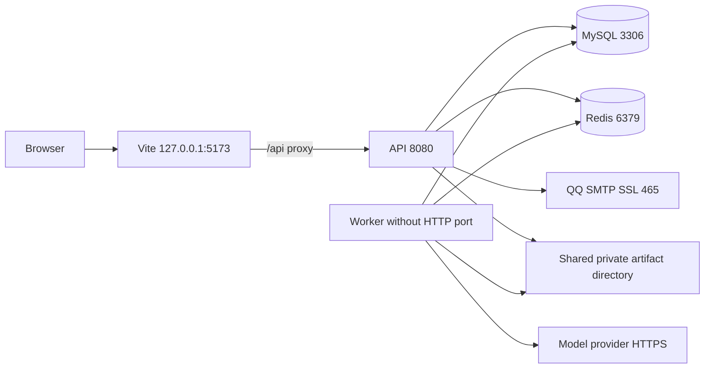

# PeachAgent backend

[中文](README.md) | [PRD](../requirements/PRD-PeachAgent.md) | [P1 design](../technical/P1-TECHNICAL-DESIGN.md) | [Frontend](../frontend/README_EN.md)

P1 uses JDK 21, Spring Boot 4.1.3, a seven-module Maven project, MySQL 5.7.44 or 8.4 and Redis 7.4. API serves identity, resources and SSE; an independent Worker consumes persistent MySQL runs, invokes models and settles usage. This is a development environment, not the P7 production deployment. See [#18](https://github.com/Ryan-Guizhou/PeachAgent/issues/18) for acceptance.

## 1. Prerequisites and topology



Install Git, JDK 21, Maven 3.9+, Node.js 22 (at least 22.12), npm and Docker Desktop or Docker Engine with Compose v2. From the repository root check `java -version`, `mvn -version`, `node -v`, `npm -v`, `docker version` and `docker compose version`. MySQL 3306, Redis 6379, API 8080, Vite 5173 must be available; outbound QQ SMTP SSL port 465 must be reachable. Middleware is published only on 127.0.0.1.

## 2. Configure

Copy [.env.example](../.env.example) to .env (`Copy-Item .env.example .env` in PowerShell, `cp .env.example .env` in Bash). Fill MYSQL_ROOT_PASSWORD, DB_PASSWORD, REDIS_PASSWORD and CREDENTIAL_KEK with locally generated random values; do not commit .env. Random hexadecimal passwords avoid shell/Compose quoting ambiguity. KEK is Base64 of exactly 32 random bytes, not a 32-character password. Bash: `openssl rand -base64 32`. PowerShell:

```powershell
$bytes = New-Object byte[] 32
$rng = [System.Security.Cryptography.RandomNumberGenerator]::Create()
$rng.GetBytes($bytes)
[Convert]::ToBase64String($bytes)
$rng.Dispose()
```

Persist and back up the key; API and Worker use the same key/version. Do not regenerate on restart. Changing key version does not migrate existing ciphertext.

| Environment variable | Default / example | Purpose |
| --- | --- | --- |
| MYSQL_ROOT_PASSWORD | Required (Compose) | Initialization root password, not used by app |
| DB_USER / DB_PASSWORD | Required | App DB credentials, matching Compose |
| DB_URL | Required; jdbc:mysql://127.0.0.1:3306/peachagent | JDBC URL |
| REDIS_HOST / REDIS_PORT | localhost / 6379 | Redis address |
| REDIS_PASSWORD | Empty in app; required by Compose | Session and rate limiting |
| SMTP_HOST / SMTP_PORT | smtp.qq.com / 465 | QQ SMTP for verification/reset |
| SMTP_USER / SMTP_PASSWORD | Required | Full QQ email / SMTP authorization code, not login password |
| SMTP_AUTH / SMTP_SSL / SMTP_TLS | true / true / false | Auth, implicit SSL, STARTTLS |
| MYSQL_IMAGE | mysql:8.4 | Compose only; mysql:5.7.44 for a fresh volume, or use an existing server |
| MAIL_FROM | SMTP_USER | Sender |
| SERVER_PORT | 8080 | API port; update Vite proxy if changed |
| PUBLIC_ORIGIN | http://localhost:8080 | Exact browser origin; Vite uses http://127.0.0.1:5173 |
| COOKIE_SECURE | true | false only for local HTTP; true for HTTPS |
| CREDENTIAL_KEK | Empty | 32-byte Base64 key; empty disables credential creation/decryption |
| CREDENTIAL_KEK_VERSION | 1 | Key version shared by API and Worker |
| PEACHAGENT_ALLOWED_INTERNAL_ORIGINS | Empty | Explicit comma-separated trusted internal origins, e.g. http://127.0.0.1:11434; default public HTTPS:443; metadata remains blocked |
| PEACHAGENT_ARTIFACT_DIRECTORY | ./data/artifacts | Same private directory for API and Worker; use absolute path if working directories differ |
| ADMIN_EMAIL / ADMIN_PASSWORD | Required by admin-init only | Optional first administrator for a non-dev database; at least 12-character password |

New databases use UTF8MB4 / UTF8MB4_UNICODE_CI. Case-insensitive identifiers require LOWER_CASE_TABLE_NAMES=1 or 2 (Compose uses 1). Never change this setting on an existing volume. Existing case-insensitive UTF8MB4 collations remain accepted. Flyway detects 5.7 / 8.x: 8.x retains its original V1 checksum; 5.7 uses a separate V1, shared V2, and V3 equivalent triggers to enforce all 104 original checks. Do not automatically repair, delete, or disable migration validation; back up and review failed/cross-version migrations separately. MySQL 5.7 is past regular security maintenance; prefer supported 8.x in production. External 5.7 needs InnoDB, DYNAMIC row format, sufficient index length, and DDL/foreign-key/TRIGGER privileges (review trigger privileges with the DBA when binlog is enabled). Flyway V1 creates 25 business tables. Business time is UTC CHAR(14) yyyyMMddHHmmss. SQL identifiers and keywords are uppercase; credentials and external model IDs retain exact case.

## 3. Start dependencies and build

```bash
docker compose --env-file .env -f compose.dev.yml up -d --wait mysql redis
docker compose --env-file .env -f compose.dev.yml ps
mvn -B -f backend/pom.xml verify
```

Compose .env interpolation does not export variables to a host JVM. In each new terminal, from the repository root, load your own trusted .env with simple unquoted values. PowerShell:

```powershell
Get-Content .env | ForEach-Object {
    if ($_ -match '^([A-Z_][A-Z0-9_]*)=(.*)$') {
        [Environment]::SetEnvironmentVariable($Matches[1], $Matches[2], 'Process')
    }
}
```

Bash:

```bash
set -a
. ./.env
set +a
```

## 4. Start API, Worker and UI

Terminal A (load .env first):

```bash
java -jar backend/peachagent-bootstrap/target/peachagent-bootstrap-1.0.0-SNAPSHOT.jar --spring.profiles.active=api,dev
```

Wait for `curl http://127.0.0.1:8080/actuator/health` to return UP (PowerShell: `Invoke-RestMethod http://127.0.0.1:8080/actuator/health`). API performs Flyway migration. Terminal B (load same .env, same repository working directory):

```bash
java -jar backend/peachagent-bootstrap/target/peachagent-bootstrap-1.0.0-SNAPSHOT.jar --spring.profiles.active=worker
```

Worker has no web port and Flyway is disabled; confirm startup logs and actual run execution. Terminal C:

```bash
cd frontend
npm install
npm run dev
```

Open http://127.0.0.1:5173, matching PUBLIC_ORIGIN exactly. Vite proxies /api to 127.0.0.1:8080 and preserves Origin. Retrieve verification codes from the real recipient inbox. See [frontend setup](../frontend/README_EN.md).

IntelliJ IDEA: import backend/pom.xml; set project SDK and Maven runner JRE to JDK 21. Create two Application/Spring Boot configurations with main class com.peachsoft.peachagent.PeachAgentApplication, classpath peachagent-bootstrap, repository root as working directory, program arguments --spring.profiles.active=api,dev / --spring.profiles.active=worker, and the same environment from .env. Do not share run configurations containing secrets. Start API before Worker; use a separate npm dev configuration in frontend.

Optional same-origin build: from frontend run npm install and npm run build, return to repository root, load .env and override PUBLIC_ORIGIN=http://localhost:8080 in the API terminal (Bash export or PowerShell $env:PUBLIC_ORIGIN). Run:

```bash
java -jar backend/peachagent-bootstrap/target/peachagent-bootstrap-1.0.0-SNAPSHOT.jar --spring.profiles.active=api,dev --spring.web.resources.static-locations=file:./frontend/dist/
```

Run Worker separately; visit http://localhost:8080/#/home. This matches CI's static UI mode, not production packaging.

## 5. First account and model

Register with email, name, currency and a password of at least 12 characters; retrieve the one-time verification token from the recipient inbox. Registration creates a personal tenant, default workspace/project and three budget policies. Create a credential bound to provider origin for BEARER or API_KEY; NONE has no credential. Create a provider connection (Base URL prefix, not final operation URL), model instance with actual external model ID and protocol, bind it to the project, run diagnostics, then use a VERIFIED model in Chat. Inspect runs, events and usage; unknown costs are not zero and real requests may incur charges.

| Built-in protocol (v1) | Type | Base URL example | Auth |
| --- | --- | --- | --- |
| openai.chat-completions | LLM | https://api.openai.com/v1 | BEARER / NONE |
| openai.embeddings | EMBEDDING | https://api.openai.com/v1 | BEARER / NONE |
| openai.images | IMAGE | https://api.openai.com/v1 | BEARER / NONE |
| openai.audio-transcriptions | STT | https://api.openai.com/v1 | BEARER / NONE |
| openai.audio-speech | TTS | https://api.openai.com/v1 | BEARER / NONE |
| anthropic.messages | LLM | https://api.anthropic.com/v1 | API_KEY |
| dashscope.text-rerank | RERANK | https://dashscope.aliyuncs.com/api/v1 | BEARER |

Examples are protocol prefixes, not verified live vendor compatibility. Check available models and actual endpoint; streaming usage and b64 PNG/WAV contracts vary. STT is limited to 10 MiB WAV; artifacts are limited to 20 MiB and expire after 24 hours. Only allow trusted local origins through the explicit allowlist on both API and Worker. Optional first administrator: load .env in a separate terminal, set ADMIN_EMAIL and ADMIN_PASSWORD, run the same jar once with --spring.profiles.active=admin-init, and remove the password from that terminal afterward. Do not combine admin-init with API; no default administrator exists in a non-dev database and repeat provisioning is rejected.

## 6. Validate, troubleshoot and stop

```bash
mvn -B -f backend/pom.xml verify
bash database/verify-schema.sh
cd frontend
npm run build
npm audit --audit-level=high
```

The [backend CI](../.github/workflows/p1-backend.yml) runs IAM, runtime and Chromium smoke on disposable database, loopback-only SMTP and HTTP fixtures; never run against real data. Linux CI pins Ubuntu 24.04; Windows can run npx playwright install chromium from frontend. Screenshots are uploaded as CI artifacts. Fixtures do not verify live providers.

| Symptom | Check |
| --- | --- |
| Unresolved DB_URL / DB_PASSWORD | Load .env into every JVM terminal or IDE |
| DB access denied / contract failure | Check original volume credentials, collation and lower_case_table_names |
| Health DOWN | Compose ps/logs mysql redis and actual connections |
| No registration email | Enable QQ SMTP, use a valid authorization code, matching sender address and outbound SSL port 465 |
| 403 login or mutation | Exact PUBLIC_ORIGIN, CSRF; do not mix localhost/127.0.0.1 |
| 401 after login | COOKIE_SECURE=false only for HTTP development; check Redis/cookie |
| Vault unconfigured / decryption failure | Same 32-byte Base64 KEK/version; restore original key |
| Endpoint denied / DNS failure | Protocol, DNS, port, trusted origin; no blanket private access |
| Run remains QUEUED | Worker, same DB, logs, budget/deadline; never edit run state manually |
| Artifact unavailable | Shared private directory, permissions, expiry |
| Flyway checksum mismatch | Never edit applied migration; use new migration |
| Chromium install failure | Supported OS and pinned Playwright; keep browser gate |

Stop UI/API/Worker with Ctrl+C; run `docker compose --env-file .env -f compose.dev.yml down` to retain volumes. Only disposable test environments may use down -v after confirming data loss. Retain .env and original KEK. Production deployment, backup/restore and upgrades belong to P7.

### QQ SMTP and existing MySQL 5.7

Enable SMTP in QQ Mail and generate a dedicated authorization code. Configure SMTP_USER (full email) and SMTP_PASSWORD (authorization code), never commit the values. MAIL_FROM defaults to SMTP_USER. Default SMTP_HOST=smtp.qq.com, SMTP_PORT=465, SMTP_AUTH=true, SMTP_SSL=true, SMTP_TLS=false. No mail container is needed. CI uses a loopback-only test SMTP fixture; real QQ credential validation remains a deployment check.

For an existing MySQL server, do not start the Compose mysql container; create the database and grant the application user privileges:

```sql
CREATE DATABASE IF NOT EXISTS PEACHAGENT CHARACTER SET UTF8MB4 COLLATE UTF8MB4_UNICODE_CI;
SELECT @@LOWER_CASE_TABLE_NAMES, @@CHARACTER_SET_DATABASE, @@COLLATION_DATABASE;
```

Inspect the variables in a session connected to the intended database. Do not blindly convert existing table data or delete persistent data/KEK. MySQL 5.7 lacks SKIP LOCKED; its claim path uses a locking read with the same state/deadline predicates and lease fencing. CI tests MySQL 5.7 and 8.4; the established performance benchmark remains on 8.4.

### Java style

Follow repository AGENTS.md. Run `mvn -f backend/pom.xml spotless:apply` locally and `mvn -f backend/pom.xml verify` before submitting. CI checks formatting and Chinese type Javadoc.

## Local development seed accounts (Flyway V4)

| Role | Email | Initial plaintext password |
| --- | --- | --- |
| Platform administrator | admin@peachagent.example.invalid | `PeachAgent-Dev-Admin-2026!` |
| Ordinary user | user@peachagent.example.invalid | `PeachAgent-Dev-User-2026!` |

These are public synthetic local-only test accounts; the SQL stores only Argon2id password hashes. Each personal tenant gets a default workspace, project and three budget policies (concurrency 8/4/2, per-run limit 180 seconds). Admin does not gain other tenants' private resource permissions. No real model credentials, fake calls or fabricated usage are seeded.

Use `api,dev` as Active profiles in IDEA or `--spring.profiles.active=api,dev` as the program argument. Worker still uses `worker`. The dev API binds to 127.0.0.1, disables secure cookies for local HTTP, and excludes mail from health so login can be verified without QQ SMTP; real registration/reset still requires SMTP. Match the browser origin to PUBLIC_ORIGIN. V4 is under `db/dev` and loaded only by a local dev API. Existing V1/V2/V3 checksums remain unchanged. Normal `api` does not insert these accounts, and Flyway validation rejects a database with V4 applied if the dev profile is removed. Use a separate production database; never bypass migration validation or expose dev accounts publicly. Reserved email/UUID collisions fail without overwriting existing records; restarts do not reset credentials or edits. The existing local connection defaults are preserved, with DB_URL, DB_USER and DB_PASSWORD environment variables taking precedence. Always override them with separate least-privilege credentials for deployment.
