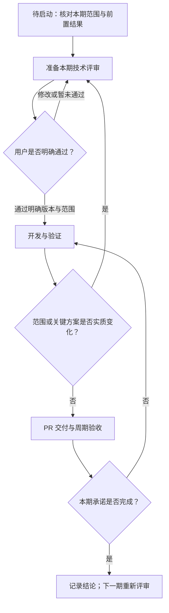

# PeachAgent 开发与评审流程

> 本目录约定 AI 与开发者如何推进工作，不代表仓库已经具备自动 CI/CD。整体需求以 [PRD](../requirements/PRD-PeachAgent.md) 为准，实现边界见 [技术基线](../technical/README.md)。

**一个阶段对应一个开发周期。每个周期开始前，只提交当期需求的技术评审；用户明确通过后才能开发。** PRD 确认、文档合并、上期验收及既往开发授权，均不能替代下一期技术评审。

## 1. 周期状态与启动条件

评审前可以读取现状、核对依赖、整理方案和估算，不修改产品实现。必要的验证实验先在评审中列明范围；涉及实现的实验也需用户授权，不能借“预研”提前开发未来阶段。

状态使用“待评审、修改中、已批准、开发中、待验收、已验收、阻塞”即可。未出现明确批准记录时保持待评审，不由 AI 自行填写“通过”。

## 2. 当前周期技术评审的最小内容

每次只维护**一个当前周期评审 Issue**，在同一处保存范围、方案、批准与验收；不另建七套方案、评审报告和进度文档。

| 字段 | 必须说明 |
|---|---|
| 周期与依据 | 周期编号、PRD 需求编号、采用的文档/代码版本、已完成前置结果 |
| 本期范围 | 解决的问题、用户结果、纳入与排除项、可验证验收条件；未来需求仅说明接口边界 |
| 技术方案 | 涉及模块和流程、拟采用方案及主要取舍、与已交付能力的衔接；只有影响本期的选型需要决定 |
| 数据与权限 | 数据归属、版本、接口、凭证、租户/空间隔离、涉及的迁移与兼容影响 |
| 执行与安全 | 适用的审批、沙盒、预算、失败、重试、恢复和外部效果处理；不适用项简述原因 |
| 验证与验收 | 正常及关键异常场景、真实构建/测试入口、验证环境、通过条件与所需证据 |
| 工期与风险 | 任务拆分、依赖、可并行范围、估算依据、主要不确定性及失败或回退办法 |
| 用户决定 | 待审批的具体版本与范围；批准后记录用户原意、来源链接或本次会话说明、日期及对应修订 |

批准记录必须能确定“哪一期、哪份方案、哪些范围获准”。不要求用户使用固定口令，但不能从沉默、催进度、认可 PRD 或同意上一周期推断批准。

评审内容发生实质修改时保留旧版和决定的对应关系，再提交差异及影响。不要覆盖旧批准记录，让它看起来像是用户批准了修改后的方案。

## 3. 批准后的实施范围

1. 核对当前周期评审已经通过、前置条件满足，再创建或更新当期开发 Issue。已有任务先查重，需求编号和验收责任应保持可追踪。
2. 在批准范围内连续完成开发、修复和验证；不为普通实现选择反复请求确认。互不影响的当期任务可以并行，共享接口和文件先协调。
3. 增减已批准需求、改变关键技术取舍、扩大数据或权限范围、改变兼容/迁移方案或明显改变周期承诺时，停止受影响的工作，提交差异重审；不受影响且仍获准的任务可继续。
4. 开发授权仅适用于本期获准范围。不得因发现后续功能“顺手可做”而提前实现，也不得以任务依赖为由绕过下一期评审。
5. 本次文档整理只完成需求、排期与流程维护，不开启任何产品开发周期。后续修正文档中的错字、失效链接等无行为变更内容，无需另起产品周期技术评审。

## 4. 开发 Issue 与 PR 的最小字段

一个独立开发 Issue 对应一条分支、一份 PR，目标为 `main`。周期评审 Issue 汇总本期开发任务，不因单个功能合并自动关闭。

| 记录 | 最小内容 |
|---|---|
| 开发 Issue | 本期批准记录、需求编号、用户结果、范围与异常边界、依赖、验收条件 |
| 分支 | 从实际最新基线建立；名称包含 Issue 编号和主题，如 `feat/issue-<编号>-<主题>` |
| PR | 关联 Issue 和批准记录；问题、改动及结果；实际验证、影响、遗留事项 |
| 完成证据 | 被验证提交、目录/命令或场景、实际结果、必要日志；合并后的 main 提交与核对结果 |

只有完整解决的开发 Issue 才使用 `Closes #<编号>`。总规划、周期评审和未完整解决的需求使用关联引用；文档 PR 不能自动关闭产品总规划。

提交与合并按对应范围内已有授权执行。用户批准技术方案表示允许按该方案开发，不自动扩大部署、公开发布、对外通知等操作权限。

## 5. 验证与合并

| 变更 | 必要验证 |
|---|---|
| 仅文档 | 链接、需求覆盖、周期归属、当前/规划状态、图示和中英文 README 的事实一致性 |
| 代码或可执行配置 | 真实构建及受影响功能；按变化验证权限、失败、预算、版本、恢复等关键边界 |
| 部署交付 | 在声明环境验证实际发布包、初始化、持久化、升级、备份恢复和完整功能 |

小改动先做受影响检查，适用的完整回归在本期集成交付时集中执行；仓库要求的合并检查仍需满足。无关 PR 的检查不会阻塞依赖已满足的当期任务。

不能用静态语法检查代替真实功能验收，也不能把未执行、环境阻塞或失败写成通过。代码缺少构建入口不能直接填“不适用”；仅文档变更则无需编造产品编译结果。

合并前确认范围、批准依据、当前提交的必要验证及冲突状态。合并后核对实际 main 内容；若冲突解决改变已验证行为，补做受影响检查。完成的 Issue 关闭，未完成范围保持可见。

## 6. 周期验收与下一期

在同一周期评审 Issue 补充以下结果，不另建重复验收文档：

| 内容 | 完成条件 |
|---|---|
| 需求覆盖 | 每个本期需求能对应实现 PR、验收场景与结果；跨任务需求有整体验收责任 |
| 用户闭环 | 本期主要路径真实可用，必要异常和受影响的前期路径已经验证 |
| 交付事实 | 相关代码进入 main，可运行入口、使用说明和验证版本一致 |
| 遗留与结论 | 未完成、未验证和阻塞项逐项保留；范围转移有用户明确决定，不以“基本完成”替代 |

本期验收通过只说明本期完成。进入下一周期时重新提交该期技术评审，等待用户明确通过，不能凭“继续推进”或上期批准自动开工。

第七周期还必须提供真实镜像/发布包、支持环境、首次与重复启动、默认挂载、秘密持久保存、动态插件、空环境恢复和七期功能联验的证据。仅有 Compose 文件或备份文件不能算部署与恢复验收。

总规划保持开放，直到七个周期的全部承诺均有验收依据；经过用户明确调整的范围应保留决定与去向。

## 7. 状态同步

每次交付简要说明完成内容、实际验证、未完成项和当前周期状态。PRD 保存范围与排期，周期 Issue 保存评审和验收，开发 Issue / PR 保存实现证据，README 只提供当前状态和入口。

同一事实不在多套表格反复登记。修改需求时更新 PRD 及受影响的当前周期记录；历史批准、验收和失败事实保留，供后续周期核对。
