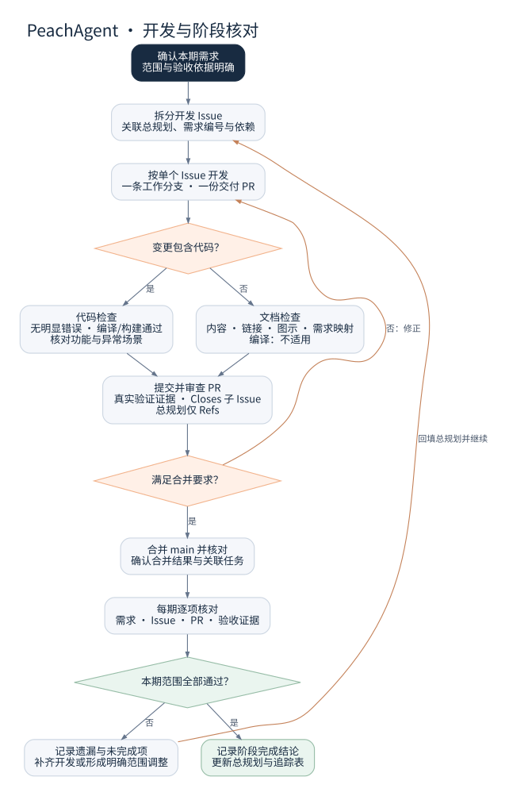

# PeachAgent 开发与阶段验收流程

> 文档版本：v0.1
>
> 更新日期：2026-11-23
>
> 适用范围：本仓库的需求整理、后续功能开发、缺陷修复与文档维护。

`ci` 目录用于约定项目开发流程和保存填写模板。当前交付范围是需求与规划文档；本目录不表示已配置自动构建或发布流水线。

项目采用以下工作顺序：**确认需求 → 拆分 Issue → 按 Issue 开发 → 提交 PR → 验证后合并 `main` → 核对阶段功能**。从本次文档初始化开始，变更也应通过对应 Issue 和 PR 留下记录。

## 1. 当前阶段与适用边界

本次允许完成的工作包括需求草案、路线图、README、流程文档及相关图表。需求文档提交到 `main`，只代表文档已经交付，不代表需求已获负责人确认，也不代表相应功能已经实现。

当前使用[总规划 Issue #1](https://github.com/Ryan-Guizhou/PeachAgent/issues/1)追踪整体功能，使用[文档交付 Issue #2](https://github.com/Ryan-Guizhou/PeachAgent/issues/2)追踪本次初始化。文档交付完成后只关闭对应文档 Issue，总规划继续保持开放。

- `requirements` 保存产品背景、分阶段需求、验收标准与决策记录。
- `technical` 当前只预留目录；技术方案须在相应需求确认后另行开展。
- `image` 保存文档需要的图表及可维护的图源。
- `ci` 保存本流程及 Issue、PR、阶段核对模板。

本仓库在文档初始化时没有应用代码或构建入口。因此，本次文档 PR 的编译检查应填写“**不适用：仅文档变更，仓库尚无可编译代码**”，并提供实际完成的文档检查结果。不得写成“编译通过”。

后续新增代码时，必须同时建立可实际执行的构建入口和运行说明；不能继续沿用文档阶段的“不适用”。

## 2. 规划和工作记录如何关联

| 记录 | 回答的问题 | 必须记录的内容 |
|---|---|---|
| 总规划 Issue | 项目整体要交付什么，目前完成到哪里？ | 六阶段范围、需求入口、开发 Issue、相关 PR、阶段结论、未完成事项 |
| 阶段需求文档 | 本阶段用户能够完成什么？ | 需求编号、使用场景、正常与异常行为、验收标准、范围外事项 |
| 开发 Issue | 本次具体完成哪项可验收工作？ | 对应需求编号、范围、验收条件、依赖、交付证据 |
| PR | 哪些变更解决了该 Issue，依据是什么？ | 关联 Issue、变更内容、验证结果、影响和遗留事项 |
| 阶段核对记录 | 本阶段承诺的功能是否全部完成？ | 逐项需求核对、证据、缺口、延期决定和阶段结论 |

总规划 Issue 是持续更新的进度入口，保持开放，直到已确认规划范围全部验收或负责人明确调整规划范围。文档初始化 PR 和单项功能 PR 不得自动关闭总规划 Issue。

六阶段分别为：

| 阶段 | 规划主题 | 初始状态 |
|---|---|---|
| 第 1 阶段 | 项目与基础对话 | 需求草案，待确认 |
| 第 2 阶段 | 可视化工作流 | 需求草案，待确认 |
| 第 3 阶段 | Agent、MCP、Skill、项目规则与上下文 | 需求草案，待确认 |
| 第 4 阶段 | 知识库与 RAG | 需求草案，待确认 |
| 第 5 阶段 | 质量中心、Prompt 优化与成本分析 | 需求草案，待确认 |
| 第 6 阶段 | 高级协作与增强能力 | 后续规划，待确认和排期 |

阶段 1—5 构成首个完整核心版本的规划范围。阶段 6 的增强能力按明确的使用需求和评测证据选择排期；列入路线图不代表所有探索项已经承诺同时开发。

## 3. 角色与责任

| 角色 | 责任 |
|---|---|
| 项目负责人 | 确认需求范围与验收口径，决定范围调整和阶段结论 |
| 开发者或获授权的 AI 协作者 | 拆分 Issue、实现约定范围、提交 PR、提供真实验证记录、更新进度 |
| 评审或验收人员 | 对照需求检查变更和证据，指出遗漏、错误及未满足的条件 |
| 合并执行人 | 核实必要检查后合并，并确认 `main` 上的交付状态 |

小团队中，一人可以承担多个角色，但记录中仍需区分需求确认、实现验证和阶段验收。已获得的明确授权持续有效；同一已确认范围内的正常推进不重复要求授权。需求有实质性变化时，应记录新的决定。

## 4. 需求确认与基线

开发功能前，应确认该阶段需求，而不是将“文档已经入库”当作确认。

1. 负责人阅读阶段目标、范围、验收标准和待确认项。
2. 在总规划 Issue 或关联记录中明确确认的文档版本、范围和保留事项。
3. 更新[需求决策与变更记录](../requirements/05-decisions-and-change-log.md)，使后续人员能够找到确认依据。
4. 对影响当前任务的未决事项，在开发前解决；与当前任务无关的后续事项可以继续保留。

需求编号在拆分、开发和验收过程中保持稳定。调整措辞不应随意更换编号；拆分、合并或取消需求时，应保留原编号和去向。

文档整理 Issue 可以在需求尚未确认时执行，其交付物明确标注为草案。功能开发 Issue 不能以此为由越过需求确认。

## 5. 将需求拆分为 Issue

按阶段需求文档中的候选任务包拆分，使用 [Issue 模板](issue-template.md)。候选任务包是拆分建议，真实 Issue 应以已确认范围为准。

每个开发 Issue 必须具备以下内容：

- 关联总规划 Issue、所属阶段、具体需求编号与对应验收项。
- 清晰的用户结果，写明本 Issue 完成后能做什么。
- 范围内和范围外事项，避免临时扩展为多个无关目标。
- 正常场景、必要异常场景和权限边界的验收条件。
- 依赖的前置 Issue，以及是否阻塞当前任务。
- 预期证据类型，例如可复现操作记录、实际构建结果、逐项验收记录。

一个 Issue 应能独立评审和验收。需求过大时，应先拆成多个可交付 Issue，并注明它们共同覆盖的需求；不能只完成其中一个 Issue 就勾选整项需求。

缺陷应记录复现条件、预期结果、实际结果和影响范围。开发中发现的新需求或无关缺陷，应建立新的记录并关联来源，不悄悄扩大当前 Issue。

拆分后更新总规划 Issue 的阶段清单。尚未确认或尚未排期的内容保持相应状态，不使用“已开始”或“已完成”标记。

## 6. 分支与开发约定

每个开发 Issue 使用一条工作分支，提交一份对应 PR，目标分支为 `main`。命名建议如下，尖括号表示需要填写的内容：

| 变更类型 | 分支名称示例 |
|---|---|
| 功能 | `feat/issue-<编号>-<简短主题>` |
| 缺陷修复 | `fix/issue-<编号>-<简短主题>` |
| 文档 | `docs/issue-<编号>-<简短主题>` |

分支从最新可用的 `main` 创建。开发前确认前置 Issue 状态和目标需求版本；同一 PR 内的补充修复继续使用原分支。

开发时应做到：

1. 仅实现该 Issue 约定的范围，保留无关文件和已有有效行为。
2. 随变更更新受影响的需求说明、使用说明和验收记录。
3. 检查必要的异常、取消、权限和成本边界，不能只演示正常路径。
4. 发现需求不清或验收冲突时，记录问题与影响，处理后再继续依赖该决定的工作。
5. 不把密钥、个人凭据、私有样本或真实敏感数据提交到仓库。

提交说明应能看出变更目的，并关联 Issue。无需为了本流程额外引入复杂格式门禁。

## 7. 提交 PR

使用 [PR 模板](pull-request-template.md)，将对应工作分支提交到 `main`。

PR 必须说明：

- 原问题或需求，以及此次变更带来的可观察结果。
- 对应的开发 Issue 与需求编号。
- 主要变更范围和需要关注的影响。
- 实际执行的检查、结果和被检查的提交版本。
- 验收证据、已知限制，以及仍未完成的事项。

只有当 PR 将完整解决对应开发 Issue 时，才写 `Closes #<开发Issue编号>`。对总规划 Issue 使用 `Refs #<总规划Issue编号>`，避免将总规划错误关闭。

如仍有该 Issue 的必需范围未完成，PR 应保持未合并状态并补齐。确需调整范围，应先记录负责人确认和剩余工作的去向，再修改 Issue 与 PR 的说明，不能用合并掩盖遗漏。

一项工作原则上保持一份 PR。PR 被关闭且未合并、必须更换分支等特殊情况，应记录原因并互相链接，避免产生两份含义不明的交付记录。

## 8. 合并 `main` 前的最低要求

所有 PR 必须先检查变更内容，确保没有明显错误，并满足对应类型的检查条件。

### 8.1 通用检查

- [ ] PR 范围与开发 Issue、需求编号和验收条件一致。
- [ ] 没有遗漏必要文件，也没有无关删除、临时文件或敏感数据。
- [ ] 变更已检查，发现的明显错误已经修复。
- [ ] 必需验收项有对应证据，未完成项没有伪装为通过。
- [ ] 检查结果对应当前 PR 内容；检查后发生的重要修改已重新验证。
- [ ] 与当前 `main` 没有未解决冲突；解决冲突后的内容已经复查。

### 8.2 包含代码的 PR

**涉及代码时，正常编译或构建通过是合并前的必要条件。**

必须使用仓库实际存在的构建入口，记录运行位置、完整命令、必要环境说明、结果和提交版本。验证范围应覆盖修改的代码及受影响的依赖部分；项目具备整体构建入口时，应确认整体构建没有因本次变更失败。

功能检查至少覆盖 Issue 的主要用户场景及与本次改动直接相关的异常场景。已有相关测试应执行；需要新增验证时，围绕真实风险编写，避免机械增加与实现重复的测试。

下列情况不能合并：

- 代码尚未编译，只有“看起来没有问题”的判断。
- 构建失败，或检查因环境问题根本没有执行成功。
- 检查的是较早版本，后续重要修改没有验证。
- 新增代码却没有任何可执行的构建入口。
- 验收条件要求的功能缺失，且没有明确的范围调整决定。

遇到阻塞应写清原因和恢复条件，不得伪造成功日志，也不得仅因着急合并而降低上述条件。

### 8.3 仅文档的 PR

纯文档变更检查以下项目：

- [ ] 本地链接、目录和图表引用有效。
- [ ] 需求编号、阶段顺序和验收映射一致。
- [ ] 图表与正文含义一致，没有把规划画成已实现功能。
- [ ] Markdown 基本结构完整，代码围栏和表格没有明显错误。
- [ ] README 的项目状态与仓库实际内容一致；双语内容保持事实一致。
- [ ] 需求文档只规定需求，没有提前固化尚未确认的技术方案。
- [ ] `technical` 保持当前阶段约定的预留状态。

仅当 PR 确实没有代码和构建相关变更时，编译项可以标记“不适用”，并说明原因。如果修改了构建配置、脚本或其他可执行内容，应按其实际影响验证，不因文件放在文档目录就自动豁免。

## 9. 合并与合并后确认

由项目负责人或已经获得明确授权的协作者，在最低检查满足后合并到 `main`。本流程不要求为同一已授权操作反复征求确认，也不代替仓库现有的权限限制。

合并前确认 PR 当前提交仍是已验证的版本。分支发生新修改时，应检查新增内容，重新执行受影响的验证。

合并后完成以下工作：

1. 确认 PR 已实际合并，记录 `main` 对应提交。
2. 确认 `main` 中包含预期文件和功能，没有误合并或遗漏。
3. 对代码变更，确认 `main` 的构建证据覆盖合并结果；如合并结果与已验证内容发生变化，应重新构建并检查受影响场景。
4. 核实对应开发 Issue 状态，补充验收证据和遗留事项。
5. 更新总规划 Issue 和[需求验收映射](../requirements/04-acceptance-and-traceability.md)。

合并后发现问题，应记录缺陷并处理，不能将失败隐藏在已关闭的 Issue 中。若问题影响阶段验收，应同步取消相应的通过结论，直到问题解决。

## 10. 每一期完成后的功能核对

每个阶段结束时，使用[阶段核对模板](phase-review-template.md)，对照阶段需求逐项验收。阶段核对由负责人或获授权的验收人员给出结论，并链接回总规划 Issue。

逐项核对至少覆盖：

| 核对维度 | 必须回答的问题 |
|---|---|
| 覆盖情况 | 每个需求编号和必需验收项是否都对应实际交付？ |
| 实际功能 | 能否从用户入口完成本阶段的端到端场景？ |
| 异常与边界 | 必需的失败、取消、权限、预算等情况是否符合要求？ |
| 交付状态 | 相关 PR 是否已合并，结果是否在 `main` 中？ |
| 遗留问题 | 是否还有阻塞、缺陷、未实现行为或未验证项目？ |
| 范围变化 | 延期、取消或替代是否有明确确认及后续去向？ |

一份 PR 合并、几个页面存在、演示一次成功，均不足以证明一个阶段全部完成。每个需求必须有具体结论，不能只写“总体通过”。

阶段结论使用以下口径：

- **未完成**：仍有本阶段已确认的必需需求未实现、未验证或存在阻塞问题。
- **已验收**：本阶段已确认范围全部满足，验收证据完整，未存在阻塞问题。
- **范围调整后已验收**：负责人明确批准调整范围；报告列出原范围、变更决定、新范围和转移事项，仅对调整后的范围给出通过结论。

未获批准的延期仍计为未完成，不能直接改列下一期再宣布本期完成。第 6 阶段的探索项，也必须先确定本次实际承诺的子范围，再按同一规则验收。

## 11. 更新总规划 Issue

总规划 Issue 至少保留以下信息，并在开发 Issue 完成或阶段结论变化时更新：

- 六阶段需求文档及各阶段当前状态。
- 已确认的范围和仍待确认的事项。
- 每阶段开发 Issue、对应 PR 和交付证据入口。
- 阶段核对记录和明确的完成结论。
- 未完成需求、阻塞问题、批准延期事项及新的归属。

关闭一个开发 Issue 只更新其对应需求的进度。若同一需求由多个 Issue 共同实现，所有必需部分验收后才能将该需求标为完成。

文档交付 Issue 完成后，可以将“规划文档已提交”标为完成；六阶段功能仍保持各自的真实状态。禁止将文档清单的完成状态复制到产品功能清单。

## 12. 流程图与文档入口

流程图强调需求、开发任务、PR 和阶段核对之间的关系。具体合并条件以本文第 8 节为准。

| 文档 | 用途 |
|---|---|
| [项目路线图](../requirements/02-roadmap.md) | 查看阶段目标和依赖 |
| [需求验收映射](../requirements/04-acceptance-and-traceability.md) | 追踪需求与交付证据 |
| [需求决策与变更记录](../requirements/05-decisions-and-change-log.md) | 查看范围确认和变更依据 |
| [Issue 模板](issue-template.md) | 将需求拆成可独立验收任务 |
| [PR 模板](pull-request-template.md) | 提交变更和验证证据 |
| [阶段核对模板](phase-review-template.md) | 核对一整期是否全部完成 |
