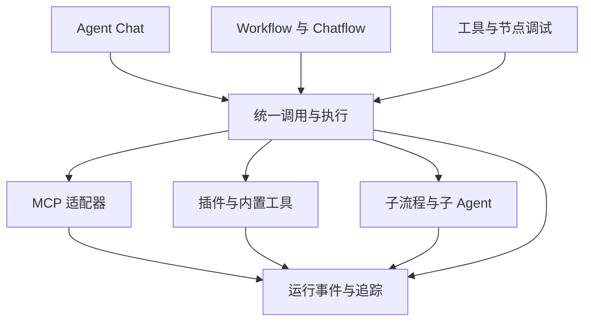
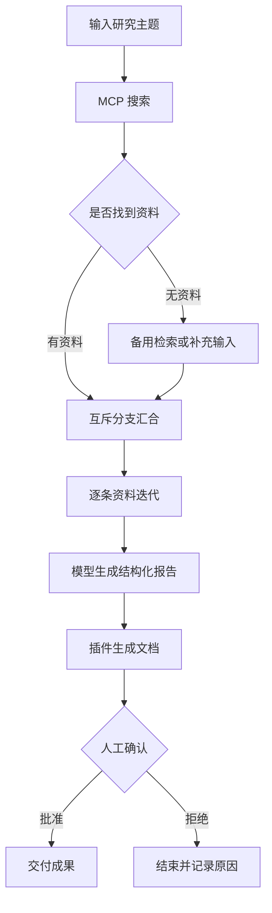

# OTRYX Studio：能力接入、工作流编排与 Agent 执行规划

日期：2026-11-23

状态：**产品规划与实施对照。已完成一轮 HTML 交互原型扩展；生产后端与真实服务能力仍待实施。**
依据：本轮用户反馈、当前 HTML 原型源码、Dify 官方文档、MCP 官方规范与 Inspector、OpenTelemetry 官方文档。

## 1. 本轮结论

保留现有亮色视觉、工作台布局和个人 AI 工作室定位，补齐四个相互衔接的核心：

1. 能力中心：连接、安装、配置、授权、发现和调试 MCP／插件能力。
2. 图编排：类型化变量、可编辑连线、分支、并行、迭代、循环、人工输入和异常恢复。
3. Agent 执行：独立 Chat 可调用 MCP、插件、知识、Skill、工作流与子 Agent。
4. 运行与调试：所有入口使用同一套运行事件、调用追踪、输入输出、版本和费用模型。

产品目标是让用户能够回答：**接入了什么能力、如何组合、这次为什么走这条路径、哪个参数出了问题、改完怎样局部验证，以及发布后会影响哪些任务。**

原规划已进入 HTML 原型实施：新增统一 Runtime、37 个节点族、MCP／插件中心、Agent Chat 工具调用与统一 Trace，保留原有视觉。以下完整规划仍包含后续生产能力，不能将所有条目理解为已接通真实服务；当前实现与限制见源码 README 和 qa/verification.md。


## 本轮补充：成功完成与产物分离

根据用户最新要求，工作流**可以没有返回值、没有文件，甚至没有任何对外产物**。例如节点已经把内容放到指定目录，或条件判断认为无需执行操作，最后都可以正常结束。

| 维度 | 定义 | 是否必须 |
| --- | --- | --- |
| 运行状态 | 配置的执行路径是否完成、失败、等待、拒绝或停止 | 必须 |
| 返回值 | 由输出或回答节点明确返回的数据 | 可选 |
| 操作回执 | 节点对目标目录、文档空间或业务表执行动作后的记录 | 可选，零条或多条 |
| 文件 | 由显式成果节点或工具产出的可下载文件 | 可选，零个或多个 |
| 节点内部输出 | 下一节点需要的数据与调试证据 | 按实际执行产生，不自动成为对外返回 |

结束节点默认支持“无返回内容”，不会自动把最后一个工具结果包装成文件。没有产物不视为失败；外部效果未知也不能由“生成了文件”冒充成功。

本轮原型已经覆盖：仅回执完成、结构化返回、显式文件、纯条件无操作完成；统一运行详情分别展示这些情况。目标写入使用明确标注的本地模拟适配器。

## 2. 已确认约束

| 约束 | 规划处理 |
| --- | --- |
| 个人用户即租户，全部功能可用 | 能力目录、连接、凭证、运行、知识、记忆都归属个人租户；不新增企业组织管理作为前置条件 |
| Sa-Token 作为权限框架 | 未来服务端统一校验用户、租户、资源与动作；远程服务的 OAuth／API 凭证单独处理 |
| 用户自配模型 | 模型连接、能力兼容、Token／成本展示贯穿 Agent、流程与调试 |
| 公共资源需要管理员审核 | Agent、Workflow、插件、MCP 配置模板、Skill、Prompt 的公开版本都走审核；安装者绑定自己的连接与凭证 |
| 运行中人工审批 | 审批、补充输入和执行恢复是持久状态；与公共发布审核分离 |
| 配置变化不全局重启 Runtime | 发布版本、按连接更新、相关插件实例滚动切换；既有运行保留快照 |
| Docker／Docker Compose 部署 | 生产架构优先单机 Compose，数据库、中间件、文件目录、配置、健康检查与初始化纳入部署方案 |
| 当前先做高保真 HTML 原型 | 外部模型、MCP、插件用明确标注的模拟适配器；变量、分支和事件记录应由实际配置决定 |

## 3. 改版前的源码差距（历史基线）

源码核查对象：`otryx-studio/core.js`、`workspace.js`、`builder.js`、`ecosystem.js`、`governance.js`。以下记录规划时的历史基线，主要差距已经在本轮前端模拟实现中补齐；它不是更新后原型的现状说明。

| 领域 | 当前状态 | 下一步需要形成的能力 |
| --- | --- | --- |
| MCP | 资产名称、地址和文字说明；不发现工具、不调用服务 | 连接实例、能力发现、工具 Schema、调用测试、协议与结果调试 |
| 插件 | 没有独立插件包／安装实例模型 | 包版本、配置实例、导出能力、依赖、运行环境与升级影响 |
| 工作流 | 六种基础节点；按节点数组前后顺序连线 | 独立 edges、端口、分支、并行、循环、变量绑定与图校验 |
| 传参 | 展示上一节点的 output 名称 | 可配置字段映射、类型与作用域校验、运行时变量快照 |
| Agent Chat | 固定工具复选框；固定回答模板与流式动画 | 能力挂载、模型选择工具、参数校验、审批、执行、结果回传、多轮调用 |
| Trace | 根据配置和统一步骤推导展示 | 运行时记录的事件、节点实例、尝试次数、工具调用与模型消耗 |
| 运行 | 统一计时器驱动固定进度 | 按图解析、按条件选路、按迭代项执行的前端模拟执行器 |
| 已有基础 | 草稿／发布快照、任务审批、市场审核、费用页 | 保留并扩展到工具、插件、连接、子流程及依赖版本 |

## 4. 参考 Dify 的方式

Dify 官方节点体系覆盖模型、Agent、检索、工具、HTTP、代码、模板、参数提取、文档提取、列表操作、变量、分支、迭代、循环、人工输入、回答和输出，另有触发器、单节点调试和变量检查器。[D1]

本方案以这些能力作为覆盖检查，页面布局与内部对象按 OTRYX 的目标设计。需要保留的三个语义区别：

- **互斥分支汇合与并行结果合并不同。** Dify Variable Aggregator 用于互斥分支；本产品单独提供并行等待和合并规则。[D4]
- **迭代与循环不同。** 迭代处理数组的各个元素，循环携带前一轮状态并按条件结束。[D5][D6]
- **调试变量与历史事实不同。** 调试可临时改值、重跑下游，但不覆盖原节点的历史输入输出。[D7][D8]

当前 Dify Agent 文档同时介绍 Classic Agent 和处于 beta 的 New Agent，后者可在 Workflow 中引用已发布 Agent。本方案采用统一 Agent 定义与能力绑定，不照搬其产品命名或 beta 边界。[D2]

## 5. 统一能力模型

### 5.1 对象的职责

| 对象 | 定义 | 示例 |
| --- | --- | --- |
| 插件包 Plugin | 可安装、版本化的扩展分发单元；可导出一种或多种能力 | 文档处理插件导出读取、转换、生成动作 |
| MCP 服务定义 | 某个 MCP 服务的描述、连接模板和可用传输 | 仓库服务、搜索服务 |
| 连接实例 Connection | 当前租户实际配置的服务地址、授权引用和运行位置 | 我的 GitLab MCP 连接 |
| 凭证引用 CredentialRef | 租户内秘密的句柄，不是秘密正文 | 某个 OAuth 授权记录或密钥槽位 |
| 工具 Tool | 可调用的具体动作，带输入／输出契约 | `search_documents`、`create_issue` |
| 资源 Resource | 可读取、引用或订阅的上下文材料 | 项目说明、数据库表结构 |
| 提示词模板 Prompt | 有参数、可预览的消息模板 | 填入仓库与目标后生成审阅指令 |
| Skill | 指令、方法、参考材料及依赖能力的组合 | 代码审阅方法、研究简报方法 |
| 能力绑定 Binding | Agent 或节点对工具、连接、版本、范围和策略的具体引用 | 研究 Agent 只启用仓库读取能力 |
| Agent／Workflow 发布版 | 可复用、带输入输出和依赖快照的执行单元 | 已发布的单条资料分析流程 |

插件不是一个没有输入输出定义的万能节点。用户在画布选择的是插件导出的具体工具动作；安装一次后可被 Agent 和工作流复用。Dify 的工具与集成体系也包含插件、MCP、发布工作流及 OpenAPI 服务。[D3][D10]

Skill 默认是行为与上下文资产；如果提供“执行 Skill”体验，需要明确由哪个 Agent／执行器解释它，并显式绑定依赖工具。MCP Resources 和 Prompts 分别进入上下文与模板入口，不统一伪装成工具调用。

### 5.2 生命周期

建议在界面区分：**已发现 → 已安装 → 待配置 → 已授权／已连接 → 已测试 → 已绑定 → 可执行**。不同资源跳过不适用状态；安装成功不等于配置完成，也不默认将所有工具授权给所有 Agent。



三个入口共用调用契约；界面展示各自适合的配置方式，错误、审批、费用与历史有统一含义。

## 6. MCP 中心与调试台

### 6.1 页面结构

MCP 中心为独立可发现入口。列表显示名称、运行位置、传输方式、连接状态、授权状态、工具数量、最近测试和依赖数量。单个服务详情包含：

1. 概览与连接配置。
2. Tools／Resources／Prompts 能力浏览。
3. 调试台。
4. 调用记录。
5. 被哪些 Agent、节点和工作流引用。
6. 配置历史、能力变化和版本兼容信息。

### 6.2 连接配置

| 项目 | 内容与行为 |
| --- | --- |
| 远程连接 | 以 Streamable HTTP 为默认选项；填写地址，绑定所需授权 |
| 受控进程 | stdio 运行在平台 Runner／容器；配置镜像或允许的命令、参数、环境引用与挂载范围 |
| 旧版兼容 | 旧 HTTP+SSE 作为兼容选项；不能与 Streamable HTTP 中的 SSE 响应流混为一谈 |
| 运行位置 | 明确“平台 Runner”“自部署 Runner”或未来的本机连接器；网页里的路径不能暗示是用户电脑路径 |
| 授权 | 无授权、服务明确支持的凭证方式、标准 HTTP 授权流程；秘密放在租户凭证库 |
| 测试 | 分别展示可达性、授权、版本／能力发现、工具级可执行性 |
| 更新 | 重新发现能力，展示增加、移除与 Schema 变化，并列出受影响绑定 |

MCP 官方当前规范为 2026-07-28，传输层已区分当前逐请求元数据与旧版本连接级握手。实现应以适配层处理版本差异，UI 展示实际兼容版本，避免固定绘制所有服务都必须走某一套旧握手。[M2]

stdio 与 HTTP 授权方式需要分别实现；Sa-Token 负责平台内身份和权限，远程 MCP 的授权是独立关系。[M5]

### 6.3 工具调试

调试页建议采用“工具目录—参数与测试—结果”的主布局，下方展开协议记录，保持现有明亮视觉。

| 区域 | 必须可操作的内容 |
| --- | --- |
| 工具目录 | 搜索、分页、说明、可用性、输入／输出 Schema、平台确认的读写级别 |
| 参数表单 | 按 inputSchema 生成字段，处理必填、枚举、嵌套对象、数组和类型；表单／JSON 切换 |
| 测试场景 | 手填参数、加载保存用例、从历史调用复制；正常、空结果、缺参、超时、执行错误等演示场景 |
| 执行 | 运行、取消、需补充输入、需授权、需审批；有能力支持时显示进度，未知总量只显示状态与耗时 |
| 输出 | 原始内容、结构化数据、文本、资源链接、文件／图像预览；存在 outputSchema 时显示校验结果 |
| 协议 | 请求／响应／通知、请求 ID、协议版本、时间；HTTP 显示状态与脱敏头，stdio 显示 stderr |
| 复用 | 保存回归用例、复制脱敏调用、挂载到 Agent、生成工作流工具节点模板 |

官方 Inspector 将 Tools、Resources、Prompts 与协议、Network、Console 等视图分开，并依据服务声明能力显示入口。本产品采用相同的能力区分，布局由自身设计体系决定。[M1]

### 6.4 错误和取消必须准确

调用失败分为：连接失败、授权失败、协议错误、工具执行错误、输出校验失败、平台策略拒绝、取消未确认、外部结果未知。

HTTP 返回成功或 JSON-RPC 包含 result 都不代表工具业务成功；`isError: true` 是工具执行失败。服务提供的 annotations 只是描述信息，不能自动扩大平台授权。[M3]

“已请求取消”“已停止执行”“结果未知”分别显示。取消不等于撤销已经发生的外部写入；超时后的写入操作需确认外部结果或满足幂等条件，不能盲目重试。

### 6.5 MCP 资源与模板

- Resources：列表、模板 URI 填参、读取预览、加入本次上下文；订阅能力按版本与声明启用。
- Prompts：参数填写、生成消息预览、引用到 Agent／LLM 节点。
- 扩展能力：长任务、应用界面等按支持情况展示；不支持时说明原因，不伪装成通用必备功能。
- 服务端请求补充信息或授权时，按兼容版本转为用户表单，并保留待恢复状态。

## 7. 插件中心

插件中心与 MCP 共用工具调试器，但保留包管理职责：

| 功能 | 规划 |
| --- | --- |
| 安装来源 | 已审核市场、私有包、开发调试包；记录来源与完整版本 |
| 插件详情 | 作者、版本、导出工具／模型／数据源／触发器、所需权限、依赖、文档与示例 |
| 配置实例 | 支持一个包配置多个连接，例如不同仓库或不同账号；工具绑定具体实例 |
| 工具清单 | 每个动作具有输入输出契约、错误说明、幂等说明和样例 |
| 调试 | 选择动作、配置参数、运行、查看结果／日志、保存测试用例 |
| 升级 | 对比能力与 Schema 变化、检查被引用位置；发布新版本并验证，保留旧版供已有快照使用 |
| 禁用与卸载 | 显示依赖影响；停止新的调用，按策略处理在途任务；不静默破坏已发布流程 |
| 开发者入口 | 清单校验、运行日志、输入输出测试、依赖检查、导出包；远程开发调试属于后续真实服务能力 |

同名工具需要内部唯一标识，例如“连接 ID＋能力 ID”；面向模型的工具名建立稳定别名映射，不能只依赖服务自报名称区分。

## 8. 工作流节点覆盖范围

优先级含义：**核心**为下一轮原型必须可配置并参与演示执行；**扩展**纳入完整产品规划，原型有配置和清晰标识的事件／结果模拟，真实执行依赖后端。没有支持的能力不得用无反馈的可点击按钮占位。

| ID | 节点／能力 | 关键配置与输出 | 优先级 |
| --- | --- | --- | --- |
| N01 | 用户输入／开始 | 字段、类型、必填、默认值、文件；输出 input 对象 | 核心 |
| N02 | Webhook 触发 | 方法、输入 Schema、签名／授权引用、去重；原型手动注入事件 | 扩展 |
| N03 | 定时触发 | 时区、计划、错过策略、并发／重复策略；原型模拟触发 | 扩展 |
| N04 | 插件事件触发 | 连接、事件类型、过滤、去重 | 扩展 |
| N05 | LLM | 模型、消息、变量、上下文、参数、结构化输出、流式与用量 | 核心 |
| N06 | Agent | 已发布 Agent 或内联配置、目标、工具、知识、Skill、轮次与预算、输出契约 | 核心 |
| N07 | 问题分类 | 分类标签、描述、默认分支、分类结果；按标签选择出口 | 核心 |
| N08 | 参数提取 | 待提取字段 Schema、模型、校验与缺失值处理 | 核心 |
| N09 | 知识检索 | 知识库、查询、过滤、检索模式、Top K、阈值、重排；片段与引用 | 核心 |
| N10 | 文档提取 | 文件引用、解析选项、分页；文本／结构化内容，OCR 通过专属能力提供 | 核心 |
| N11 | 记忆读／写 | 租户／Agent／会话作用域、键、值、写入策略与来源 | 扩展 |
| N12 | MCP 工具 | 连接实例、具体工具、Schema 参数映射、授权与结果 | 核心 |
| N13 | 插件工具 | 安装版本、动作、配置实例、参数与输出 | 核心 |
| N14 | HTTP 请求 | URL／方法／Query／Header／Body、授权引用、超时、响应映射 | 核心 |
| N15 | 代码处理 | 语言、声明的输入输出、资源限制；原型仅受控示例执行器 | 核心 |
| N16 | 数据库查询 | 连接、参数化查询、行数限制、结果 Schema；写入另设动作与策略 | 扩展 |
| N17 | 沙箱任务 | 执行器、镜像／模板、工作目录、文件挂载、命令、资源与网络策略 | 扩展 |
| N18 | 字段映射／JSON 转换 | 来源路径、目标路径、显式类型转换、默认值 | 核心 |
| N19 | 模板渲染 | 文本／JSON 模板、变量、输出类型 | 核心 |
| N20 | 变量赋值 | 目标作用域、赋值／追加／清空、持久化时机 | 核心 |
| N21 | 列表处理 | 筛选、排序、去重、切片、计数、选择字段 | 核心 |
| N22 | IF／ELSE | AND／OR 条件组、IF／ELIF／ELSE 出口、类型化比较 | 核心 |
| N23 | Switch | 指定变量、多个 case、default；默认单一命中 | 核心 |
| N24 | 互斥分支汇合 | 同类型候选字段、实际激活分支、统一输出 | 核心 |
| N25 | 并行分发／汇合 | 显式分支；等待全部或允许部分失败；结果合并规则 | 核心 |
| N26 | 数组迭代 | items、item／index、串行／限额并行、结果顺序、逐项错误策略 | 核心 |
| N27 | 条件循环 | 初始状态、条件、最大次数、状态更新、超限出口 | 核心 |
| N28 | 循环控制 | Break／Continue，只作用于所属循环容器 | 核心 |
| N29 | 人工输入／审批 | 表单、审阅内容、可编辑结果、批准／拒绝／补充／超时出口 | 核心 |
| N30 | 子工作流 | 已发布版本、参数映射、输出契约、递归深度与调用预算 | 核心 |
| N31 | 等待／事件恢复 | 等待时间或关联事件、期限、恢复条件 | 扩展 |
| N32 | MCP 资源读取 | 连接、资源 URI／模板参数、输出格式 | 核心 |
| N33 | 提示词模板 | 本地 Prompt 或 MCP Prompt、填参、消息预览与输出 | 核心 |
| N34 | 对话回复 | 文本／变量／文件／引用、流式分段、多轮会话 | 核心 |
| N35 | 最终输出 | 无返回／结构化返回、命名字段、类型、API／任务输出契约 | 核心 |
| N36 | 成果生成 | 文档／表格等生成能力、文件名、产物引用与预览 | 核心 |
| N37 | 终止／失败 | 状态、错误码、原因；明确终止当前作用域或整个流程 | 核心 |

说明：N11、N25、N28 为相关节点族，界面可展开多个具体节点；MCP、插件和 HTTP 节点共用调用基座。超时、重试、默认值、错误出口是每个适用节点的共同执行策略，不为每一种策略单独堆一个节点。

### 8.1 节点公共配置

统一右侧配置结构：

1. **基础**：名称、说明、节点类型与版本。
2. **输入**：常量、变量、模板／表达式、凭证引用，显示来源、类型和预览。
3. **能力配置**：该节点专属的模型、工具、插件、知识或子流程配置。
4. **输出**：Schema、字段别名、结果解析、样例与引用方式。
5. **执行策略**：超时、重试、错误分支、默认值、并发、审批和预算。
6. **调试与最近运行**：测试输入、模拟场景、运行记录、日志和局部复测。

对 MCP 节点，选择服务和工具后直接消费工具 Schema 生成参数表；对 Agent 节点，选择 Agent 发布版后展示能力快照并允许受约束的本次覆盖；对插件节点，选择具体动作与配置实例。

## 9. 变量与上下游传参

### 9.1 类型与作用域

建议类型：string、number、integer、boolean、object、array、file、message、secretRef。对象／数组提供嵌套 Schema；文件使用受租户校验的文件引用，不把大文件正文塞入流程定义。

| 作用域 | 示例表达方式（本产品设计示例） | 规则 |
| --- | --- | --- |
| 输入 | `input.topic` | 本次运行只读输入 |
| 系统 | `sys.run_id`、`sys.tenant_id` | 运行时提供，普通节点不可覆盖 |
| 上游节点 | `nodes.search.result.items` | 只能引用当前路径可达且已产生的值 |
| 会话 | `conversation.language` | 跨对话轮次，按明确写入时机持久化 |
| 工作流变量 | `workflow.report_title` | 本次运行范围，写入和并发冲突需定义 |
| 迭代项 | `iteration.item.url`、`iteration.index` | 仅所属迭代容器及子节点可见 |
| 循环状态 | `loop.round`、`loop.reviewed_text` | 跨本循环轮次传递，结束后显式导出 |
| 环境配置 | `env.default_language` | 非秘密的部署／空间配置 |
| 凭证 | `secretRef.gitlab` | 只能绑定认证槽位，不能插入模型提示词或普通日志 |

### 9.2 变量选择器

按来源分组，展示节点名称、字段路径、类型、说明和上次调试样例。选择后形成可点击变量标签。输入框可在常量、变量、模板、表达式之间切换；模板插值只用于文本，完整对象映射保留原类型。

例如，MCP 搜索节点输出：

```json
{
  "items": [
    { "title": "示例资料", "url": "https://example.com/document", "score": 0.92 }
  ],
  "total": 1
}
```

对应映射：

| 下游 | 配置 | 来源 |
| --- | --- | --- |
| IF 节点 | `total > 0` | `nodes.search.result.total` |
| 迭代节点 | 输入数组 | `nodes.search.result.items` |
| 迭代中的读取工具 | URL 参数 | `iteration.item.url` |
| 迭代中的模板 | 当前资料标题 | `iteration.item.title` |
| 汇总模型 | 资料数组 | `nodes.process_items.results` |
| 交付节点 | 文档引用 | `nodes.generate_report.file` |

JSON 为拟议结构示例，不声称是任何特定 MCP 服务的实际返回值。

### 9.3 必须明确的规则

- 非相邻的可达上游可引用；并行兄弟分支互不读取，汇合后才能共同使用。[D9]
- 分支未执行时，其输出是“未产生”；这与空字符串、空数组、null 有不同含义。
- 类型不匹配、必填缺失、跨作用域引用、引用已删除节点应在发布前阻止。
- 节点显示名可以改；引用使用稳定节点 ID 和字段路径，避免改名破坏流程。
- 控制边决定激活路径；数据引用决定输入来源。数据依赖必须被图校验，不允许用数据引用绕过控制流。
- 并发分支避免写同一共享变量；需要合并时通过显式 reducer／汇合规则处理。
- 输出无 Schema 时先标为未知类型，用户定义解析／映射后才对外承诺结构。
- Mock 值只属于调试会话；正式运行与历史记录不会被测试输入覆盖。

## 10. 连线、分支与执行语义

### 10.1 可编辑图

工作流保存 nodes、edges、ports、input/output schemas 和版本。画布支持创建／删除／重连边、插入节点、节点搜索、复制、撤销重做、框选、缩放、自动整理与键盘操作。

普通边、分支边、错误边均有文字标签；颜色仅辅助区分。拖动节点只改变布局，不改变执行顺序。默认不允许任意回连成环，循环通过专门容器表达。

### 10.2 分支

- IF／ELIF／ELSE 按配置顺序选择一个出口，明确兜底；Switch 默认单一匹配。
- 问题分类输出标签，可附模型实际提供的置信信息；模型没有提供时不伪造概率。
- 未选中的路径标记 skipped，并显示条件与实际参与判断的值。
- 互斥汇合仅等待当前被激活路径；不能等待未执行分支，也不能只凭“第一个非 null 值”判断来源。

### 10.3 并行与汇合

- 明确激活哪些分支及并发限额。
- 核心支持等待全部；可配置允许部分失败后继续并返回每个分支的状态。
- 明确结果合并形式：命名对象、数组拼接、字段映射或专门代码／模板处理。
- 多个分支同名字段不静默覆盖；需要显式冲突规则。
- 首个成功／竞速等策略保留扩展点，需同时定义剩余分支的取消与副作用处理。

### 10.4 迭代与循环

迭代支持逐项输入、索引、串行／限额并行、按输入顺序收集结果。核心错误策略为整体失败或继续并保留错误位置；剔除失败项属于显式选项，不能悄悄改变索引。

循环定义初始状态、条件、每轮状态更新、最大轮次与预算。Break／Continue 只能作用于所属循环；每一轮具有独立节点执行记录。达到上限时清晰标为上限结束或失败，不伪装成目标达成。

### 10.5 人工输入与恢复

人工节点可展示输入、编辑内容、填写字段、补充文件，并选择批准、拒绝或其他定义的决定；反馈成为输出变量。状态至少区分等待输入、等待审批、已提交、已拒绝、已超时和已取消。[D11]

恢复时校验原 Run、节点实例、等待标识与当前状态；重复提交只生效一次。批准后的参数若发生实质变化，需要重新确认。已成功的外部写入不能因恢复而重复执行。

## 11. 工作流调试体验

画布保留中央主体：左侧可收起节点库／大纲／变量，右侧节点配置，下方展开调试区，避免所有面板同时挤满页面。

| 调试方式 | 行为 |
| --- | --- |
| 校验流程 | 检查未连接节点、不可达节点、非法环、缺参、类型、分支出口、依赖与授权 |
| 单节点测试 | 手填输入或使用历史样例，不必执行全部上游 |
| 从此处测试 | 必须具备有效上游快照或显式 Mock 输入；显示被复用的来源 |
| 断点／逐步 | 在节点前暂停，查看已解析输入、当前变量，执行下一节点 |
| 分支场景 | 保存不同输入；验证“无数据”“命中某 case”“工具超时”等路径 |
| 迭代检查 | 按 index／round 查看单次输入输出、错误与费用 |
| 调试变量 | 临时修改，重新跑下游；保留原历史记录，可恢复原值 |
| 模拟工具 | 选择明确标注的 fixture；断言输出字段、分支与状态 |
| 比较运行 | 比较输入、配置版本、路径、输出、错误和消耗 |

仅当前调试作用域允许修改执行输入；生产历史只读。Dify 的单节点与变量检查器可作为行为参照。[D7][D8]

## 12. Agent 工作台与独立 Chat

### 12.1 Agent 配置

建议分为：基础身份、模型与提示词、能力、知识与记忆、执行策略、测试与评测、发布版本。

“能力”页从统一目录选择：

- 已配置插件的具体工具。
- MCP 连接内逐个启用的 Tools。
- MCP Resources 作为上下文，Prompts 作为参数化指令模板。
- Skill 及其所依赖的工具／参考资料。
- 作为工具暴露的已发布工作流。
- 作为子任务单元的已发布 Agent。

绑定时显示：来源、版本、连接、输入输出、范围、审批要求、超时和费用信息。支持自动选择、指定工具和禁止调用；工具数量多时按用途分组并受限检索，实际调用仍须校验白名单。

模型能力不支持所需工具调用或结构化输出时，应明确提示兼容性限制；不能把生成一段“将调用工具”的文字当成已执行。

### 12.2 三种工作模式

| 模式 | 建议默认行为 |
| --- | --- |
| Chat | 允许已经授权的查询／检索工具，帮助获得有依据的回答；写入行为进入审批 |
| Plan | 可查询资料和检查前置条件；输出步骤、拟用能力、预计范围，等待用户开始执行 |
| Execute | 在授权、预算、轮次与并发上限内执行计划；关键写入按策略暂停确认 |

“独立聊天”应拥有完整工具能力，不要求用户先搭工作流。

### 12.3 聊天界面

中间保留对话与产物，右侧按需展开“本次能力与执行”。输入区提供能力选择与上下文添加入口。

消息中工具调用卡包含：工具及来源、输入参数、等待授权／审批／执行状态、结果摘要、错误、耗时和链路入口。展开后查看脱敏完整输入输出；多次并行调用分组显示。

支持按轮次禁用／启用能力、选择连接，临时调整只作用于本会话，并有“保存为 Agent 草稿”的明确动作。每轮开始冻结当轮能力配置；中途关闭工具停止新的调用，在途调用按取消策略处理。

### 12.4 执行闭环

模型提出调用 → 平台解析并校验参数 → 校验租户、能力与凭证 → 必要时等待审批 → 统一执行器调用 → 返回结果／错误 → 模型继续或结束。

限制最大工具轮次、重复失败次数、总时长、Token 和工具成本预算；当达到限制时说明已完成与未完成项。调用结果进入上下文时可摘要、裁剪或保留文件引用，原结果仍可从运行记录查看。

展示行动计划、调用记录和可展示的决策摘要；不伪造模型内部思维过程。长会话可配置上下文整理，显示保留摘要、引用与压缩前后 Token；长期记忆写入独立受控。

## 13. 统一追踪中心

### 13.1 一条业务运行，共用多种视图

所有入口——MCP 测试、插件测试、单节点调试、流程运行、Agent Chat 和评测——都生成相同结构的运行记录。

| 视图 | 主要问题 |
| --- | --- |
| 总览 | 谁发起、运行版本、状态、总耗时、等待耗时、费用、可选返回值／操作回执／文件 |
| 执行图 | 哪些节点实际运行、哪个条件命中、哪些路径跳过 |
| 调用树 | 哪个 Agent／节点调用了哪个工具、子流程和模型 |
| 耗时瀑布 | 串行／并行关系、慢调用、排队、首字延迟和人工等待 |
| 输入输出 | 原始输入、变量解析后的实参、结构化结果、文件与错误 |
| 事件记录 | 调用开始、重试、授权、审批、取消、恢复和结束 |
| 消耗 | 模型 Token、已知工具费用、估算依据；未知费用明确标为未知 |

### 13.2 关联标识

建议分别记录业务与技术标识：

- tenantId、appId、conversationId、messageId、runId、parentRunId。
- workflowVersion、agentVersion、toolDefinitionVersion、connectionConfigVersion、schemaHash。
- nodeId、nodeExecutionId、iterationIndex／loopRound、attemptId、toolCallId。
- traceId、spanId、parentSpanId、MCP requestId／外部 requestId。

同一画布节点在循环中会执行多次，因此 nodeId 不能代替 nodeExecutionId；MCP 请求 ID 也不替代平台的工具调用 ID。

### 13.3 追踪证据与边界

事件应在实际执行边界记录，而不是事后按进度推演。Run 的业务状态与 Trace 的技术 Span 分开；等待用户数小时的运行可以结束当前 Span，恢复后建立关联的新 Span，而不要求一个 Span 始终悬挂。

OpenTelemetry 通过 Span、上下文传播和 Span Links 关联不同工作单元；MCP 当前规范也为 `_meta` 中的 traceparent、tracestate、baggage 保留传播约定。[O1][M4]

远程 MCP 服务没有埋点或没有返回可关联信息时，展示客户端可观测的请求边界，并标注远端内部未上报。协议日志不自动等于对方内部完整链路。

大输入输出使用受控存储引用，日志默认脱敏、截断并可按授权查看；Token 使用模型实际返回值或标注估算，工具成本未知时不填零。父层汇总子调用消耗，不重复累计同一笔模型调用。

### 13.4 恢复、重试和重放

| 操作 | 语义 |
| --- | --- |
| 从审批／输入暂停继续 | 恢复同一业务 Run，消耗等待令牌，跳过已完成步骤 |
| 当前调用重试 | 新建 attempt，保留失败记录；参数和外部副作用经策略校验 |
| 单节点重新测试 | 新建调试运行，可修改输入，不覆盖生产历史 |
| 从此处重跑下游 | 使用明确快照创建分叉运行，并标注来源；不能静默复用过期副作用 |
| 完整重新运行 | 创建新 Run，选择原快照或新发布版，保留关联 |
| 历史回放 | 只重现事件和数据，不再次执行外部操作 |

## 14. 发布、市场和版本

### 14.1 公共发布

发布对象可以是 Agent、Workflow、插件包、MCP 连接模板、Skill 和 Prompt。审核对象是明确版本的内容、声明、依赖和所需权限。公开包中不包含个人连接凭证、私人知识数据、运行日志或敏感文件。

安装流程：选择公开版本 → 检查依赖 → 安装到个人空间 → 绑定自己的连接／凭证 → 调试通过 → 挂载使用。

通过公共审核不代表为用户自动授权外部账号，也不代替运行时审批。

### 14.2 配置更新与运行不中断

- Agent／Workflow 发布生成不可变版本，新运行解析到选定版本。
- 工具定义、输入输出 Schema 和连接配置保存版本／哈希，运行保存引用快照。
- 连接更新只刷新相应连接池或适配器实例；新旧实例按需要并存，旧实例处理完在途调用后释放。
- 插件代码升级可能需要替换对应插件进程／容器，只影响相关实例，不全局重启所有 Runtime。
- 已有运行保留配置，但每次调用仍检查即时权限、凭证撤销与禁用状态；历史授权不形成永久豁免。
- 对远程 MCP，只能冻结本平台掌握的定义与配置，不能保证对方实现永不变化。发现 Schema 漂移时执行兼容检查并展示影响。

## 15. 信息架构与原型页面改版

保留现有设计令牌、侧栏形式和工作台。导航按工作目的组织：

| 一级工作区域 | 页面／内容 |
| --- | --- |
| 开始工作 | 工作台、会话、待处理事项 |
| 构建应用 | Agent Studio、Workflow、Chatflow；三种工作方式复用能力与运行契约 |
| 能力中心 | MCP 服务、插件与工具、Skill、Prompt、知识、记忆、模型、连接与凭证 |
| 运行与调试 | 任务、调试会话、调用追踪、运行审批 |
| 发布与生态 | 市场、我的发布、管理员审核 |
| 质量与用量 | 评测、用量、预算、成本分析 |
| 空间设置 | 偏好、运行环境、部署引导 |

重点改版：MCP 详情／调试台、插件详情／工具调试、完整工作流编辑器、Agent 能力配置、增强 Chat、统一 Run 详情。通用输入输出查看器、变量选择器、工具选择器、凭证选择器、调用卡、错误卡、审批卡和版本对比组件应复用。

Chatflow 是带会话输入、会话变量和多次回复的工作流模式；Agent Chat 是模型按权限动态选择能力的会话模式。两者在界面与数据上区分，工具与追踪共用。

## 16. 下一轮 HTML 原型的实现约束

### 16.1 前端内部的建议模块

以下名称为建议职责，不声称已有文件或 API：

| 模块 | 职责 |
| --- | --- |
| Capability Catalog | 插件、MCP、工具、资源、模板及能力绑定 |
| Schema Form | 参数表单、JSON 编辑、类型校验与输出检查 |
| Workflow Graph | nodes／edges／ports、布局与静态校验 |
| Variable Resolver | 作用域、路径、模板、受限表达式与数据绑定 |
| Mock Runtime | 根据真实配置执行图，产生分支、迭代、暂停、失败和产物 |
| Tool Adapters | MCP／插件／HTTP 等统一调用契约；本轮连接明确的模拟场景 |
| Run Event Store | Run、节点实例、工具调用、事件、快照、错误、用量 |
| Trace Views | 调用树、瀑布、画布回放、参数检查 |

避免把用户输入表达式直接交给不受约束的 `eval`。代码／沙箱节点采用固定演示处理器，不宣称浏览器具备真实容器执行环境。

### 16.2 模拟应具有因果关系

- 输入为空会得到无数据分支，类型错误会被阻止。
- 条件改变会改变实际执行路径，未执行分支不会产生工具结果。
- 数组长度决定迭代次数；循环按状态与条件终止。
- 工具失败触发配置的错误分支或终止。
- 暂停审批会保留上下文，恢复后不重跑已经完成的写入。
- 禁用能力后，后续调用不可继续选择该能力。
- Chat 中的调用卡和 Trace 使用同一个 toolCallId。

### 16.3 实施顺序

1. 定义统一工具、节点、变量、连线、版本和运行事件契约。
2. 完成 MCP／插件调试与 Agent 能力挂载，打通 Chat 工具调用。
3. 完成工作流图编辑、节点配置、传参、分支、并行、迭代、循环和人工恢复。
4. 把统一追踪、单节点调试、版本、依赖、审核和评测贯穿所有入口。

四步是工程依赖顺序。下一次完整原型交付以三条验收路径全部闭合为目标，不以增加了多少页面作为主要完成标准。

## 17. 核心验收路径

### 路径 A：MCP → Agent Chat → Trace

创建演示连接 → 发现多个工具 → 查看 Schema → 测试正常与超时 → 保存用例 → 挂载到 Agent → 独立对话触发调用 → 处理审批／失败 → 结果进入回答 → 跳到对应 Trace。

验收：连接、安装和绑定分别可见；参数可修改；错误不会显示为成功；禁用后不再可调用；调用卡与记录准确关联；需补充输入时能继续原调用。

### 路径 B：变量 → 分支 → 迭代 → 插件交付



验收：搜索结果数组可以传入迭代，item.url 能映射到读取工具；修改条件能切换路径；汇合不等待未激活分支；每个迭代项独立记录；审批恢复不重复生成／外发。

### 路径 C：复用 → 版本 → 局部调试

发布“单条资料处理”子流程 → 主流程和 Agent 都引用 → 制造某项工具错误 → 从父 Run 定位子流程和工具 → 修改输入单独测试 → 发布新版本 → 新任务使用新配置，旧任务和指定原配置重试保留旧快照。

验收：父子关系与费用汇总正确；没有重复计费；调试不改历史事实；工具升级可看到依赖影响；更新不全局重启 Runtime。

### 通用验收清单

| ID | 要求 |
| --- | --- |
| AC-01 | 删除被引用节点／字段时明确列出影响并阻止错误发布 |
| AC-02 | 错误类型、参数来源、连接和版本能从 Trace 中定位 |
| AC-03 | IF、Switch、并行汇合、迭代、循环各至少有一个成功与失败场景 |
| AC-04 | 空结果、缺参、类型错误、超时、工具错误、输出 Schema 错误各可复现 |
| AC-05 | 所有可编辑字段保存后影响对应模拟结果；取消保存不改变发布版 |
| AC-06 | 审批重复提交仅生效一次；取消不宣称外部写入已回滚 |
| AC-07 | 只读回放、重试、调试、重跑、恢复使用不同动作与记录 |
| AC-08 | 市场公开包没有凭证和私人数据；安装时绑定自己的连接 |
| AC-09 | Agent 能力临时覆盖与发布默认能力可明确区分 |
| AC-10 | 真实浏览器验证桌面与窄屏、键盘、选择器、弹窗、拖动替代、文件下载 |
| AC-11 | 不支持的功能说明原因；不保留看似可用但无实际反馈的控件 |
| AC-12 | 模拟执行、实际观测与估算数据在 UI 中明确区分 |

## 18. 后续真实产品的架构与部署边界

建议职责包括 Web、API／控制面、Agent／Workflow Runtime、MCP／Plugin Runner、受限代码执行器、关系数据库、协调／队列、文件与追踪存储。这是后续服务划分建议；初期可在一个 Compose 中组合，不强制拆成大量微服务。

数据库选型、队列持久化、对象存储是否内置、真实工具 SDK 版本、日志留存和资源配额，须在服务端设计中确定，不以本原型的模拟实现代替。

部署应提供可维护的 Compose 与环境模板：密码与外部模型凭据自行配置；数据、文件、日志、工作目录和必要配置挂载明确；包含健康检查、初始化、备份恢复说明和按组件升级路径。已有镜像、端口与配置键必须以后端实际实现为准，不能生成不存在的官方镜像名作为可用成品。

### 非功能要求

- 租户隔离：接口、工具调用、连接、文件、追踪和恢复操作均服务端校验租户，不信任模型提供的 tenantId。
- 秘密管理：引用与秘密分离，运行时按授权注入，前端、提示词与日志不持有明文历史副本。
- 资源控制：调用轮次、并发、预算、超时、输出大小、循环上限与子流程深度可限制。
- 执行一致性：持久 Run 与等待状态；副作用按外部能力提供幂等或人工核对，不承诺全局 exactly-once。
- 观测：业务事件是用户工作事实的来源，遥测是诊断视图；允许部分外部服务不可观测。
- 可访问性：保留亮色设计与统一控件，复杂画布有键盘／表单替代，错误不只用颜色表达。

## 19. 后续需核定的实施选择

这些不阻塞本轮产品规划，也无需用户逐项确认后才能完善原型：

1. 正式服务端模型网关／Agent SDK 的实现与兼容版本。
2. 首批真实 MCP 与插件连接器，建议从搜索、仓库、文档三个用途开始。
3. 生产级代码执行器和 stdio Runner 的隔离方案。
4. Trace 数据后端、输入输出留存期限与可见范围。
5. 并行上限、预算默认值、超时与日志容量，依据实际压测与部署资源确定。

## 20. 官方参考资料

查阅日期：2026-11-23。本文中大部分页面与内部对象是本产品建议，下面资料用于核对外部产品和协议事实。

- [D1：Dify 文档与完整节点索引](https://docs.dify.ai/llms.txt)
- [D2：Dify Agent 节点](https://docs.dify.ai/en/cloud/use-dify/nodes/agent)
- [D3：Dify Tool 节点](https://docs.dify.ai/en/cloud/use-dify/nodes/tools)
- [D4：Dify Variable Aggregator](https://docs.dify.ai/en/cloud/use-dify/nodes/variable-aggregator)
- [D5：Dify Iteration](https://docs.dify.ai/en/cloud/use-dify/nodes/iteration)
- [D6：Dify Loop](https://docs.dify.ai/en/cloud/use-dify/nodes/loop)
- [D7：Dify Single Node 调试](https://docs.dify.ai/en/cloud/use-dify/debug/step-run)
- [D8：Dify Variable Inspector](https://docs.dify.ai/en/cloud/use-dify/debug/variable-inspect)
- [D9：Dify Orchestration Logic](https://docs.dify.ai/en/cloud/use-dify/build/orchestrate-node)
- [D10：Dify Integrations](https://docs.dify.ai/en/cloud/use-dify/workspace/plugins)
- [D11：Dify Human Input](https://docs.dify.ai/en/cloud/use-dify/nodes/human-input)
- [M1：MCP Inspector Web](https://modelcontextprotocol.io/docs/2026-07-28/tools/inspector/web)
- [M2：MCP Transports](https://modelcontextprotocol.io/specification/2026-07-28/basic/transports)
- [M3：MCP Tools](https://modelcontextprotocol.io/specification/2026-07-28/server/tools)
- [M4：MCP Base Protocol 与 Trace Context](https://modelcontextprotocol.io/specification/2026-07-28/basic/index)
- [M5：MCP Authorization](https://modelcontextprotocol.io/specification/2026-07-28/basic/authorization)
- [O1：OpenTelemetry Traces](https://opentelemetry.io/docs/concepts/signals/traces/)
