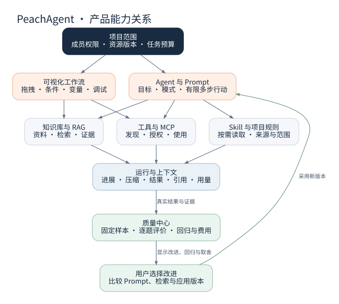

# 项目背景与产品范围

> 项目：PeachAgent · 版本：v0.1 · 更新：2026-11-23
>
> 状态：需求草案，待项目负责人确认；不代表现有功能。

## 1. 背景

PeachAgent 来自对 AI 应用开发过程的完整需求：用户不仅需要一次模型对话，还需要组合工作流、外部工具、任务指导和自有知识，持续检查结果是否正确、成本是否合理。

本项目需要解决以下场景中的问题。这些是本次规划确定的产品问题，尚未进行市场规模或竞品覆盖率验证。

| 问题 | 对用户的影响 | 产品需要提供的结果 |
|---|---|---|
| 一个任务涉及多个步骤，依靠手工反复调用 | 不易复用，出错后难以定位 | 将步骤组合成可视化工作流，查看各步骤的输入、结果与状态 |
| 工具、Skill、项目规则混在提示词里 | 用户不知道用了什么指导、允许了什么动作 | 分别管理能力、任务指导、规则和授权，并展示本次采用的内容 |
| 对话和工具结果不断变长 | 关键目标、限制、证据可能被遗漏 | 明确上下文容量、压缩行为和回读来源，保留任务连续性 |
| 资料存在但答案未找到或引用错误 | 无法判断是资料、检索还是回答出了问题 | 提供知识处理、检索试验、证据引用和失败归因 |
| 修改提示词或检索方式后“看起来更好” | 无法判断是否真的改善，也看不到回归 | 使用固定样本与明确口径比较多个版本 |
| 多步执行、重试和评测产生开销 | 结束后才发现消耗过多 | 执行前有边界，执行中有提醒，执行后有可解释用量 |
| 功能规划散落在讨论中 | 开发遗漏、阶段完成标准不明确 | 用稳定需求编号连接阶段、Issue、PR 和验收证据 |

## 2. 产品定位

PeachAgent 是面向开发者和 AI 应用建设者的智能体开发平台。用户应能在同一项目里完成：

1. 创建 Agent 或工作流，配置模型和任务目标。
2. 选择可调用的工具、MCP 服务、Skill、项目规则及知识。
3. 在明确权限、步骤、时长和预算边界内运行任务。
4. 检查结果、证据、运行过程和用量。
5. 用质量中心判断不同配置的优劣，再决定是否采用优化。

产品优先交付逐期可用的完整用户路径。功能页数量、节点数量或模型接入数量不能单独作为项目成功标准。

上图表达用户能力之间的关系：工作流与 Agent 使用项目内资源，运行结果进入评测和改进过程；权限、版本与预算贯穿各个阶段。它不是技术架构或部署图。

## 3. 目标用户与主要任务

| 角色 | 主要任务 | 需要看到的结果 | 不应被要求提前掌握的内容 |
|---|---|---|---|
| 项目负责人 | 确认需求、安排阶段、核对交付、控制预算 | 功能覆盖、验收证据、未完成项、质量与成本变化 | 具体框架和底层执行原理 |
| AI 应用开发者 | 构建 Agent、配置 Prompt、组合工作流和工具 | 可重复使用的应用配置、运行结果、错误定位 | 每种工具的内部实现 |
| 知识维护者 | 导入和更新资料、检查内容、设置可见范围 | 文档处理状态、原文与证据、更新生效情况 | 检索引擎内部结构 |
| 评测人员 | 建立样本、标注依据、比较结果、复核争议 | 逐题结果、失败类型、实验条件、结论限制 | 某个特定评测框架 |
| 项目成员 | 在已授权范围内使用应用、查看结果 | 可信的完成状态、必要的解释和可追溯产物 | 平台运维与部署细节 |

早期角色可以由同一人兼任。产品权限只需支撑实际责任差异，不提前规划复杂组织层级。

## 4. 核心使用场景

### 4.1 完成第一次可控对话

用户创建项目，配置自己有权使用的模型，设定任务限制，发送问题并查看回答。发生凭证错误、服务不可用、预算不足或取消时，用户能知道发生了什么，且不会把失败显示成成功。

### 4.2 编排一个有条件分支的业务流程

用户拖入节点、连接步骤、配置变量和条件，先检查配置再运行。用户能看到哪个分支被选择、哪个步骤失败，以及结果来自哪一个流程版本。

### 4.3 使用工具与 Skill 完成多步任务

用户授权指定工具并绑定任务相关 Skill。Agent 按需读取指导和资料，在任务限制内执行；不相关内容不应全部塞入上下文。用户可以检查工具调用、采用的规则、压缩摘要和完成依据。

### 4.4 基于项目知识回答问题

用户上传资料，检查处理结果，在检索试验中找到证据，再通过 Agent 或工作流生成带引用的答案。资料没有答案、资料已失效或用户无权访问时，产品应明确表达限制。

### 4.5 验证一次优化是否值得采用

用户选择固定问题集和已确认的判定依据，对比两个 Prompt、检索配置或 Agent 版本，查看改进、回归、失败、耗时和费用。优化建议只是候选，采用哪个版本由用户决定。

### 4.6 完成需要人工介入的复杂任务

在后续阶段，任务可以等待授权、补充信息或检查结果，再按已记录的状态继续。多 Agent 协作、脚本执行和复杂资料处理按实际需要逐步加入。

## 5. 范围与阶段边界

| 能力 | 核心版本要求 | 后续增强 |
|---|---|---|
| 项目、模型与对话 | 配置、授权、运行、历史、基础用量 | 更丰富的协作和模型选择策略 |
| 工作流 | 拖拽、连线、变量、条件、调试、版本、子流程 | 受控并行、循环和复杂汇总 |
| Agent 与工具 | 有限多步执行、远程 MCP、工具授权、运行证据 | 多 Agent 分工和更长任务 |
| Skill 与项目规则 | 按需发现、读取正文与资料；目录规则来源可见 | 在受控执行条件下使用附属脚本 |
| 上下文与记忆 | 容量提示、压缩、保留约束与证据、基础记忆控制 | 更复杂的跨会话连续性 |
| RAG | 常见文本资料、检索对比、引用、缺证据处理 | 图文表格、跨资料关联等经评测证明必要的能力 |
| 质量与 Prompt | 固定样本、逐题判定、A/B 对比、候选优化、人工选择 | 更丰富的实验和优化方式 |
| 成本 | 从首次付费调用开始记录用量并限制任务；后续汇总 | 商业账单暂不纳入规划 |

### 5.1 本次仓库交付范围

本次提交项目背景、需求拆分、路线图、需求验收关系、文档图示、README 和开发流程。`technical/` 仅保留占位。现有讨论中的技术建议不作为本次已确认的技术决定写入仓库。

### 5.2 当前不纳入交付的内容

- 产品代码、演示服务和可运行安装包。
- 框架、语言版本、数据库、接口、部署结构和架构图定稿。
- 自动化 CI/CD 平台、灰度发布、复杂规范门禁。
- 商业计费、支付结算、插件交易市场。
- 大规模运维、跨区域容灾、复杂企业组织管理。
- 无需授权就执行任意命令或操作外部系统的能力。

“暂不纳入”不等于永远禁止。以后需要新增时，先形成明确需求和验收范围。

## 6. 成功标准

| 目标 | 必须有的观察依据 | 不足以证明成功的现象 |
|---|---|---|
| 可用 | 目标用户能完成阶段规定的端到端场景 | 只有页面、表单或演示截图 |
| 可控 | 未授权、超限、失败和取消场景有正确结果 | 正常场景能运行 |
| 可解释 | 能定位采用的配置、版本、证据和失败环节 | 只有最终答案或一个总分 |
| 可比较 | 样本、判定口径与对比条件可追溯 | 单个例子回答变长或措辞更流畅 |
| 可负担 | 展示用量、估算依据、任务限制和成功任务成本 | 费用字段恒为零或只有总消耗 |
| 可交付 | 需求、Issue、PR、验收证据一致，遗漏有记录 | PR 已合并或任务列表全部勾选 |

当前不承诺“召回率达到某个固定值”“所有任务成功”或某个响应时间。目标值在样本、负载和预算条件明确后确认；报告必须说明适用范围。

## 7. 术语

| 术语 | 本项目需求中的含义 |
|---|---|
| Agent | 在目标、权限和资源限制内选择下一步操作并完成任务的应用 |
| Workflow | 用户事先组织的步骤、分支和输入输出关系 |
| Tool | 被授权执行的一项外部或平台能力 |
| MCP | 本项目要求支持的一类工具与资源接入方式；接入成功不等于全部操作获授权 |
| Skill | 可按任务需要读取的工作指导及附属资料；不自动授予执行权限 |
| AGENTS.md | 项目或目录规则文件；文件作用范围和实际采用内容需要可查看 |
| Context | 本次任务用于理解目标、约束、进展和证据的信息 |
| Prompt | 对任务、输入和输出要求的指令模板；原讨论中的“promote 优化”按 Prompt 优化理解 |
| RAG | 从用户授权的知识中找到证据，再辅助回答或执行任务的能力 |
| 质量中心 | 管理样本、判定依据、评测、对比及复核的产品能力 |
| 运行完成 | 执行过程结束；不自动等同于业务结果正确或用户接受 |
| 验收通过 | 已确认范围内的标准有真实证据支持，并完成必要复核 |

## 8. 需求来源与确认方式

本版需求来自本项目讨论中的能力要求，以及“先完成规划、需求确认后再定技术方案”的范围约束。此前蓝图中的技术选型和参数建议不随本版需求自动生效。

产品负责人应优先确认：核心用户场景是否正确、阶段边界是否合适、各阶段验收是否足够、后续增强范围是否需要调整。具体待决事项见 [待决事项与变更记录](05-decisions-and-change-log.md)。
