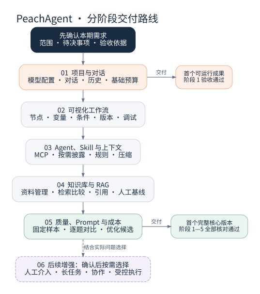

# 分阶段产品路线图

> 版本：v0.1 · 更新：2026-11-23 · 状态：需求草案，待确认。
>
> 本文规定交付顺序与完成标准，不确定技术方案、人员安排或工期。

## 1. 路线图原则

每一期必须交付一条真实可用的用户路径。前一期建立的权限、预算、版本和结果记录要求，在后续能力中继续成立。

**阶段 1 是首个可运行成果；阶段 1–5 组成首个完整核心版本；阶段 6 为后续增强。** 不应为了未来能力推迟首次对话、首次工作流或首次知识问答。

图中的“完成”均指通过对应需求验收。当前所有功能阶段仍为待确认、未开发。

## 2. 开发前：需求确认

当前文档交付用于建立需求草案，完成以下事项后才进入对应阶段的技术设计和开发：

1. 确认阶段的用户目标、范围和必须完成的验收场景。
2. 对该阶段待决事项给出选择，或明确不影响开工的处理边界。
3. 在总规划 Issue 中记录采用的需求版本。
4. 把该阶段候选任务包拆成独立 Issue，保留完整的需求编号和验收映射。

后期需求未全部确认不必阻止已确认阶段推进；未确认事项不能被执行者自行视为已批准。

## 3. 各阶段交付

| 阶段 | 用户目标 | 必须交付 | 进入条件 | 完成证据 |
|---|---|---|---|---|
| 1：项目与对话 | 在自己的项目中完成可控对话 | 项目和基础角色、模型配置、对话与 Prompt 基础、历史、用量、任务限制 | 本阶段需求确认，可用的授权模型与体验样本 | 正常对话、错误、取消、权限及预算场景记录 |
| 2：可视化工作流 | 把多个步骤组合为可运行流程 | 拖拽、连线、节点配置、变量、条件、版本、调试、基础工具、子流程 | 阶段 1 的项目、调用、运行记录和任务限制可用 | 含分支的流程、错误配置拒绝、版本隔离和副作用处理记录 |
| 3：Agent 与上下文 | 让 Agent 使用工具和指导完成有限多步任务 | 远程 MCP、授权、Skill 渐进披露、目录规则、执行模式、上下文压缩、基础记忆 | 阶段 1–2 的调用、权限、版本、流程承载能力可用 | 多步任务、未授权拒绝、Skill 按需读取、压缩连续性和超限停止记录 |
| 4：知识库与 RAG | 用自己的资料生成可核对的答案 | 资料管理、处理预览、检索试验、检索方式对比、引用、无答案处理、Agent/工作流接入 | 项目隔离、运行记录、用量和上下文控制可用 | 文本资料问答、证据定位、版本更新、删除生效、人工基线检索记录 |
| 5：质量与优化 | 用证据选择更合适的配置 | 数据集、指标口径、逐题评测、版本对比、Prompt 候选优化、复核与成本报表 | 可运行的 Agent/工作流/RAG 版本，合法可用的评测样本 | 固定条件对比报告、失败归因、人工复核、候选选择、成本核对记录 |
| 6：高级协作与扩展 | 满足核心版本无法覆盖的复杂任务 | 从人工介入、长任务、协作、受控执行、高级知识处理等候选中确定范围 | 核心版本验收；已有真实使用反馈或失败案例；本期增强范围单独确认 | 获选增强能力的场景验收与核心能力回归结果 |

详细范围与逐项标准见 [阶段需求索引](README.md#阶段需求)。

## 4. 关键能力如何逐期出现

| 能力 | 首次可用 | 后续完善 | 边界说明 |
|---|---|---|---|
| 成本与任务限制 | 阶段 1 | 阶段 5 提供跨任务分析和完整对比 | 不能把执行前限制推迟到阶段 5 |
| Prompt | 阶段 1 的模板与试用 | 阶段 2 复用，阶段 5 评测驱动优化 | 基础模板不等于自动优化 |
| 工具 | 阶段 2 的显式工具配置与调用 | 阶段 3 接入 MCP 并由 Agent 选择 | 配置或发现工具不等于授权使用 |
| 运行版本 | 阶段 1 的记录，阶段 2 的工作流版本 | 后续扩展到 Agent、Skill、知识和评测 | 不允许草稿修改改变历史运行依据 |
| Agent 节点 | 阶段 3 | 阶段 6 的协作与复杂恢复 | 阶段 2 不把未实现节点显示为可运行 |
| 知识检索节点 | 阶段 4 | 阶段 5 批量评测，阶段 6 处理复杂资料 | 阶段 4 已需人工可核对的基础样本 |
| 人工确认 | 有副作用操作开放前就需明确授权 | 阶段 6 建立长时间等待、撤回和恢复过程 | 早期可阻止不具备安全条件的动作 |
| Skill 附属脚本 | 阶段 6 获选后 | 按需要扩大支持范围 | 阶段 3 读取 Skill 不意味着可运行脚本 |
| 记忆 | 阶段 3 的受控基础能力 | 阶段 6 的复杂连续任务 | 与知识库资料分别管理 |
| 自动化协作 | 阶段 3 的有限单 Agent 任务 | 阶段 6 的多 Agent 分工 | 所有子任务共享上层权限和总体预算边界 |

## 5. 每期的验收方式

### 5.1 功能验收

每项已确认需求都有对应开发 Issue、PR 和验收记录。验收记录至少写明：需求编号、使用场景、测试输入、预期结果、实际结果、证据位置、检查人或执行记录、仍存在的问题。

一个阶段只有在以下条件都满足时才可标记“完成”：

- 已确认范围内的每项需求均已核对，所有必需标准有通过证据。
- 本期完整用户路径能够跑通，依赖的前期主要路径仍可用。
- 失败、取消、无权限、无配置和预算不足等适用异常路径已检查。
- 未完成项、范围调整及遗留问题均已列出；影响本期验收的事项已经解决或获明确范围调整决定。
- 总规划 Issue、需求追踪表和阶段核对报告保持一致。

### 5.2 代码合并与阶段验收的关系

“可编译”是代码 PR 合并前的底线；“需求验收通过”是阶段完成的依据。二者分别记录。只通过编译、只合并 PR 或只创建页面，不能宣布阶段完成。

本次为文档交付，没有产品代码和构建入口，编译检查不适用；适用的是内容、链接、图示和需求一致性检查。

## 6. 任务拆分规则

每份阶段需求末尾提供候选任务包，用来控制开发范围。需求确认后，按以下原则创建 Issue：

1. 一项 Issue 解决一个可独立说明和验收的问题；过大任务拆分，过小且不可独立验证的工作合并。
2. 所有任务均引用稳定需求编号；一个需求跨多个任务时，明确谁负责整体验收。
3. 先交付可使用的完整路径，再补充同一能力的增强项，避免所有能力长期停留在“部分开发”。
4. 共性需求分配到相关功能任务的验收里；必要的公共能力可单独立项，但不能脱离首个使用场景。
5. 记录依赖和阻塞原因。仅当依赖已满足或可明确替代时安排执行。
6. 一项开发 Issue 对应一份交付 PR；按 [开发流程](../ci/README.md) 合并并核对。

本次只建立 [总规划 Issue #1](https://github.com/Ryan-Guizhou/PeachAgent/issues/1) 和 [文档交付 Issue #2](https://github.com/Ryan-Guizhou/PeachAgent/issues/2)。候选开发任务不因文档提交而自动开工。

## 7. 排期与调整

本版不虚构完成日期或人力。需求确认后，结合执行人员、可用模型和资料、每期工作量及实际反馈安排时间。

调整阶段顺序时，应明确受到影响的用户路径和依赖；拆出增强需求时，应保留原需求编号、拆分关系和去向。未开发的工作不能通过修改状态名称变为“完成”。

## 8. 路线图当前状态

| 跟踪项 | 当前状态 | 下一项动作 |
|---|---|---|
| 需求文档基线 | 已形成 v0.1 草案，待确认 | 按背景、路线图、阶段需求顺序审阅 |
| 技术设计 | 未开展 | 相应需求确认后再编写 |
| 阶段 1–5 开发 | 未开始 | 确认阶段 1，拆分开发 Issue |
| 阶段 6 增强 | 后续候选 | 依据核心版本反馈选择范围 |
| 编译与功能验收 | 产品代码尚不存在 | 在对应代码和验收场景交付后记录真实结果 |

需求状态明细见 [验收与需求追踪](04-acceptance-and-traceability.md)，范围待决事项见 [待决事项与变更记录](05-decisions-and-change-log.md)。
