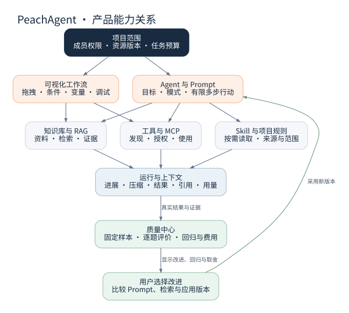

# 产品架构与业务蓝图

> 版本：v0.2 · 更新：2026-11-23 · 状态：规划中的产品结构与业务规则；不表示界面或功能已经实现。

本文件把“有什么功能”组织为用户能够连续完成任务的产品。服务拆分、存储和执行机制另见 [技术总架构](../technical/01-platform-architecture.md)；需求细节以阶段文档和专题中的编号为准。

## 1. 产品总结构

| 产品域 | 用户进入时要解决的问题 | 主要产物 | 对外提供的信息 |
|---|---|---|---|
| Studio | 我要构建什么任务、采用什么资料和能力、怎样交互 | Agent、工作流、Prompt、Skill、工具绑定、知识配置、插件和应用草稿 | 可运行的版本、调试输入、依赖和所需授权 |
| Runtime | 本次任务如何完成、现在进行到哪里、是否需要我参与 | 运行记录、节点/工具结果、上下文摘要、任务文件、停止原因 | 可观察事实、引用、版本、时长、Token 和需要处理的异常 |
| Quality | 结果是否正确、哪些变化有效、回归在哪、是否值得采用 | 数据集、人工标注、评测报告、对比实验、Prompt 候选 | 逐题证据、指标定义、失败分类、改进与退化、费用变化 |
| Operations | 谁能使用什么、怎样发布共享、消耗和运行是否正常 | 权限与凭证配置、应用发布版本、审核记录、公共条目、预算和部署记录 | 可用资源、授权限制、发布状态、运行健康及可追溯管理操作 |

插件与公共资源仓库贯穿四域。插件可以扩展开发界面和执行能力，也可以提供知识处理或评测能力；公共仓库负责可发现性和审核，不承担实际任务执行。质量中心能够评测内置和插件能力，不能只给内置功能留观察入口。

## 2. 工作空间与角色模型

每个个人账号对应独立租户，租户内允许多个项目。项目用于组织同一目标下的应用、数据、运行和评测，个人凭证可以由本人明确绑定到项目；跨项目引用需要明确可见范围。首期不要求团队协作成员管理，也不以组织角色作为使用高级能力的条件。

管理员拥有账号治理、公共资源审核和平台运行管理入口。审核者看到的是作者提交的发布包及审核所需信息；不能通过审核界面自动读取作者未提交的私有知识、历史会话或密钥。管理员本人需要开发应用时，同样使用自己的个人空间。

| 操作范围 | 普通个人用户 | 平台管理员 |
|---|---|---|
| 本人项目、应用、知识、凭证、评测与用量 | 按本人资源权限管理 | 作为普通用户管理自己的内容 |
| 已审核公共目录 | 搜索、阅读、安装/复制、反馈问题 | 同样可使用，并可执行公共治理动作 |
| 提交公开内容 | 可以提交本人有权发布的具体版本 | 可以提交；公开仍须有可追溯审核决定 |
| 待审核包与驳回意见 | 仅提交者可查看本人记录 | 按审核职责查看并决定 |
| 平台健康、账号停用、配额与风险处置 | 查看与本人有关的状态和原因 | 执行管理动作并留记录 |
| 他人私有密钥与未公开资料 | 不可见 | 不设置默认明文查看入口；必要故障调查应限定范围并留下依据 |

## 3. 核心对象及关系

| 对象 | 用户理解 | 生命周期与关系 |
|---|---|---|
| 个人租户 | 我的数据和资源边界 | 拥有多个项目和个人配置；账号停用影响新操作，但不伪造历史任务结果 |
| 项目 | 围绕一个业务目标的开发空间 | 汇聚应用、知识、规则、评测与运行；归档/删除需展示影响 |
| Agent | 可以按目标选择下一步动作的任务执行者 | 引用 Prompt、模型、工具、Skill、规则、知识和上下文策略；版本可以被工作流调用 |
| 工作流 | 我明确编排的步骤和分支 | 节点引用 Agent、模型、工具、插件或子流程；发布前检查结构和依赖 |
| Prompt 模板 | 可编辑、带变量的提示内容 | 有草稿、版本和评测比较；优化产生候选，不覆盖当前版本 |
| MCP 连接配置 | 将外部能力接入本人项目的连接及授权 | 记录服务能力、凭证绑定、允许工具和变化；公开模板不包含作者会话和授权 |
| Skill | 可按任务需要逐步读取的能力说明包 | 简介、正文、参考资料和可选脚本各有来源；读取不等于脚本获得执行许可 |
| 项目规则 | 在项目或目录范围内约束任务的说明 | 包括 AGENTS.md 等规则来源；展示范围、采用内容和冲突，不把资料当作管理员授权 |
| 插件 | 用户可开发和安装的扩展包 | 可含代码、配置、界面和资源；有版本、依赖、权限、安装与卸载状态 |
| 知识库与资料 | 回答和执行时可引用的受控信息 | 原资料、处理版本、检索结果和引用可关联；更新、撤权和删除影响新的使用 |
| 评测集与报告 | 用来判断是否改进的样本及结果 | 样本含目标/证据/用途；报告锁定目标版本、条件和判定依据 |
| 运行与调用明细 | 一次任务及其实际动作 | 父子任务、节点尝试、用量、产物、人工介入和停止原因关联；刷新页面不生成新任务 |
| 应用与发布版本 | 可以被最终用户使用的产品入口 | 将 Agent/工作流及依赖组成可运行版本；支持 Web/API/Webhook 入口和停用/回退 |
| 公共条目与审核版本 | 被管理员允许公开的可复用内容 | 条目可以有多个版本；每个公开版本有独立审核，未审核更新不覆盖已公开内容 |

一个资源可以经历“私有草稿 → 私有可用版本 → 提交审核 → 审核通过的公开版本”。这个过程与应用的“设计 → 运行调试 → 评测 → 发布执行入口”不同：公开资源可以只是模板，而私有应用也可以由所有者显式开放受保护的 API。

## 4. 产品导航与关键页面

| 一级入口 | 二级工作区 | 页面必须帮助用户判断什么 |
|---|---|---|
| 工作台 | 个人概览、项目列表、最近运行、待处理事项 | 我的任务是否完成，哪些任务等我处理，近期消耗和异常是什么 |
| 项目 / Studio | 对话、Agent、工作流画布、Prompt、工具/MCP、Skill、规则、知识、插件 | 当前编辑对象与版本是什么，缺什么依赖，怎样调试，改变会影响哪些引用 |
| 运行中心 | 运行列表、步骤轨迹、人工介入、产物、上下文记录 | 实际运行了什么、用了哪个版本、为何失败、是否可以安全恢复 |
| 质量中心 | 样本集、标注、评测任务、逐题比较、失败分析、Prompt 优化 | 提升依据是否一致，漏召回发生在哪一步，有哪些退化和未知 |
| 资源仓库 | 按应用/插件/Skill/MCP/Prompt 分类、版本详情、我的提交、已安装 | 哪个版本审核通过，需要哪些权限与配置，是否适配当前平台，安装会不会升级已有应用 |
| 应用发布 | 发布检查、渠道、版本与调用权限、回退、使用记录 | 谁能调用、以谁的身份执行、消耗谁的凭证、如何停用 |
| 个人设置与用量 | 模型、凭证、Token 面板、预算、数据管理 | 秘密是否有效，消耗来自哪里，缺失用量如何解释，如何撤销访问 |
| 管理控制台 | 待审核、公共版本治理、账号状态、平台配额、健康和审计 | 审核对象是什么，影响哪些安装/运行，操作有无依据，是否只影响目标范围 |

插件自定义界面可以出现在声明并获准的配置、调试、结果和专属扩展页面。平台仍提供统一导航、版本、授权提示和禁用入口；插件不能自行覆盖登录、全局权限或资源审核结论。统一表单与自定义界面需表达同一份有效配置，避免两种方式保存后行为互相矛盾。

## 5. 端到端用户旅程

### 5.1 从空账号到一个可用应用

用户注册进入个人空间，创建项目，配置本人模型并测试连接；从对话或模板开始编写 Prompt。随后选择 Agent 或画布，绑定所需工具、Skill 和知识；调试时查看实际步骤、上下文和用量。质量中心比较候选与基线，用户采用版本后发布 Web 或受保护 API。应用入口、版本、模型凭证归属、预算和停止方式需可理解。

完成条件：用户能从已发布应用的结果追溯到项目中的具体版本、依赖、运行和消耗；修改草稿不会改变该发布版本。此路径分期建设，到阶段 6 必须完整联通。

### 5.2 自定义插件从开发到使用

作者先选择扩展点，按照开发资料创建配置清单与执行/界面能力，完成本地或平台提供的调试。用户安装私有版本，查看需要的权限，绑定本人凭证并运行。升级时先检查新版本可用性与配置变化，确认需要迁移的引用；正在执行、暂停和待审批的旧任务继续绑定原版本，当前撤权仍生效。失败升级可以保留仍获准且可用的旧版本。

完成条件：自定义代码确实提供原本没有的业务能力，主平台和全局 Runtime 未因安装或升级重启；自定义前端与统一表单都可用，卸载时可看见引用和处理方式。

### 5.3 RAG 发现问题并证明改进

用户导入真实资料，检查解析与分段是否完整；建立包含可回答、无答案、精确术语、跨段/跨资料和权限差异的样本。运行基线，区分未进入候选、排序靠后、最终上下文截断和生成误用。用户选择对应策略，再用相同资料版本和样本做对照，查看逐题依据、总体变化、回归、延迟和消耗。

完成条件：报告能解释“提升了哪一层的指标、分母是什么、是否改变候选数量或上下文预算”，而不是只显示一张提高了若干百分点的图。原文标注单位不能因切分方案变动而失去可比性。

### 5.4 公共资源发布与再使用

作者将可复用内容整理为不含私有密钥和数据的候选版本，填写用途、依赖、权限、样例和许可。管理员审核该版本，批准后所有正常用户可以发现。使用者安装或复制后配置自己的凭证；提交者上传新版本时重新审核。管理员下架违规版本时，目录、链接和新安装入口一致限制，已安装资源的后续处理有明确策略。

完成条件：未审核内容不能通过直接 URL、搜索、文件下载或版本选择泄漏；审核不代表第三方服务或所有运行行为永久可信。

### 5.5 长任务、人工介入与预算

用户提交需要多个步骤或多个 Agent 的任务，在权限范围内运行。涉及明确要求人工决定的动作时暂停，显示决策对象、范围和已发生事实。用户可以稍后返回批准、拒绝或取消；恢复前复核资源与凭证是否仍有效。所有子任务共享父任务约束，Token 面板分别显示子明细和不重复的整体汇总。

完成条件：关闭页面不等于取消任务，恢复不重复执行已知完成的外部写入；结果未知时先核实，而不是盲目重试。

### 5.6 自托管部署与持续使用

部署者取得正式版本，按说明填写数据库和中间件密码，运行一条部署命令。部署程序准备目录和挂载、初始化服务及管理员首次入口；用户登录后配置自己的模型密钥。随后验证重新创建容器、升级前备份、新环境恢复和功能联验。

完成条件：项目、凭证、知识、插件、发布版本和必要运行记录可按声明恢复；只有卷而没有备份不能判为可恢复交付。

## 6. 关键状态与用户决定

| 对象 | 用户可见状态 | 必须明确的决定 |
|---|---|---|
| 应用版本 | 草稿、验证中、可发布、已发布、停用/回退 | 是否采用候选，是否迁移依赖，谁可调用 |
| 运行 | 等待、执行中、待人工、恢复检查、成功/失败/取消、结果待核实 | 是否批准动作，是否取消，是否在核实后重试 |
| 插件安装 | 待验证、待配置、可用、升级中、停用、卸载受阻/已卸载 | 授予哪些能力，是否迁移引用，怎样处理旧版本 |
| 公共版本 | 草稿、待审核、通过、驳回、撤回、下架 | 提交的是哪个版本，审核意见是什么，旧公开版是否仍可用 |
| 资料处理 | 等待、处理中、可用、部分失败、更新失败、删除中/已删除 | 是否使用旧可用版本，如何补正，删除范围是什么 |
| 评测 | 草拟、执行中、完成/部分失败、待复核、已复核 | 如何处理未知/争议，哪些样本保留独立检验用途 |

具体状态名称可以在交互设计时统一，但这些业务差异不能合并成一个含糊的“成功/失败”字段。

## 7. 完整性检查

每个领域必须具备创建/配置、运行/验证、错误说明、权限、版本、观察和退出/停用路径。只有“能新增一条配置”不等于支持该能力；只有“可以安装插件”不等于支持热升级和安全卸载；只有“能调用大模型评一次分”不等于质量中心。

完整能力与阶段归属见 [能力矩阵](07-capability-matrix.md)，实际核对采用 [验收追踪](04-acceptance-and-traceability.md)。
