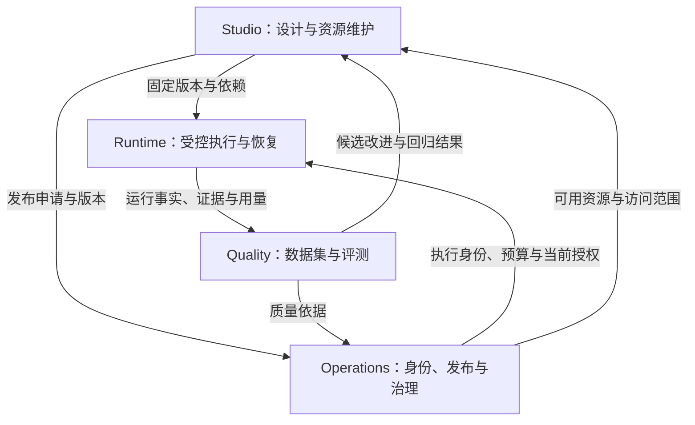

# PeachAgent 产品需求文档

> 更新：2026-11-23 · 产品负责人及开发批准人：项目所有者（本仓库需求提出者）  
> 状态：整体需求与排期整理，待确认；七个正式产品开发周期均未通过技术评审、未启动。已有 OTRYX Studio 浏览器原型，原型演示不计作正式功能验收。

## 1. 概述

PeachAgent 面向个人开发者和独立产品开发者，提供从设计 Agent / 工作流，到受控执行、知识检索、质量评测、应用发布和自托管部署的完整平台。用户自行配置模型和工具凭证，在自己的工作空间内维护应用、数据与运行记录。

产品沿用 **Studio、Runtime、Quality、Operations 四域架构**，按七个阶段逐步交付。每个阶段对应一个开发周期；每期开工前只评审该期需求及技术方案，取得用户明确通过后再开发。整体 PRD 确认、原型合并或上期验收均不代替下一期批准。

本文是需求、阶段范围和验收标准的唯一正文。实现边界见[技术基线](../technical/README.md)，实际评审与交付按[开发流程](../ci/README.md)执行。

### 需求大纲

| 章节 | 要回答的问题 |
| --- | --- |
| [2. 背景与问题](#background) | 为什么建设，现有做法有什么困难 |
| [3. 目标与成功标准](#objectives) | 交付后应完成什么，如何证明有效 |
| [4. 用户与使用场景](#users) | 谁使用，分别有什么权限和任务 |
| [5. 价值主张](#value) | 相比现有处理方式，用户得到什么改善 |
| [6. 产品方案与完整需求](#requirements) | 四域关系、信息架构、功能、通用约束和范围边界 |
| [7. 七个开发周期](#release-plan) | 每期做什么、依赖什么、多久、怎样验收 |
| [8. 技术评审与交付规则](#review-gate) | 谁批准，批准什么，何时允许开始下一步 |

## 2. 背景与问题

把模型接入聊天页面，只能解决一次问答。实际任务还需要选择模型、查找资料、调用工具、处理失败、等待人工决定，并确认外部操作真的完成。个人开发者通常要在脚本、模型控制台、知识检索工具和业务系统之间拼接这些步骤；配置、执行依据和结果分散，维护一个可持续使用的应用比完成一次演示困难得多。

现有原型已经把主要操作串联起来，适合验证页面和交互。下一步需要建立真实身份、持久化、执行隔离、可恢复任务和可核查的质量、用量记录。分期的目的，是先形成最小可用闭环，再增加复杂能力，避免界面、运行逻辑和运营治理各自发展。

| 需要解决的难题 | 对用户的影响 | 产品应提供的结果 |
| --- | --- | --- |
| 模型、Prompt、工具、知识分散维护，变更会影响旧任务 | 不知道某次结果用了什么配置，难以复现和回退 | 统一对象入口，草稿与运行版本分离，依赖和运行快照可追踪 |
| 长任务涉及多次调用、外部写入和人工确认 | 重试可能重复写入，关闭页面后不知道任务是否继续 | 明确任务状态、审批对象、取消边界、检查点和恢复依据 |
| 同一模型不适合所有任务，模型用途与费用不清楚 | 连接可用但能力不匹配；子任务和重试开销难以控制 | 按类型和能力管理模型，按任务选择，统一记录消耗与预算 |
| RAG 出错时只看到最后答案或总分 | 无法判断问题来自解析、召回、排序、上下文还是生成 | 可解释的知识处理链，原文证据标注和逐题对比 |
| 插件与共享资源难以安全复用 | 更新可能打断任务，复制配置可能带出密钥 | 版本化插件、隔离运行、自备凭证、按版本审核公开内容 |
| 原型完成后仍缺发布、权限和部署路径 | 应用不能稳定提供给外部调用者，也难以恢复数据 | 受保护的 Web/API/Webhook 发布、调用治理和可恢复部署包 |

上述问题来自已确认的产品目标和原型使用要求；尚未形成线上用户效率、规模或成本基线，不把预期改善写成已验证收益。

## 3. 目标与成功标准

| 目标 | 可核对的成功标准 | 收口周期 |
| --- | --- | --- |
| 建立个人开发者的最小闭环 | 两个独立账号分别完成注册、空间/项目创建、配置本人模型、流式对话、查看历史和用量；跨租户及跨空间访问被阻止 | P1 |
| 完成可解释、可治理的应用交付 | 从草稿设计到调试、固定版本评测、受控发布与外部调用全程可追溯；关键失败、撤权、取消、审批和恢复路径都有实际证据 | P2–P6 |
| 形成可持续使用的完整平台 | 七期范围逐项验收；在受支持的干净环境完成部署、容器重建、备份恢复、升级和前六期功能联验 | P7 |

每期只以需求及端到端验收证据判定完成。PR 数量、节点数量、文档条目数量和原型页面数量不作为产品完成率。响应时间、并发、任务容量和 RAG 指标阈值在对应周期评审中根据场景与环境确定，验收时记录实际结果。

## 4. 用户与使用场景

| 用户/角色 | 主要任务 | 权限与范围 |
| --- | --- | --- |
| 个人开发者、独立产品开发者 | 创建项目，配置模型与工具，构建 Agent/流程，评测并发布应用 | 一名个人用户对应一个独立租户，可创建多个工作空间；普通用户可使用全部产品功能 |
| 插件与资源作者、复用者 | 开发工具或插件，维护 Skill/Prompt/MCP 模板，提交共享或安装使用 | 私有开发不需要公共审核；公开必须按版本审核，安装后绑定使用者自己的凭证 |
| 应用调用者 | 在授权范围内调用已发布 Web/API/Webhook 应用 | 调用身份、应用所有者、执行租户、凭证提供者和用量承担者分别明确 |
| 平台管理员/部署维护者 | 管理账号状态、审核资源、处理风险版本、部署和恢复 | 管理权限不默认授予所有私有内容及密钥读取权；关键操作留审计记录 |

### 三条主要使用路径

1. **构建应用：** 注册 → 默认工作空间 → 创建项目 → 配置模型 → 对话/Agent/工作流设计 → 调试 → 评测 → 发布 → 查看调用与消耗。
2. **复用能力：** 私有开发或选择已审核资源 → 核对版本、权限和依赖 → 安装到工作空间 → 绑定本人凭证 → 验证 → 显式采用升级。
3. **改进结果：** 从失败运行采集候选样例 → 人工核对标准答案/证据 → 固定数据和配置比较 → 分析退化与费用 → 人工采用新版本或保留基线。

## 5. 价值主张

| 要素 | 应用开发者 | 能力作者与复用者 |
| --- | --- | --- |
| 谁 | 要把 AI 能力变成可长期使用应用的个人开发者 | 要提供或复用工具、插件、Skill、MCP、Prompt 的开发者 |
| 要完成的工作与障碍 | 串联模型、知识和业务操作，并能解释失败、权限和费用 | 一次开发可复用，同时避免升级中断、权限扩大和密钥泄漏 |
| 现有处理方式 | 脚本、模型控制台与独立业务工具分别配置，人工对照记录 | 复制代码和配置、手动安装与更新，再自行排查兼容和依赖 |
| 产品提供的做法 | 同一工作台设计，统一 Runtime 执行，Quality 验证，Operations 发布治理 | 可验证的版本包、统一配置或自定义界面、受控安装与运行、公共审核 |
| 改善后的结果 | 从任务输入追溯到配置、工具动作、证据、用量和发布版本 | 可独立演进能力，同时保留旧应用及在途任务的版本依据 |
| 替代方案与选择理由 | 可以继续编写脚本或采用现有平台；选择 PeachAgent 的依据是完整闭环、自主配置和可扩展治理是否达到验收要求 | 可以维护私有 SDK 或分发仓库；选择 PeachAgent 的依据是统一安装、调试、授权、版本和分发路径是否减少重复工作 |

PeachAgent 的交付价值，是让个人开发者在同一条可追踪路径上完成构建、运行、验证和发布，并能安全复用自己或他人开发的能力。

## 6. 产品方案与完整需求

### 6.1 四域架构

四域划分产品职责，不等于必须部署四套独立服务。Studio 形成版本，Runtime 执行，Quality 提供改进依据，Operations 负责统一身份、发布、用量和治理。

### 6.2 对象与信息架构

| 对象/入口 | 归属与职责 |
| --- | --- |
| 账号与个人租户 | 账号对应独立租户；租户负责身份、资源和消耗归属 |
| 工作空间 | 租户内独立工作范围；注册生成默认空间，可新建、重命名和切换；切换不携带其他空间的业务上下文 |
| 项目 | 位于工作空间内，组织 Agent、工作流、会话、资源引用和运行；跨项目复用必须显式授权 |
| 模型中心 | 维护供应商连接、凭证引用、模型实例、能力和用途默认值；其他页面只选择和引用 |
| 工具与连接 | 统一管理 MCP 与插件的连接、发现、配置、授权、调试和版本；不再设置重复管理入口 |
| 知识库 / 提示词与 Skills | 知识库独立管理资料、处理版本和检索；Prompt/Skill 管理可复用指令及附属内容；执行绑定只保存引用 |
| 运行中心 | 查看主任务、子任务、节点尝试、审批、结果、回执、产物与用量 |
| 质量中心 | 用户维护数据集、评测规则、批量运行、逐题结果、人工复核和版本比较 |
| 应用发布 / 公共仓库 | 发布提供可调用服务；公共仓库提供可安装/复制资源，两者的授权与状态分别管理 |
| 设置与管理 | 主题、语言、个人用量与凭证；管理员的账号治理、公共审核和平台健康 |

所有持久资源和异步任务均能确定租户、工作空间及适用项目。列表、搜索、直接链接、执行、导出和历史详情遵守同一访问范围。工作空间不是新租户，公开目录也不代表对其他租户私有资源的授权。

### 6.3 核心业务规则

| 对象 | 归属、生命周期与约束 |
| --- | --- |
| 租户 / 工作空间 / 项目 | 个人账号对应独立租户；空间是资源隔离边界，项目组织 Agent、工作流、会话和评测。项目归档不删除既有运行事实。跨项目引用必须显式授权；跨空间默认拒绝，P1 评审确定租户级资源共享范围。 |
| 模型 / 工具凭证 | 供应商凭证、工具连接凭证、应用调用 Key 分别管理；模型实例按类型与适配协议声明，登记、适配、验证可调用是不同状态。 |
| 版本 | 草稿可变，运行版本固定；应用服务版本引用已验证的 Agent 或工作流及依赖；公共审核版本独立，不因草稿更新自动变化。 |
| 任务 / Run / Execution | Task 表示用户目标；Run 是一次受控运行，含状态、身份、预算和依赖；Execution 表示运行中的具体节点或工具尝试，重试产生独立记录。 |
| 审批 | 运行操作、应用 Key 申请和公共资源审核分别管理状态及权限，可统一呈现待办，不能互相代替授权。 |
| 预算 | 租户、空间、项目及任务限制同时生效；子任务继承父任务剩余额度；未结算调用计入占用，未知成本不承诺金额封顶。 |
| 任务生命周期 | 正式产品切换空间或关闭页面不等于取消任务，用户可按授权查看和显式停止；前期中断如实记录，不自动重放结果不明的外部写入。 |
| 删除与撤权 | 禁止新引用或调用，检查活动/暂停依赖并提示受影响对象；历史运行保留允许访问的版本和事实，不借旧快照绕过当前权限。 |

Chat、Plan、Agent 是同一运行基础设施上的模式策略：Chat 限于问答与获准的只读检索，不执行写入及工作流／子 Agent 委派；Plan 生成可审阅、可修改的计划，未经批准不执行计划动作；Agent 在当前授权、预算、步数与审批规则内自主推进。模式切换不扩大权限。计划与运行分别记录，动态子 Agent 按 P6 交付。

### 6.4 功能需求与验收要点

下列功能组用于排期和开发 Issue。每行同时规定用户行为与可观察的结果；当期技术评审再拆为具体接口、数据和测试任务。旧需求编号仅用于追溯，其含义不改变：如 `PA-P1-001～002` 表示包含该连续编号范围；完整旧明细保留在 Git 历史中。

#### P1：账号、空间、模型与对话基础

| 功能组 | 必须提供的行为与验收结果 | 原需求覆盖 |
| --- | --- | --- |
| P1.1 账号与工作空间 | 注册、登录、退出、账号恢复及身份失效处理；注册创建默认空间，支持多空间/多项目、项目归档。两个账号与两个空间的数据、凭证引用、历史及运行互不串用；新空间的示例内容明确标识 | PA-P1-001～002；PA-P1-014；新增 N-01 |
| P1.2 模型与凭证 | 供应商连接与模型实例分开维护；支持自定义连接、能力参数、启停、引用检查和诊断。模型目录覆盖 LLM、Embedding、Rerank、Image、STT、TTS 类型；能力不匹配或未支持适配时阻止调用，不静默替换模型。本人凭证可验证、轮换和撤销，不回显秘密 | PA-P1-003～004；新增 N-02 |
| P1.3 对话与 Prompt | 流式对话、历史、停止/重试、Prompt 变量预览与版本、结果复制/复用和反馈。失败、部分输出和取消状态清楚；修改草稿不改写旧运行的配置 | PA-P1-005～007；PA-P1-012～013 |
| P1.4 运行与基础消耗 | 保存运行依据、状态、模型和用量；从首次调用提供 Token 面板及调用/时间/Token/可计算费用预算；并发任务共同占用项目及租户额度，计入未结算调用，费用未知时不承诺金额封顶。真实报告、估算、未知分开，失败与重试不漏记 | PA-P1-008～010；PA-P1-016 |
| P1.5 工作台与扩展入口 | 首次配置引导、最近任务、明确错误和未配置状态；三套主题、中文/英文界面、导航滚动位置及未保存编辑保护；插件作者可声明身份、版本、配置、权限和扩展点。本期只开放已实现能力 | PA-P1-011；PA-P1-015；PA-PLG-001～003；新增 N-03 |

模型目录覆盖六类；P1 技术评审逐类型明确登记、能力校验和真实调用的交付范围，列出首批适配器及验收样例。未完成真实适配的条目标明未支持调用，后续新增模型继续遵循同一契约。主题沿用日光纸感、深空工作台、冷静灰蓝；正式交付覆盖当期页面的中英文，未来页面随所属周期同步交付。

#### P2：可视化工作流与界面扩展

| 功能组 | 必须提供的行为与验收结果 | 原需求覆盖 |
| --- | --- | --- |
| P2.1 画布与版本 | 新建、查找、复制、归档、拖拽、连线、编辑恢复、导入导出和运行前检查；区分草稿与可运行版本。无效图定位到节点/字段；跨项目导入重新处理依赖和凭证 | PA-P2-001～002；PA-P2-006～007 |
| P2.2 数据与控制流 | 提供输入、模型、Prompt/文本处理、变量、条件、工具、子流程、输出及结束等基础能力，注明输入输出和限制；分支不混入未执行路径的数据；子流程锁定版本、继承总限制并检查递归 | PA-P2-003～005；PA-P2-012 |
| P2.3 调试与业务入口 | 样例输入、节点/流程试跑、步骤状态、失败定位、取消、运行轨迹和受授权业务表单入口。保存部分结果和真实外部操作状态，子流程消耗不重复累计 | PA-P2-008～009；PA-P2-013～014 |
| P2.4 业务工具与操作确认 | 工具登记、Schema 参数验证、调试和调用授权；必要的外部写入先确认，结果未知先核实，撤权后不再启动新动作。查询成功与业务目标完成分别表达 | PA-P2-010～011 |
| P2.5 插件开发与界面 | 提供 SDK/样例、调试、打包、完整性和兼容检查、租户内安装、统一表单、自定义配置/调试/结果/登记的导航扩展页面及节点接入。两种界面保存一致配置；卸载或离开后旧界面失效；局部故障不破坏主界面，安装/配置升级不重启主平台 | PA-P2-015～017；PA-PLG-004～011 |

P2 开放配置、界面和基于受信实现的节点扩展，界面隔离与插件包保存同时交付；用户代码、Skill 脚本及本地 MCP 进程须待 P3 执行隔离验收通过后开放。P2 先完成基础编排和必要确认。持久人工等待、复杂循环、并行汇合和跨进程恢复在 P6 收口；尚未实现的节点不可伪装为可运行能力。

#### P3：Agent、工具与上下文执行

| 功能组 | 必须提供的行为与验收结果 | 原需求覆盖 |
| --- | --- | --- |
| P3.1 Agent 与运行模式 | 配置指导、模型、工具范围、完成标准和步数；提供对话、规划、执行行为。规划持久保存且批准后执行；自主推进受授权、预算和停止条件约束。Agent/工作流互调，完成结论关联实际动作和证据 | PA-P3-001～002；PA-P3-013～014 |
| P3.2 MCP 工具能力 | 管理连接、发现与更新 Tools/Resources/Prompts，选择能力、验证参数、调试、处理断连和能力变化；只对当前获准工具执行调用，资源/提示词不自动成为工具权限 | PA-P3-003～005 |
| P3.3 Skill | 导入、编辑、版本、依赖和引用检查；先读取简介，再按需读取正文、资料和获准脚本。可检查采用了什么内容，附属资料不自授执行权限 | PA-P3-006～007 |
| P3.4 规则与上下文 | 处理 AGENTS.md 等规则的来源、目录范围、冲突与采用记录，允许显式映射其他规则文件及其项目、目录和任务范围；上下文预算、输出预留、去重、窗口、结构化压缩、结果外置与回读保留目标、约束、决定、待办和证据 | PA-P3-008～011 |
| P3.5 记忆 | 区分工作状态、会话历史、长期记忆和知识库；长期记忆经用户授权，可查来源、修改、删除，新的使用遵守当前范围 | PA-P3-012 |
| P3.6 代码与插件运行 | 代码插件/Skill 脚本在基础隔离就绪后开放，限制文件、网络、时间、资源与能力。安装、启用、配置、升级、降级、停用/撤权、卸载及迁移可解释；新旧版本并存，已发布和在途/暂停任务保留原版本依据，升级不重启全部 Runtime。卸载前检查活动及暂停引用；原版本不可用时明确阻塞，当前撤权仍约束旧任务 | PA-P3-015～016；PA-PLG-012～017；PA-PLG-022～023 |

运行模式、上下文范围和执行策略分别配置，切换模式不能扩大权限。P3 提供单 Agent 与明确互调；由规划器动态创建和调度多个临时子 Agent 的完整能力在 P6 验收。

#### P4：知识库与可解释 RAG

| 功能组 | 必须提供的行为与验收结果 | 原需求覆盖 |
| --- | --- | --- |
| P4.1 资料生命周期 | 创建知识库、导入已支持文本/文档、查看处理状态和原文、更新/删除/撤权；更新失败保留可用旧版并标明状态，旧索引和缓存不能绕过当前权限 | PA-P4-001～004；PA-P4-012 |
| P4.2 处理与检索 | 分段预览与调整；关键词、语义、混合候选、过滤、查询改写/拆解、重排、去重、相邻/父级证据补充及上下文预算可配置。记录实际查询、候选和排序变化；支持知识处理/检索插件 | PA-P4-005～008；PA-PLG-018 |
| P4.3 回答与证据 | Agent/工作流复用知识能力，回答关联有效原文引用；可从解析、过滤、召回、排序、截断到生成定位问题。无答案或证据不足时如实说明 | PA-P4-009～010 |
| P4.4 检索基线 | 建立含可回答、无答案、术语、多证据与权限差异的人工标注样本；使用稳定原文位置比较分段方案，展示逐题证据，不只给总分 | PA-P4-011 |

#### P5：质量、Prompt 优化与完整消耗

| 功能组 | 必须提供的行为与验收结果 | 原需求覆盖 |
| --- | --- | --- |
| P5.1 用户数据集 | 用户自行创建、编辑、导入/导出、分组、版本化样例，维护输入 Schema、预期结果、证据、评分规则及数据来源；开发集与独立检验集分开。运行输出进入候选样例后需人工核对，不能自动成为标准答案 | PA-P5-001～003；新增 N-04 |
| P5.2 多维评测 | 固定目标、数据、模型和判定版本，批量运行/停止/重试；区分运行成功、任务完成、回答与引用质量。覆盖工具参数、Skill 选择/渐进读取、压缩保全和插件契约；评分可人工复核并保留原判及理由 | PA-P5-004；PA-P5-006；PA-P5-008；PA-P5-015～018；PA-PLG-019 |
| P5.3 对比与报告 | 分开呈现候选召回、最终结果、排序和上下文覆盖；明确样本分母、语料、权限、K 与预算等条件，展示改进、退化、失败/未执行/未知、延迟和费用；可追溯导出并按原因回收问题 | PA-P5-005；PA-P5-007；PA-P5-009；PA-P5-011；PA-P5-014 |
| P5.4 Prompt 优化 | 锁定基线，生成候选、展示差异，用开发样本优化、独立样本检验；由用户采用或回退，不自动覆盖在用版本，预算不足保留已有结果 | PA-P5-010 |
| P5.5 消耗与预算 | 统一覆盖对话、Agent、RAG、Embedding/重排、压缩、评测、优化和插件模型调用；按个人/空间/项目/运行/模型/来源查询明细，父子任务与补报不重复。币种和价格来源明确，未报告值不填零；并发与子任务共享总预算 | PA-P5-012～013；PA-P5-019 |

P5 建立多 Agent/长任务的评测口径和数据结构，P6 实际交付协作与恢复后，使用真实运行完成对应回归验收。

#### P6：协作、发布、公共资源与运营

| 功能组 | 必须提供的行为与验收结果 | 原需求覆盖 |
| --- | --- | --- |
| P6.1 自主协作与复杂编排 | 有界循环/批量、并行、汇合和错误终止；规划器可自主创建、分工和调配临时子 Agent，配置每个子 Agent 的模型/候选池、依赖、并发与预算。子任务收窄继承父权限与总预算，临时对象结束后归档，仅用户明确保存才成为永久 Agent | PA-P6-001～002；PA-P6-005；新增 N-05 |
| P6.2 人工介入与恢复 | 审批固定动作、对象、关键参数和版本；内容变更、批准过期或授权失效后不得沿用原批准。任务持久等待，批准/拒绝/取消、过期及重复决定可处理；重启后核对检查点、原版本、当前权限和外部结果再恢复。已知完成写入不重复执行，未知结果进入待核实 | PA-P6-003～004 |
| P6.3 执行空间与记忆治理 | 强化沙盒、授权文件/网络和资源约束，受控本地 MCP/脚本、产物归属与访问；长期记忆候选经复核，过期、冲突、删除可治理；动态插件在长任务/暂停/恢复状态下保持引用稳定 | PA-P6-006～010 |
| P6.4 知识与模型增强 | 扫描文本、表格结构、跨文档证据接入同一知识/评测链；按任务能力、费用、延迟和预算选择模型，明确替代条件与实际模型；不支持能力时停止或请求调整 | PA-P6-011～012 |
| P6.5 应用发布与 API Key | 已验证 Agent/流程和依赖形成不可变服务版本，提供 Web/API/Webhook、发布前检查、升级/回退/下线；API Key 支持申请、所有者审批、领取、作用域、到期、限流/配额、轮换和吊销，区分调用者与所有者。Webhook 校验与重复触发有明确处理，通知失败可受控重发，重发不重新执行业务任务；调用关联运行和用量 | PA-P6-013～016；PA-PLG-021；新增 N-06 |
| P6.6 公共资源仓库 | 应用模板、插件、Skill、MCP、Prompt 同一目录；标明作者、用途、许可、兼容性、依赖、权限、样例；去除私密信息后提交固定版本，管理员审核通过才对所有正常用户可见。支持驳回/撤回/重审、用户选版本安装、普通撤回和风险下架，保留影响说明、通知与审计 | PA-P6-018；PA-PLG-020；PA-HUB-001～018 |
| P6.7 运营治理 | 管理账号状态、租户/应用配额、调用记录、健康告警和审计；按范围导出、保留及删除数据。用户可停用应用或撤销访问；管理员治理不默认暴露私人密钥和内容 | PA-P6-017；PA-P6-019～021 |

新版发布和普通撤回不改写已采用的私有副本；风险下架按精确版本限制新读取、安装及受影响的新执行。公共模板安装后使用安装者的凭证；调用托管应用时，必须明确执行租户、凭证提供者和用量承担者。公开目录可见、工具动作批准、API Key 审批、开发周期批准是不同决定，互不代替。

#### P7：Docker Compose 部署与完整验收

| 功能组 | 必须提供的行为与验收结果 | 原需求覆盖 |
| --- | --- | --- |
| P7.1 安装与初始化 | 发布真实可获取镜像、支持环境/资源条件、Compose、密码配置样例、一次启动入口与首次管理员引导；初始化可重复且不覆盖已有数据。默认流程仅需填写数据库/中间件密码，内部密钥自动生成，个人模型/工具凭证登录后配置 | PA-P7-001～005 |
| P7.2 持久化与诊断 | 预设数据、知识、插件及界面包、产物、运行和秘密材料的持久化；就绪检测、依赖故障、启停/中断状态、日志与资源诊断明确，网络/文件/执行隔离随部署生效 | PA-P7-006～010 |
| P7.3 恢复与交付 | 实机验证插件动态升级、版本兼容、备份与干净环境恢复、应用升级及数据兼容回退；完成前六期端到端联验和部署维护说明。容器重建、持久卷和备份恢复分别验证 | PA-P7-011～015 |

### 6.5 所有周期共同遵守的要求

| 要求 | 验收边界 | 原需求覆盖 |
| --- | --- | --- |
| 身份、空间与秘密 | 当前授权覆盖读写、搜索、任务、导出和历史；Sa-Token 用于身份与权限框架；BYOK 秘密不进入模型上下文、普通日志、公开包或报告；撤销后阻止新的使用 | PA-COM-001～002 |
| 版本与消费 | 草稿不改写运行/发布/评测快照；资源当前撤权仍生效。Token 报告/估算/未知、缓存与推理子项、父子汇总不重复；取消不承诺已发生费用退回 | PA-COM-003～004 |
| 状态与重复影响 | 等待、运行、待人工、恢复检查、成功/失败/取消和结果待核实区分；取消停止新动作。结果未知时不盲目重试外部写入；运行成功可以没有返回值或文件，仍应有完成依据/操作回执 | PA-COM-005～006；新增 N-07 |
| 数据与指令 | 资料、记忆、产物的来源、范围、更新、保留和删除可解释；外部资料/工具返回/Skill 不得扩大授权。用户明确指令可覆盖普通建议，实际权限和预算仍生效 | PA-COM-007～008 |
| 可用性与交互 | 缺少非必需能力不阻断已可用路径；失败和未支持能力如实显示。中文/英文、主题、键盘焦点、文字状态、可定位错误、滚动与未保存保护随当期页面验收 | PA-COM-009～010 |
| 质量与追踪 | 结论关联实际样本、版本、条件和逐题证据；人工改判留痕，导出遵守权限与脱敏；Run/Trace/调用/产物/用量可串联 | PA-COM-011～012 |
| 扩展与公开治理 | 插件变更不要求重启全部 Runtime，旧引用不静默迁移；审核绑定不可变版本，列表/搜索/直接链接/下载的公开范围一致，新版本重新审核 | PA-COM-013～014 |

新增 N-01～N-07 分别补充此前原型已经提出的多空间、模型分类、主题/双语/导航、自维护数据集、动态子 Agent、API Key 生命周期和无返回值任务。编号用于补充追踪，不把原型实现视为服务端技术方案。

### 6.6 非功能性验收维度

各周期只确定当期可执行的目标阈值、负载、环境与测量方式，记录实际值及是否通过；不得用模拟数值代替真实指标。

| 维度 | 验收内容 | 首次评审 |
| --- | --- | --- |
| 性能与容量 | API 延迟、首 Token 延迟、并发会话/运行、事件延迟、存储及上下文容量 | P1，随新增能力复核 |
| 安全 | 租户/空间越权、凭证泄漏、外部连接 SSRF、指令注入、插件隔离、审计 | P1，P2/P3/P6 扩展 |
| 可靠性 | 幂等、取消、部分失败、重试、异常退出与未知外部效果 | P1/P2，P6 恢复 |
| 可观测性 | Run/Trace/调用关联、失败定位、用量及预算一致性 | P1，持续扩展 |
| 可扩展性 | 模型、节点、工具、插件、评测扩展的兼容性与影响范围 | P1/P2，后续验证 |
| 可用性 | 空状态、加载、错误、键盘、焦点、响应式、双语及未保存保护 | 当期页面 |
| 部署与数据恢复 | 可重复启动、持久化、迁移、备份一致性、RPO/RTO | P1 基础，P7 整体验收 |

### 6.7 范围边界与待决事项

完整版本包含以上七期，不能把插件、公共审核、Token 面板、发布或部署降为可选项。企业组织/部门权限、商业套餐与充值结算、Kubernetes/多地域高可用、完整音视频理解、全量 GraphRAG、模型训练及独立 Debug/自定义模式不列为本轮必交付；模型目录可登记相关类型，不代表承诺完整媒体处理平台。

| 尚需决定的事项 | 首次评审周期 |
| --- | --- |
| 首批模型适配器及每种类型的验证范围，账号恢复/会话策略，空间资源可见范围，基础容量和保留期 | P1 |
| 画布/执行契约、插件 SDK 首批支持范围、插件包保存、自定义界面通信与隔离方式 | P2 |
| Agent 编排框架、代码插件语言和隔离后端、规则与上下文实现、持久计划/批准方式 | P3 |
| 支持文档格式、知识原文与检索存储、检索引擎、真实语料与标注方式 | P4 |
| 评测规则、质量基线、费用口径和价格更新方式 | P5 |
| 调度恢复、动态子 Agent 策略、外部调用身份/额度、公共版本风险处置及扫描/表格支持范围 | P6 |
| 正式镜像、最低主机条件、备份一致性、恢复时间/数据目标、升级与回退支持范围 | P7 |

这里只安排决策时点，不提前批准实现方案。当前原型容量上限、页面中的厂商样例和本地存储实现均不直接成为生产承诺。

## 7. 七个开发周期

### 7.1 排期方式

沿用七阶段顺序，**一个阶段就是一个开发周期**。以前一期验收通过为正常进入条件，每期先完成当期技术评审；用户通过后才计算开发工期。以下是按单一主线开发、可用 AI 辅助、包含实现/联调/测试/缺陷修复的初步估算，并非已承诺日期。评审准备和等待批准、需求变更或外部阻塞单独记录，不计入开发周数。

| 周期 | 目标与需求范围 | 前置输入 | 开发工期初估 | 本期必须验收的闭环 |
| --- | --- | --- | --- | --- |
| P1 基础工作台 | P1.1–P1.5；Operations 身份/用量与 Studio/Runtime 最小路径 | PRD基线、P1技术评审通过 | 2–3 周 | 两账号、各多空间独立配置本人模型并完成对话；历史/用量可回看，撤权和错误可解释，主题/语言/导航可用 |
| P2 工作流 | P2.1–P2.5；Studio 画布与 Runtime 基础编排 | P1验收、P2技术评审通过 | 3–4 周 | 分支流程、固定子流程和工具调用可运行；无效图被阻止，取消与外部确认正确；两类插件界面可安装使用 |
| P3 Agent执行 | P3.1–P3.6；Runtime Agent/上下文/工具/代码扩展 | P2验收、P3技术评审通过 | 4–6 周 | 计划经批准执行，Agent调用工具/Skill/工作流完成任务；压缩保留约束，脚本受隔离，升级插件不打断无关任务 |
| P4 知识与RAG | P4.1–P4.4；Studio知识与Runtime检索 | P3验收、P4技术评审通过 | 3–4 周 | 导入、更新、检索、引用贯通；能解释逐题候选/排序/上下文，撤权和删除对新使用生效 |
| P5 质量与成本 | P5.1–P5.5；Quality与完整用量 | P4验收、P5技术评审通过 | 3–4 周 | 用户数据集完成固定条件比较、人工复核和Prompt候选采用；改善/退化有依据，明细与汇总可核对 |
| P6 发布与运营 | P6.1–P6.7；复杂Runtime与Operations收口 | P5验收、P6技术评审通过 | 4–6 周 | 动态子Agent、持久审批/恢复、扫描/表格/跨文档、受控API和Key、公共审核形成闭环，六期完整联验 |
| P7 部署交付 | P7.1–P7.3；完整平台安装与恢复 | P6验收、P7技术评审通过 | 2–3 周 | 干净环境密码配置后启动；重建保留数据，备份可恢复，升级/回退与前六期功能实际验证 |

**合计初估 21–30 个开发周**，不含审批等待；每期技术评审根据真实人员投入和方案重新估算。P3 的执行隔离与插件版本、P6 的恢复/协作/发布是主要不确定项，应在该期评审说明风险和范围处理，不提前用缩减需求填平工期。

### 7.2 横向能力的交付时点

| 能力 | 首次提供 | 后续完成 |
| --- | --- | --- |
| 身份、空间隔离、凭证、版本、Trace、基础预算 | P1，从第一次真实调用起生效 | 每期新入口继承；P6/P7联验 |
| 插件 | P1声明；P2配置、节点、统一/自定义界面 | P3受控代码及版本并存；P4/P5知识与评测扩展；P6共享；P7实机升级 |
| 人工批准与恢复 | P2外部操作确认，P3计划批准及基础运行状态 | P6持久等待、跨进程恢复及动态协作；不得在前期开放无保护写入 |
| 知识与质量 | P4文本知识与最小证据基线 | P5完整质量中心；P6扫描、表格、跨文档与协作回归 |
| 用量与运行记录 | P1基础记录与面板 | P3加入压缩/脚本等调用；P5统一核算；P6外部应用与子任务 |
| 持久化与部署 | P1起数据与配置分离、可迁移设计 | P7正式打包与恢复验收；不把数据保存推迟到最后 |

P1 保存运行事实，P2 保存动作确认与外部效果记录，P3 保存计划版本及批准依据；P6 才完成执行检查点和跨进程续跑。前期中断须保留真实状态并阻止盲目重放，持久计划不等于已具备运行恢复。

当前所有正式周期均为“待技术评审”。既有原型只用于明确交互和验收场景，不提前勾选正式产品需求。

## 8. 技术评审与交付规则

1. **只展开当期。** 建立一个当期评审 Issue，列出本期功能组、边界、依赖、方案、数据/接口/权限、失败恢复、验证方式、交付物、工期和风险。未来周期仅保留本文路线图，不预写详细实现方案、不批量创建未来开发任务。
2. **取得明确批准。** 用户明确说明“P几技术评审通过”或等价决定，并能对应评审 Issue、PRD与方案版本，才可进入开发。未回复、文档合并、仅说继续整理、上期通过均不算本期批准；批准记录缺失时保持待评审。
3. **在批准范围内开发。** 拆分当期 Issue，一项任务对应一个分支和PR；独立任务可并行。不为日常细节反复请求批准；涉及新增范围、权限、核心方案或验收下降时，说明具体变化并重新评审受影响部分。
4. **用证据验收。** 合并前完成适用构建、必要测试和安全/异常场景检查；未执行项明确标记。开发批准、PR合并、功能验收分别记录，合并本身不证明需求完成。
5. **周期结束再进入下一期。** 回填当期需求→Issue→PR→验证证据与遗留项；阻塞项未解决或未获明确范围调整时不宣告本期完成。下一周期仍须重新提出当期技术评审并取得用户通过。

只维护本 PRD、技术基线和开发流程；README 提供入口，原型契约描述已存在的实现。当期评审、审批记录和验收证据放在该期 Issue/PR，避免再生成计划、总结、评审模板等重复文件。需求来源包括[总规划 Issue #1](https://github.com/Ryan-Guizhou/PeachAgent/issues/1)、既有需求/技术文档的 Git 历史及[当前原型](../prototype/README.md)；本次重新组织不代表任何开发周期已获批准。
