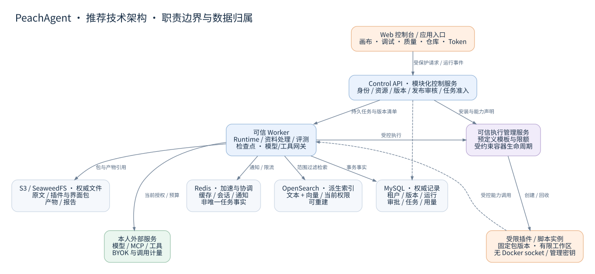

# 平台技术总架构

> 版本：v0.2 · 更新：2026-11-23 · 状态：拟实施架构；当前仅有文档，不存在下文所列应用服务或已验证的部署包。

## 1. 架构目标与取舍

PeachAgent 采用“模块化控制服务 + 独立执行进程 + 受控插件实例”的起步架构。它同时满足个人用户快速上手、代码能力可扩展、在途任务可追踪，以及后续单机 Docker Compose 交付。四个产品域用于划分职责和导航，不强制拆成四套微服务。

前期不引入服务网格、多集群、复杂灰度或独立消息平台作为基本依赖。运行状态和任务意图必须持久化，不能为了少一个组件就把长任务放在 HTTP 请求、浏览器连接或进程内队列里。插件代码独立执行，不能为了方便加载而进入主应用 JVM 并要求重启整个平台。

## 2. 推荐选型及验证边界

| 领域 | 推荐 | 选用理由与必要验证 |
|---|---|---|
| Web 控制台 | Vue 3、TypeScript、LogicFlow | 建立一致的管理与画布体验；先验证节点扩展、序列化、撤销/重做和自定义插件界面，不让画布数据格式成为执行唯一契约 |
| 控制服务 | Java 21、Spring Boot、模块化业务包 | 用户指定 Sa-Token 与 Java 生态相适配；以单一服务组织资源、权限、版本、审核和查询，避免早期分布式事务 |
| 模型接入 | Spring AI 适配层 + 平台 Model Gateway | 复用模型 API 与流式调用抽象；平台仍处理 BYOK、按请求配置、能力检查、脱敏、预算与用量归集 |
| 执行内核 | 平台工作流定义 + Spring AI Alibaba Graph 适配 | 优先复用图调度/中断能力；平台负责版本快照、持久状态、权限、外部效果和恢复策略；验证不足时更换适配实现而非改变产品文件格式 |
| 身份权限 | Sa-Token（用户指定） | 登录、权限与会话管理；资源归属、公共版本访问和服务执行身份仍在应用层统一校验 |
| 事务数据 | MySQL | 保存租户、项目、资源版本、运行、授权、审批、用量与任务意图；需验证 Graph 检查点适配，不假设框架自带符合要求的 MySQL Saver |
| 加速与协调 | Redis | 会话、短期缓存、限流、通知和队列加速；不能是已承诺持久任务状态的唯一副本 |
| 检索 | OpenSearch | 同一检索边界内提供文本与向量候选及权限过滤；具体混合与重排方案通过样本评估 |
| 文件与包 | S3 兼容接口，默认 SeaweedFS | 保存原文、解析产物、插件包、界面静态包、运行产物和报告；保留替换存储后端的接口 |
| 执行隔离 | 独立 Worker、可信执行管理服务、受限实例 | 插件执行不共享 API 进程权限；普通 Worker 和插件实例不拥有 Docker 管理权限 |
| 交付 | Docker Engine + Compose plugin | 单机默认服务、挂载和初始化随包交付；容量、版本和最低机器条件以发行实测为准 |

[Spring AI Chat Model](https://docs.spring.io/spring-ai/reference/api/chatmodel.html) 提供统一模型与流式接口；[LogicFlow 官方项目](https://github.com/didi/LogicFlow) 面向可定制图编辑。这里将它们用于适配和交互，租户隔离和业务执行语义由 PeachAgent 实现。[Sa-Token 官方项目](https://github.com/dromara/Sa-Token) 提供身份与权限相关能力，但引入框架本身不等于完成数据隔离。

[Spring AI Alibaba Graph 持久化说明](https://www.java2ai.com/docs/frameworks/graph-core/core/persistence/) 描述检查点机制。是否能满足 PeachAgent 的租户键、序列化、恢复和 MySQL 事务要求，需要阶段 1 原型验证；不能把内存检查点或已有 Redis 示例直接当作平台的耐久任务保证。

对象存储默认推荐 [SeaweedFS 官方单机 S3 与 Docker 用法](https://github.com/seaweedfs/seaweedfs)，后续需锁定镜像与具体启动参数。该选择服务于用户不自行编译依赖的目标；[MinIO 官方仓库](https://github.com/minio/minio) 当前说明社区分发转为源码、历史二进制不再维护，因此本方案不预设旧 MinIO 镜像作为长期默认。发行时仍需重新验证所有依赖可获取性。

## 3. 进程和模块职责

| 组件 | 负责 | 不承担 |
|---|---|---|
| Web / 入口代理 | 控制台、SSE 订阅、应用入口、HTTPS、静态资源路由 | 不持有服务商密钥，不直接连数据库，不把网页关闭解释成取消任务 |
| Control API | 账号租户、项目资源、版本、发布、审批、凭证绑定、任务受理、查询与预算准入 | 不在请求线程执行长任务，不执行租户代码，不直接接受任意容器管理参数 |
| Runtime Worker | 按固定运行清单执行工作流/Agent，保存步骤状态、检查点和事件，协调工具/模型/检索 | 不把模型计划视为已授权命令，不拥有宿主机管理权限 |
| Ingestion / Evaluation Worker | 资料处理、索引构建、批量评测与优化实验 | 可与 Runtime 使用同一代码发行、按角色启动；不强制首期独立微服务，但任务队列和限额分开 |
| Model / Tool Gateway | 解析本人绑定，检查当前授权，调用外部服务，记录用量和外部效果状态 | 这是受信逻辑模块，可运行于可信执行服务；不允许插件绕过治理直接持有全租户凭证 |
| 执行管理服务 | 按预定义实例模板启动/回收受限插件环境、报告健康与版本就绪 | 唯一在必要时接触受约束容器生命周期接口的组件；不向租户暴露任意 Docker API |
| 插件执行实例 | 执行指定包/版本/租户任务的自定义代码或脚本 | 无数据库管理密码、宿主根目录、Docker socket、其他租户工作区或平台会话 Token |
| 公共资源服务模块 | 管理提交快照、审核决定、公开副本和安装依赖 | 不让公共页面从作者可变私有草稿即时拼接内容 |

控制服务内部按 identity、workspace、asset、application、catalog、quality、usage、runtime-control 划分模块。先用清晰模块接口和事件降低耦合，有真实吞吐或团队独立交付需求后再拆进程；不要求开发第一天搭建分布式全家桶。

## 4. 权威数据与派生数据

| 存储 | 权威数据 | 派生/临时数据 | 关键约束 |
|---|---|---|---|
| MySQL | 个人租户、项目、资产元数据、不可变版本清单、当前绑定/授权、运行与步骤、审批/审核决定、用量账本、任务与 outbox | 查询统计可重算 | 私有对象必须携带 tenantId，必要时 projectId；公共条目使用独立公开实体与状态，不靠取消租户过滤生成 |
| S3 / SeaweedFS | 原始资料、发布包、界面包、长结果、报告及必要产物 | 可重建解析输出按类型登记 | 对象键是定位方式，不是授权；下载前检查当前资源范围，引用需含内容摘要与版本 |
| OpenSearch | 无唯一权威业务内容 | 文本/向量索引、公共目录搜索索引 | 从可访问版本构建；查询注入租户/项目/版本条件，返回后再校验当前撤权；索引落后不能导致越权 |
| Redis | 部分会话凭据需按会话策略持久化/失效 | 缓存、限流、工作通知、短租约 | 丢失通知可从 MySQL 任务表重扫；缓存键含租户与版本，授权失效不能只等长 TTL |
| 宿主挂载 | 内部主密钥、安装配置、恢复材料按部署契约保管 | 插件解包缓存、工作区、临时文件、日志 | 区分必须备份、可重建和到期清理；不把所有宿主目录挂到插件容器 |

调用明细在 MySQL 记账，原始大响应可存受限对象存储。模型秘密用加密存储并经受信服务按绑定解密；主密钥首次部署生成并持久保存，备份策略必须包括解密能力。密文数据库备份缺少主密钥无法恢复 BYOK 配置。

## 5. 平台核心契约

以下为拟定逻辑契约名，不是已存在接口或数据库表。

| 契约 | 至少包含 | 目的 |
|---|---|---|
| ResourceVersion | 类型、所有者、版本、内容摘要、依赖版本、配置结构、所需能力 | 草稿编辑与可运行/可审核版本分离；引用能稳定定位 |
| ApplicationManifest | 入口版本、Agent/工作流/Prompt/Skill/插件依赖、模型能力要求、参数结构、知识选择规则 | 发布检查一次记录全部依赖；默认不附带密钥值或个人资料副本 |
| ExecutionEnvelope | runId、parentRunId、tenantId、projectId、调用者/执行者、目标版本、授权/预算引用、幂等键 | 每次任务身份明确，异步队列和子任务不丢作用域 |
| NodeExecutionSpec | 节点类型/版本、参数、输入输出结构、效果类别、超时/重试策略、所需能力 | 内置与插件节点走同一校验和运行管理 |
| RunCheckpoint | 完成/待执行节点、变量与产物引用、循环与分支状态、人工等待、依赖版本、检查点格式版本 | 恢复依赖完整事实，而不是只存一段对话摘要 |
| InvocationRecord | 唯一调用/尝试 ID、来源任务、供应商、模型、状态、用量状态、时间、价格版本 | 统一 Token 和费用汇总，支持失败/重试/取消后的补报 |
| PublicRevision | 审核候选摘要、公开文件清单、资源类型、依赖、许可、权限声明、审核决定 | 所有公开入口读取相同已批准内容，禁止待审内容混入 |

执行者身份与浏览器登录者身份可以不同，例如应用所有者显式开放 API；必须通过明确的发布授权决定运行租户与凭证绑定，不能相信请求体传来的 tenantId 或模型推断的“作者已批准”。

## 6. 一次运行的数据路径

1. API 根据登录/调用凭据解析主体，验证目标版本、项目范围、输入和预算。生成运行记录、输入快照与待调度任务，在同一事务记录 outbox。
2. 调度器读取事务已提交的任务；Redis 可加速通知，但数据库可重新扫描。Worker 领取有期限的执行租约并使用递增 fencing 标识，避免过期 Worker 继续提交状态。
3. 每步执行前从固定版本读取配置，核对当前授权和预算。模型/工具请求获得唯一 invocationId 和 attemptId；外部写操作另记效果意图、幂等键及结果状态。
4. 成功结果、输出引用、步骤状态、用量事件与下一步意图持久保存。大文件先完成对象写入和校验，再建立可见引用；未引用的临时对象由清理任务回收。
5. 浏览器通过 SSE 或查询读取事件；断开连接只影响展示，取消需显式命令。事件可使用递增序号重连补取，最终状态从持久记录校准。
6. 任务因人工介入而暂停时保存检查点，释放执行实例或线程。恢复时按原版本重建上下文，同时重新核对当前凭证、权限、资源状态和额度。
7. 失败由状态机决定重试、转待核实、终止或等待处理。对外部效果无法确认时不能因为 Worker 租约到期就自动重复写入。

该路径提供可恢复的执行管理，不声称分布式外部系统支持“恰好一次”。框架重放、应用幂等和第三方幂等键分别解决不同问题，详见 [执行设计](03-execution-context-and-security.md)。

## 7. 插件、审核和动态生效

插件包、配置版本和前端包分别有不可变摘要。安装先校验依赖、权限和运行环境，完成实例/页面就绪后再更新“可供新任务选择”的引用；已有发布和任务使用显式版本。启停和引用切换通过共享注册表及变更通知传播，Worker 在调用前检查当前绑定，不要求重启全局进程。

当前权限不能固化在老清单里成为永久授权；运行快照保留当时使用依据，但每次新动作都核对当前有效范围。旧版本被风险隔离时，继续运行须按治理策略中止或等待处理，不能偷偷换成新版。具体关系见 [插件设计](02-plugin-runtime-and-ui.md)。

公开仓库以经过脱敏检查的发布快照为输入。审批对象包含可公开内容、代码、界面和依赖声明，批准后生成/开放独立公开版本；私有草稿修改不影响它。公开资源默认安装到使用者空间并重新绑定本人 BYOK。在线应用执行入口的身份和消耗另行定义，见 [公共仓库与发布设计](05-public-repository-and-application-release.md)。

## 8. 索引、异步任务与一致性

资料更新先生成新处理版本，解析/索引成功并满足可用条件后再切换活动指针；部分失败保留旧可用版并明确显示。删除和撤权先写权威不可访问状态，再异步清理索引和对象；任何异步滞后均不能绕过读取时权限检查。

评测和优化任务同样使用任务表、独立队列/并发额度和调用账本，避免大规模评测占满交互运行。涉及模型非确定性的任务需保留样本、参数和版本；重试生成新 attempt 事实，不能覆盖第一次结果伪装没有开销。

聚合统计、公共搜索索引和运行列表可最终一致，但展示需说明更新截止时间。授权撤销、审核未通过、敏感下载和预算准入不能依赖陈旧统计来放行。

## 9. 部署边界与恢复

默认 Compose 包包含入口/控制台、控制 API、Worker 角色、可信执行管理、MySQL、Redis、OpenSearch 和 S3 服务。默认向宿主公开主控制台 HTTPS 18443 和插件静态 HTTPS 18444 两类 Web 入口，不公开数据库或管理端口；默认不需额外 DNS 配置，证书、秘密及挂载契约以 [部署设计](06-docker-compose-deployment.md) 为准。

只有不可被租户代码改写的执行管理服务，在确有需要时获得容器生命周期能力；请求只可选择批准的执行模板、包摘要、资源限额和授权路径。API、普通 Worker、插件实例不能访问 Docker socket。该服务具有宿主影响能力，必须单独隔离和验证；容器本身不被宣传为绝对的多租户安全屏障。

恢复材料至少覆盖事务库、权威文件/插件包、内部密钥与版本清单。Redis 缓存和检索索引可按声明重建；在重建期间明确哪些能力暂不可用。版本回退还要检查数据格式兼容，不能只替换旧镜像。

## 10. 分期架构里程碑

| 阶段 | 架构产物 | 必须避免的返工 |
|---|---|---|
| 1 | 锁定依赖组合，个人租户与版本模型，模型网关与用量账本，持久任务原型，插件清单 | 全局单例模型密钥、只有内存状态、后补租户字段 |
| 2 | 平台图契约、画布适配、节点校验、统一表单和前端扩展宿主 | 将画布私有 JSON 直接当永久运行协议 |
| 3 | 工具/Skill/规则/上下文、代码实例、动态注册、预算与权限贯通 | JVM 动态加载造成全局重启，裸露宿主目录和密钥 |
| 4 | 资料版本流水线、检索策略注册、原文证据锚点、索引权限 | 只存 chunkId 导致切分对比失效，更新失败破坏旧可用库 |
| 5 | 评测任务、独立检验、Token 汇总与 Prompt 候选 | 只存总分、父子消耗重复、对保留样本反复调参 |
| 6 | 审核公共快照、发布清单、外部调用身份、恢复/协作/治理 | 公开草稿、作者凭证外泄、暂停任务被升级静默改写 |
| 7 | 锁定镜像和数据迁移、预设挂载、初始化、备份恢复、部署验收 | 只有 YAML 无可获取镜像，挂载不全、主密钥丢失、伪造可用说明 |

## 11. 风险与验证计划

框架适配、隔离强度、检索成本和单机容量均需真实验证。阶段 1 的验证任务应给出可复现实验、通过/失败条件、替代路径和对需求的影响；阶段 7 再在干净环境完成完整安装与恢复。未完成这些验证前，本蓝图仅表示当前推荐设计，不构成吞吐量、召回率或部署成功率保证。
