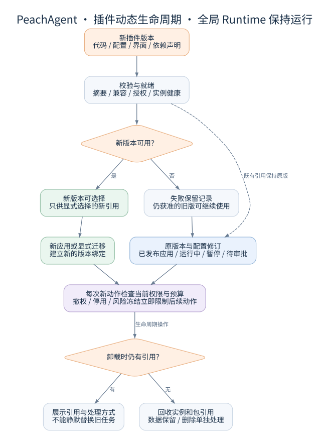
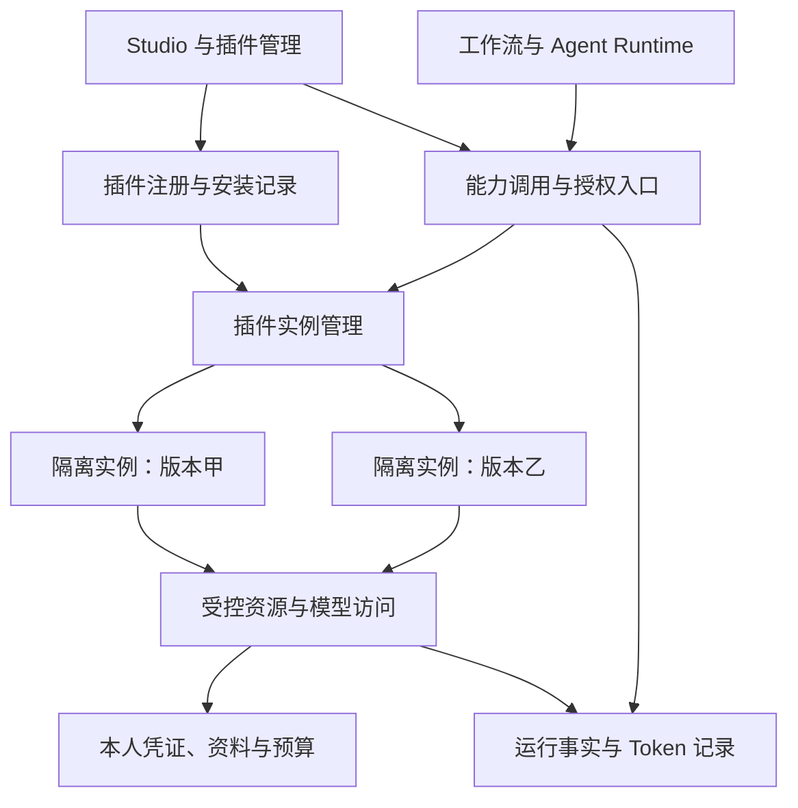
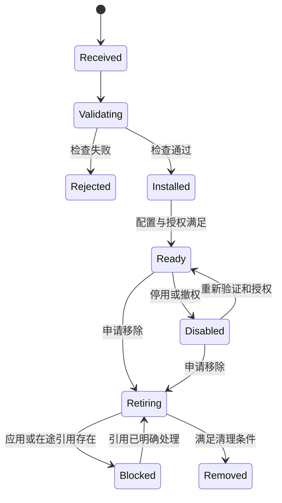

# 插件运行与自定义界面总体设计

> 版本：v0.2 · 日期：2026-11-23
>
> 状态：基于已确认需求的总体设计方案；尚未实现，接口、对象和状态名称均为拟定契约。
>
> 范围：配置插件、受控代码插件、自定义前端组件/页面、个人安装、动态版本和调用生命周期。
>
> 前置：[总体架构](01-platform-architecture.md) · 需求：[插件系统](../requirements/topics/01-plugin-system.md)

## 1. 设计目标与已确认约束

插件作者需要开发平台原本没有的节点、工具、模型接入、知识或评测能力，并提供专用界面；使用者需要在平台持续运行时安装、配置和更新这些能力。仅把新代码加入主工程依赖、重新编译并整体重启，不能满足本项目的自定义插件要求。

| 约束 | 本设计中的处理 |
|---|---|
| 个人账号对应一个个人租户，可有多个项目 | 安装、配置、授权、执行资料和用量均有租户与项目边界 |
| 个人用户可使用全部产品功能 | 功能可用性与跨租户权限、运行额度分别处理 |
| 模型及外部凭证全部 BYOK | 使用者绑定本人凭证，插件包和公共资源不携带作者秘密 |
| 不重启全部 Runtime 或主平台 | 平台保持稳定，配置/UI 动态注册，代码由可独立替换的执行实例承载 |
| 支持统一表单与自定义界面 | 标准表单由声明生成；专用组件/页面默认在受限 opaque iframe 中挂载 |
| 已发布应用不被插件更新静默改变 | 应用与运行绑定不可变插件版本、包摘要及配置修订 |
| 暂停、待审批也是在途任务 | 保留版本引用；恢复时核对当前授权，不隐式切换新版 |
| 所有模型消耗可追踪 | 插件模型调用归集到本人 Token 面板，保留真实功能来源及去重依据 |

本设计允许单插件实例重启、替换或回收。代码版本保留也不要求每个旧实例永久驻留：可以保留不可变包和配置，在仍有合法引用且满足运行条件时重新建立相同版本实例。

阶段 1—6 完成平台和插件功能，阶段 7 验证 Docker / Compose 交付环境。基础隔离执行必须在阶段 3 开放代码插件前成立，不能等部署阶段才补。

## 2. 插件与相邻概念的职责

| 概念 | 职责 | 与插件的关系 |
|---|---|---|
| Tool | 提供一项可调用能力 | 可由内置能力、远程服务或插件实现 |
| MCP | 外部工具与资料接入方式 | 插件可封装 MCP 配置或提供相关适配，但 MCP 注册不能代替新代码执行 |
| Skill | 任务指导、参考资料、模板及受控附属脚本 | 可被打包分发；阅读 Skill 不授予脚本执行权限 |
| Node | 工作流中的配置与执行能力 | 插件可新增节点类型、配置界面和执行逻辑 |
| Plugin Package | 可校验、可版本化的能力包 | 声明资源、代码、UI、依赖和权限 |
| Installation | 某个个人租户安装特定版本的事实 | 与其他用户的安装、配置和凭证相互独立 |
| Plugin Instance | 实际承载代码或特定会话的运行单元 | 可独立创建、替换、停止，不决定应用应使用哪个版本 |

核心对话、工作流、Agent、RAG、质量和运营路径由平台内置能力直接提供；插件是其可选使用的扩展机制，不能代替基础功能的实现责任。

插件同时服务四个产品域：Studio 负责开发配置与界面；Runtime 负责调用与执行；Quality 负责调试、评测和回归；Operations 负责安装、授权、版本状态、公共发布和用量查看。它不是单独新增一个只负责“资源列表”的页面。

## 3. 总体结构

### 3.1 稳定平台与独立插件执行

注册与安装模块保存能力和引用关系；Runtime 只调用平台已经校验的能力，不直接把用户包加载进自身进程。插件实例管理按指定版本和配置创建运行单元。模型、资料、产物和外部访问通过受控入口提供，调用事实归入现有运行和用量体系。

这些是逻辑职责，不要求每个框分别部署为微服务。plugin-host 表示可信插件控制角色，默认由 app / worker 的受信模块承载注册、校验、版本路由和 UI 管理，不新增一个必需的常驻服务，也不在这些进程中执行租户代码。需要管理执行环境的 execution-manager 处于独立信任边界，接受受限管理动作；插件代码不能继承其管理凭证。init / maintenance 是按需执行并退出的短期任务。默认部署职责以[部署设计](06-docker-compose-deployment.md)为准。

### 3.2 前端扩展结构

主控制台保留登录状态、租户/项目选择、导航和权限判断。默认主入口为 HTTPS 18443，插件静态入口为 HTTPS 18444，不要求部署者额外配置 DNS 或 hosts。插件 UI 在不开放 allow-same-origin 的受限 iframe 中运行，成为 opaque origin；平台提供前端桥接 SDK，完成配置、试运行、结果和受限导航通信。不同端口仅分离路由和 Web 来源，不能代替 Cookie 隔离。

普通字段继续由主平台统一表单处理。插件自定义“组件”可以视觉上嵌入节点配置或结果区域，但其代码不直接进入主平台 JavaScript 执行环境，也不通过任意远程脚本修改宿主组件树。

## 4. 能力包与拟定契约

以下名称是方案中的概念对象，不表示仓库已有对应类、数据库表、接口或 SDK。

| 对象 | 最少信息 | 保持的约束 |
|---|---|---|
| PluginPackage | 身份、作者来源、版本、包摘要、能力清单、内容清单、协议/SDK 兼容范围、依赖 | 一旦确认版本，内容不可原地替换 |
| ExtensionDescriptor | 能力标识、类别、输入输出、配置声明、错误类别、外部影响、需要的授权、UI 位置 | 发现、配置、调用和评测使用同一份能力声明 |
| Installation | 本人租户、来源版本、安装状态、允许项目、启用能力 | 其他租户安装同包仍是独立安装 |
| ConfigurationRevision | 配置内容、创建者、修订号、凭证引用、适用范围 | 修改形成新修订，不改写旧运行配置 |
| ApplicationBinding | 应用版本、能力、安装、插件版本、包摘要、配置修订 | 安装“最新版”不更新已发布绑定 |
| Invocation | 任务、尝试、能力、绑定、有效权限、预算和结果 | 执行者不能自行改写可信租户或资源范围 |
| UiSession | 租户/项目、安装/版本、配置修订、承载位置、iframe 实例、挂载代次、允许动作、过期时间、会话状态 | 可信绑定保存在宿主；导航、重载、卸载与撤权使旧会话失效 |
| DependencyReference | 应用引用、未结束任务引用、执行中调用引用 | 删除判断不能只统计活跃进程 |
| PluginDataReference | 个人租户、项目、插件命名范围、数据/产物版本、访问和保留规则 | 不授予插件直接修改平台内部资料的能力 |

输入、输出和配置声明拟采用明确版本的 JSON Schema，并发布平台实际支持的词汇与限制。JSON Schema 官方说明其用于描述和约束 JSON 结构；选用该表示法仍需要平台实现校验、兼容检查和错误展示，不会自动带来完整插件系统。[官方依据 S1](https://json-schema.org/draft/2020-12/json-schema-core)

能力类型至少覆盖 node、tool、model-adapter、knowledge-processor、retriever、evaluator、optimizer 和 resource。类型名称可在接口设计时统一，但不能把类别扩充伪装为已经支持执行；每一类必须有约定、SDK 样例和集成验收。

包中可包含静态界面产物、可执行产物和资源文件。路径检查、体积限制、禁止越界解包、内容摘要和依赖检查在受控准备区域完成，不在主 Runtime 中直接解包并执行安装脚本。声明和签名只能说明来源与完整性，不能证明代码行为安全或结果正确。

## 5. 后端执行与 SDK 方案

### 5.1 隔离运行单元

采用稳定的调用边界连接主平台与插件执行单元。自定义代码在受支持的执行档案中运行，档案说明语言运行环境、依赖形式、资源限制和允许能力；首个后端 SDK 与总体工程选定的后端语言保持一致，脚本档案逐种列出已验证的版本范围，不声称支持任意环境。

初始实例默认按照个人租户、项目、安装、插件版本和配置修订划分，不跨租户复用带可变状态的执行实例。运行工作目录与可用资料按调用授权分配，复用执行实例时必须处理上次调用遗留状态。对于不能可靠清理的插件，使用按调用建立和回收的运行单元。

主平台只提供受约束的“创建某已验证包实例、检查就绪、停止指定实例”等管理操作；插件声明不得直接指定任意宿主挂载、特权运行、管理端点或平台凭证。用户代码不拥有实例管理接口的权限。

Docker 官方把内核隔离、资源限制、运行配置和守护进程管理权限列为不同安全边界，并提醒只有可信主体应控制守护进程。因此，容器化插件仍需限制管理入口，不能向插件挂载 Docker socket 或把任意运行参数直接透传给容器管理端。[官方依据 S2](https://docs.docker.com/engine/security/)

### 5.2 配置插件与代码插件

| 形态 | 执行方式 | 变更方式 |
|---|---|---|
| 配置/资源插件 | 平台已支持能力解释其声明，引用本人资源 | 更新安装记录与新配置修订 |
| 代码插件 | 隔离执行单元通过稳定调用契约承载新逻辑 | 建立新版本实例，验证后供显式引用 |
| UI 插件 | 按包版本提供预构建静态界面，默认以 opaque iframe 挂载 | 新会话绑定新资产，旧会话按引用或失效规则处理 |
| 组合包 | 以上内容共享不可变包身份与明确依赖 | 先整体验证，再启用兼容组合；失败不部分成功 |

将插件加入主平台工程依赖并整体重启，只可作为平台自身升级的一部分，不是本需求的插件安装机制。主进程内热替换类、共享第三方依赖或注入任意宿主前端脚本也不作为首版方案：这类做法会扩大故障范围，且难以满足个人租户隔离与新旧版本并存。

### 5.3 SDK 必须交付的内容

| SDK/开发支持 | 应包含内容 | 实际验收 |
|---|---|---|
| 能力声明支持 | 模板、声明校验、错误说明、版本兼容规则 | 作者能得到可检查的能力包 |
| 后端能力 SDK | 输入输出、取消、截止时间、受控资源调用、错误与产物上报 | 新代码同时被工作流及 Agent 调用 |
| 模型适配支持 | 请求与响应映射、流式结果、用量提取、能力说明 | 使用本人 BYOK 完成调用并进入 Token 面板 |
| 前端桥接 SDK | 握手、能力请求、配置变化、结果展示、卸载清理 | 同一包提供统一表单和自定义界面 |
| 知识/质量 SDK | 证据与权限引用、评测结果及失败状态、候选优化输出 | 接入原有样本、比较和复核流程 |
| 开发验证工具 | 本地样例、受控调试、打包检查、兼容样例与问题报告 | 不修改主平台源码完成安装和调用 |

本文件不提供尚不存在的 CLI 命令或假设已发布的依赖坐标。实现 Issue 必须交付实际工具、使用说明与能够独立复现的样例。

## 6. 调用协议与结果事实

### 6.1 拟定调用信息

| 信息组 | 内容 | 谁决定 |
|---|---|---|
| 身份与范围 | 个人账号、租户、项目、应用版本、任务及当前操作 | 主平台依据已验证身份与真实任务确定 |
| 版本 | 安装、插件版本、包摘要、能力标识、配置修订 | 已发布绑定或明确选择的调试绑定 |
| 调用 | 唯一调用、尝试、输入及授权资料引用 | 主平台创建，插件不能自行冒用其他调用 |
| 限制 | 截止时间、有效权限、资源限制、预算关联 | 权限与预算控制模块确定 |
| 结果 | 输出、状态、错误类别、产物引用、外部结果是否确定 | 插件报告，平台验证并记录 |
| 用量观察 | 实际模型请求关联、供应商报告、估算状态、非 Token 用量 | 受控访问层核对，插件补充不能覆盖已知事实 |

对身份、权限和预算使用短时且限定用途的调用授权，不向插件透传用户完整登录令牌或任意跨租户访问能力。主平台身份与权限接入使用用户指定的 Sa-Token；租户归属和资源授权是平台必须实现的业务规则，不能假设框架会自动推导。

### 6.2 执行顺序与异常

1. 根据任务绑定解析精确插件版本、包摘要与配置修订；缺失时明确失败，不回退“最新版本”。
2. 检查账号/租户状态、项目范围、安装状态、当前授权、凭证可用性与共享预算。
3. 为该调用确定有效限制，建立或选择相符实例；实例就绪失败只影响相关能力。
4. 调用插件；涉及模型、资料、产物或外部服务时再次经受控入口检查。
5. 校验输出声明，核对用量、产物和外部结果确定性，记录完成、失败、取消或待核实。
6. 上层任务按结果推进；不能因为插件返回一段“成功”文字就宣布业务目标完成。

失败尝试应有独立尝试记录和真实消耗。具有外部影响的调用在结果不确定时不能盲目重复；可去重的内部结果并不保证外部业务动作“恰好执行一次”。是否重试取决于操作性质、可核实结果和已有授权，详细任务语义与[执行和上下文设计](03-execution-context-and-security.md)保持一致。

## 7. 安装、升级、配置与卸载

### 7.1 生命周期

状态用于某个安装版本，不把全部插件版本合并成一个“当前最新版”。下载或校验成功只说明包可进入下一步，不能跳过个人配置和授权。

### 7.2 动态升级

先准备新包、检查兼容和依赖，再创建该版本的执行与界面产物，完成就绪和样例验证。新版本只成为可显式选择的候选；已有应用的绑定保持不变。用户采用新版本时形成新应用/配置依据，不能原地修改已发布版本。

若新版本不健康，停止其新调用并保留失败记录，不切走旧应用。回退意味着选择一个仍存在、兼容且获准的版本及配置；已经发生的外部写入不能通过代码回退撤销。插件自有资料迁移若不可逆，需要先有恢复路径并显式说明影响。

### 7.3 配置与凭证不同步冻结

业务配置修订与代码版本一起固定；编辑形成新修订，影响范围在采用时明确。凭证使用受控引用：真实秘密可以由使用者轮换或停用，执行时检查当前状态，不为了复现旧任务而保存可无限继续使用的旧秘密。

运行记录保留所用凭证引用及必要版本识别信息，避免存储可直接使用的秘密。凭证轮换不要求重启全部 Runtime；某插件不能无中断调整连接时，仅替换该插件实例，并明确其在途行为。

### 7.4 暂停与待审批引用

必须分开统计：

- 应用版本对插件及配置的长期引用。
- 所有未结束任务的引用，包括暂停、待审批、等待补充信息。
- 正在调用实例的短期执行引用。
- 历史解释与法定/用户约定保留范围。

仅没有活跃调用不代表可以卸载。暂停任务可释放执行实例以节省资源，但保留可重建的不可变包、配置、状态和资料引用。恢复时优先核对当前权限；原版本不可用或被安全停用时明确阻塞，不能静默切换新版或恢复已撤销权限。

用户需要清理旧版本时，应先迁移或停用引用它的应用，再明确结束、取消或按支持路径处理未结束任务。安装内容的移除和个人资料的删除分别展示，不隐式联动。

## 8. 自定义前端界面与能力通信

### 8.1 扩展位置

| 位置 | 允许的职责 | 宿主保持控制的内容 |
|---|---|---|
| 配置区域 | 专用字段选择、预览与配置变化 | 保存、完整校验、权限和秘密绑定 |
| 调试区域 | 输入编辑、请求受控试运行、结果检查 | 实际执行权限、费用提示、取消和限制 |
| 结果区域 | 呈现获准结果或产物 | 资料访问范围、下载授权和版本标识 |
| 导航扩展页 | 在登记路径下提供完整插件功能页 | 平台主导航、登录、租户选择和跨页面权限 |

统一表单是平台标准能力，自定义界面是在同一配置契约上的额外呈现方式。插件不能通过 UI 自行保存另一个租户的设置，也不能因为用户点击某按钮就获得未声明的执行能力。

### 8.2 默认 opaque iframe 与静态入口

默认使用 `sandbox="allow-scripts"`，不开放 `allow-same-origin`、顶层导航、弹窗、表单提交、下载或其他额外能力。静态内容从 HTTPS 18444 提供，主平台从 HTTPS 18443 提供。每次挂载形成独立的 opaque 文档，不把所有插件放进一个允许同源访问的共享页面空间；插件不能凭相同静态入口相互读取 DOM、Cookie 或共享存储。

MDN 与 WHATWG 说明，不开放 allow-same-origin 会使文档使用不通过同源检查的特殊来源，脚本与存储行为会受到相应限制；allow-scripts 只恢复脚本执行。该浏览器行为是默认隔离的依据，SDK 不能假定 localStorage、宿主 DOM 或任意浏览器能力都可使用。[官方依据 S9](https://developer.mozilla.org/en-US/docs/Web/HTML/Reference/Elements/iframe) · [S3](https://html.spec.whatwg.org/multipage/iframe-embed-object.html#the-iframe-element)

静态入口由平台受信分发层控制，只提供经校验的指定包版本产物，不承载登录、平台业务 API 或任意反向代理。它不得转发或记录请求中的 Cookie / Authorization，不返回 Set-Cookie，也不允许包文件自定义响应头。静态资源直接打开时仍由服务端下发带 sandbox 限制的 CSP，避免只依赖父页面的 iframe 属性；CSP sandbox 必须是实际响应头，不能仅写在 HTML meta 或报告模式中。[官方依据 S14](https://developer.mozilla.org/en-US/docs/Web/HTTP/Reference/Headers/Content-Security-Policy/sandbox)

**端口不是 Cookie 安全边界。** RFC 6265 明确同一主机的 Cookie 不按端口隔离。因此，默认主会话由受信宿主维护，浏览器侧登录能力只在主控制台受信环境使用，不能下发给插件；不得以“18443 与 18444 不同”作为秘密保护的依据。如果选定登录方案使用 Cookie，应核对 Secure、HttpOnly、作用域和服务端 CSRF 防护，同时验证静态入口剥离敏感请求头与日志脱敏；这些措施不等于浏览器绝不会向该端口发送 Cookie。[官方依据 S12](https://www.rfc-editor.org/rfc/rfc6265.html#section-8.5)

平台业务 API 不对 `Origin: null` 开放 CORS，也不能仅依赖 CORS 阻止有副作用请求；服务端同时检查身份、资源权限和 CSRF 条件，拒绝不满足条件的请求。opaque 插件只能通过宿主的能力桥接取得允许的数据和操作。MDN 指出，不同沙箱文档都可能序列化为 null，不能把 `Access-Control-Allow-Origin: null` 当作可信来源白名单。[官方依据 S11](https://developer.mozilla.org/en-US/docs/Web/HTTP/Reference/Headers/Access-Control-Allow-Origin)

已有独立内容来源的部署可启用明确来源模式；必须验证每个信任范围的真实来源、Cookie 边界、允许的 sandbox 能力和精确 targetOrigin，不能把所有不可信插件合并为一个可互读的同源空间。这是可选部署档案，不要求默认安装者新增 DNS、hosts 或额外域名。

### 8.3 拟定会话建立与能力契约

以下是需要 SDK 与宿主共同实现的协议设计，不是已有接口，也不是浏览器自动提供的身份认证。

| 消息类别 | 例示动作 | 校验 |
|---|---|---|
| 生命周期 | 就绪、心跳、界面错误、卸载完成 | 绑定的 iframe、挂载代次、安装/版本、协议及当前会话状态 |
| 配置 | 读取允许字段、提出配置修改、请求校验 | 配置声明、当前项目、允许字段、敏感项遮蔽 |
| 执行 | 请求试运行、取消本人调试调用 | 当前身份、权限、BYOK、任务限制与必要确认 |
| 结果 | 读取本次结果、打开授权产物 | 任务和产物归属、当前权限、大小限制 |
| 展示 | 请求调整区域尺寸、打开登记扩展页 | 可用位置、有限尺寸和平台登记路由 |

默认 opaque 档案采用以下顺序：

1. **先建立宿主绑定。** 宿主确认不可变包摘要和静态入口，创建本次 iframe，记录租户、项目、安装、插件版本、配置修订、UI 位置、窗口引用及挂载代次。这些值以宿主记录为准，不采信插件自报的租户或“已批准”字段。每次尝试产生不可预测、短时有效、一次性的会话 nonce；它只是握手挑战，单独持有不能调用任何业务 API，不写入 URL 或普通日志。
2. **仅发送非秘密引导。** 宿主向指定 `iframe.contentWindow` 发送协议版本、界面类型、非敏感会话标识、挑战和过期信息。opaque 目标没有可精确匹配的普通来源，因此该引导使用 `targetOrigin="*"`，但目标始终是已登记的单个窗口，不向窗口层级广播。此时不发送主平台 Token、BYOK Key、凭证引用详情、业务配置、任务结果或私人资料。
3. **验证回应。** 宿主要求 `event.source === 当前登记的 iframe.contentWindow`，并检查 nonce 未使用、未过期、挂载代次一致、消息结构正确，且安装/版本/租户/实例绑定仍有效。默认档案预期 `event.origin` 为 `"null"`，但 null 本身不证明身份；其他 null 文档、兄弟插件、旧 iframe 或仅知道公开包标识的页面均不因此获准。明确来源档案还必须精确校验其登记 origin。
4. **建立短期专用通道。** 校验通过后把挑战原子地置为握手中，仅为该代次创建一个候选 MessageChannel，拒绝重复建立通道，再向上述指定窗口转移一个端口；在端口内完成本次挑战应答前不开放业务能力。挑战成功后原子地标为已消费，超时或重复应答关闭候选端口，不复用 nonce。全局 window 消息监听器此后不接受业务 RPC；宿主按自己持有的 MessagePort 与记录关联请求，而不是假设端口消息携带可信 event.source。
5. **逐次授予最小能力。** 端口拥有者只能提出声明内请求。每次 RPC 核对会话有效期、挂载代次、请求标识、消息大小、频率与允许动作，后端再检查当前个人租户、项目、安装授权、任务状态、资料范围、BYOK、预算和必要确认。满足条件后才返回完成该动作所需的最少配置字段或结果；主平台登录令牌和真实模型/外部密钥始终不进入插件 UI。未知或重复请求不得触发新的有副作用调用。
6. **先失效，再清理。** 导航、重载、切换项目/版本、撤权、会话过期、退出或卸载都使旧代次和端口失效，拒绝新增动作，清理订阅并取消可取消的待办回调。宿主主动导航前立即失效；发现非预期 load 或重载时关闭现有会话，不对任意新文档自动重建。重新挂载必须再次从宿主确认的固定产物发起，并使用全新挑战。已发生的外部动作仍按原任务保留真实状态。

MDN 说明 postMessage 的来源表示发送当时的来源，窗口之后可能导航；MessageChannel 只提供一对可转移端口。因此，窗口引用、挑战和通道解决的是会话绑定、防重放及能力路由，**不证明插件代码可信，也不保证对恶意导航的零时间窗口防护**。原文档可以滥用或转交已经获得的能力；实现必须以当前授权、最小资料披露和第 8.6 节的风险边界约束结果，不能把 nonce 宣称为包内容认证。[官方依据 S10](https://developer.mozilla.org/en-US/docs/Web/API/Window/postMessage) · [S13](https://developer.mozilla.org/en-US/docs/Web/API/MessageChannel)

对于有确定真实来源的可选档案，使用精确 targetOrigin 和 origin 校验，仍保留窗口、挑战、版本绑定与逐次授权。WHATWG 对消息格式、目标来源与消息滥用的要求同样适用；使用 opaque 档案不构成向任意窗口发送秘密的理由。[官方依据 S5](https://html.spec.whatwg.org/multipage/web-messaging.html)

### 8.4 挂载、导航与卸载

挂载前确定插件版本、UI 产物摘要、配置修订和承载位置；静态入口不得把固定版本请求重定向到 latest。准备会话、等待就绪和开始业务能力是分别可观察的状态，超时显示局部错误。旧应用继续使用其绑定的界面版本，不随新包安装静默更新。

关闭界面时由宿主先禁用会话，再关闭端口、清除回调和订阅、移除 iframe；不能只相信插件自己发送“已清理”。迟到的响应不能写入新项目、替代新配置或恢复旧权限。页面重载、异常导航和浏览器返回后的恢复均须验证会话是否仍有效，不复活已消费的挑战或端口。

界面故障提供关闭、重试以及适用的统一表单入口。SDK 限制消息频率、载荷、待处理请求数量和操作时间；主控制台保持错误诊断与恢复入口。可恢复的界面错误和过量消息需要实际浏览器测试，不能将此等同于针对任意恶意脚本的硬资源隔离。

### 8.5 静态产物与前端兼容档案

作者交付预构建的 HTML、脚本、样式和资源，不在浏览器或主平台运行任意构建脚本；通过平台 SDK 通信，不注入宿主 JavaScript 或引用宿主私有组件状态。首版 SDK 提供在默认 opaque 档案验证过的静态打包样例，优先形成不依赖运行时远程模块装载的独立产物，并清楚列出允许的浏览器能力。

跨来源模块脚本需要 CORS，不能假定改变 iframe 来源后原有开发服务器、动态 import、字体、Worker 或存储使用方式仍然兼容。需要模块或其他跨来源静态资产的档案，应分别验证其 MIME、CSP、无凭证资源访问和 CORS；若对明确可公开的静态资源放宽无凭证读取，也不得同步放宽主平台 API 或将私人包资料公开。未验证档案阻止启用并给出原因，不以开启 API 的 null CORS 或撤掉 sandbox 作为兼容修复。[官方依据 S15](https://developer.mozilla.org/en-US/docs/Web/HTML/Reference/Elements/script)

### 8.6 CSP、资料披露与实际限制

默认 CSP 对脚本与资源使用经验证的明确来源或摘要，限制连接、对象、嵌套框架、表单与后台 Worker；主控制台限制可嵌入静态入口。业务请求经宿主桥接，UI 不自行连接模型或取得全量资料。每种实际策略需要在所支持浏览器中验证，不能假定所有 CSP 草案能力已一致实现。[官方依据 S4](https://www.w3.org/TR/CSP3/)

iframe 与 CSP 不是绝对网络沙箱或硬性 CPU 沙箱，不能保证每个插件拥有独立浏览器进程，也不能保证恶意页面无法通过自身导航或其他浏览器行为外传已获准显示的数据。导航发生后关闭旧会话只能阻止后续受控能力，不能撤回已经交付的文本或阻止所有已经发生的出站请求。默认要求最少字段、最小结果片段、按需读取与明确用户授权；不需要明文资料的界面只接收受控引用。必须把“阻止未授权读取”和“已经披露给插件后绝对无法复制”区分开，后者不属于本方案可以承诺的安全效果。

## 9. 凭证、租户与受控资源

### 9.1 模型和外部服务

普通节点和工具插件通过受控模型/外部访问入口调用，不能直接读取全局凭证。入口根据本人绑定、允许目标和任务预算提供能力；平台没有公共模型兜底，缺少本人凭证即返回明确配置问题。

模型接入插件需要新增协议映射时，执行逻辑负责构建或解释请求/响应，真正访问供应商的受控入口核对目标并附加本人凭证；默认不向 UI 或一般插件代码返回秘密值。确有无法适用的服务接入应单独设计凭证暴露范围并得到用户授权，不得把全量凭证注入所有插件进程。

出站访问按能力和允许目标限制，阻止借自定义地址访问其他租户服务、平台管理端点或宿主资料。模型访问统一归集，不能通过插件私自调用外部模型而绕过额度与 Token 记录；无法可靠核对的用量明确标为未知或估算。

### 9.2 文件、资料与产物

插件通过受控资料引用读取本次获准内容，通过产物能力写入个人租户与项目范围。禁止获得平台通用数据库账号、全局对象存储凭证或任意宿主文件路径。

知识处理和检索扩展返回的证据必须验证文档归属、版本和当前授权；插件自报某个文档标识不是取得访问权限的依据。插件输出仍作为业务资料处理，不能自动变成 Agent 的更高权限指令。

### 9.3 资源限制

代码执行具备内存、CPU、进程/任务数量、时间、临时存储和输出体积限制，具体值根据实际执行档案与验收负载确定。取消先停止新增受控动作，再按能力结束或回收相关实例；已发送外部操作保留待核实状态。

Docker 默认不设置资源上限，因此不能只写“运行在容器里”就宣称预算和资源隔离已经完成。实现与部署验收需要证明所要求限制在目标宿主环境中确实生效。[官方依据 S6](https://docs.docker.com/engine/containers/resource_constraints/)

非 root、受限系统调用、只读基础文件系统、受控临时目录与网络等属于执行档案要求；宿主支持和例外需真实验证。Rootless 可减少相关权限风险，仍不替代每次资料授权和资源限制；是否采用更强执行边界由风险及验收结果决定，不把容器当成绝对安全保证。[官方依据 S7](https://docs.docker.com/engine/security/rootless/) · [S8](https://docs.docker.com/engine/security/seccomp/)

## 10. 用量、状态与资料迁移

### 10.1 Token 归集

每个真实模型请求有可去重的调用依据，并关联租户、项目、任务、父任务、插件安装/版本、功能来源与供应商报告。输入、输出、缓存或推理用量按供应商实际含义保留，不能把已包含的分类重复累加。

插件模型调用可产生于对话、Agent、知识处理/检索、评测和优化。任务来源与“由哪个插件实现”是不同维度；父运行、插件和评测报告引用同一次调用时，只在原始明细中计量一次。重试导致新的真实供应商调用应分别计量。

供应商原始用量观察与插件补充报告相互核对；无法证明的数字标为估算或未知。非 Token 的外部调用、处理页数和执行资源使用另列。完整指标口径与[知识、质量和用量设计](04-knowledge-quality-and-usage.md)保持一致。

### 10.2 插件状态与迁移

优先让插件通过平台提供的、限定租户/项目/安装范围的状态和产物能力保存数据；不授予插件直接管理平台内部表结构的权限。包升级涉及配置或插件自有资料变化时，在独立新修订中转换、验证，再由用户选择采用。

需要就地迁移或具有不可逆变化的插件，必须声明影响、备份或导出方式、允许回退的范围以及失败恢复办法。旧版本仍有在途引用时，不破坏它所依赖的资料结构；若不能共存，应明确阻止升级或先处理受影响任务，不能用“热更新”掩盖不兼容。

## 11. 公共发布和应用发布联动

私人插件的安装与公共发布是不同流程。私人开发和自用完成后，可以向公共仓库提交不可变包、说明、兼容范围、权限清单和验证资料；审核通过后他人获取仍需在本人租户安装，并填写自己的模型及外部凭证。

发布 Agent 或工作流时，检查其全部插件引用、资料引用和本人配置。缺失依赖、已停用版本或不满足的权限应成为可解释的发布/使用阻塞。复制公共应用时导入能力依赖和可共享内容，不继承作者私人安装、运行记录、秘密或知识。

公共下架、撤回、审核与公开范围由[公共仓库及应用发布设计](05-public-repository-and-application-release.md)统一定义；插件系统接收相应事件后核对新获取、已安装版本和在途执行的实际影响，不能自行把“目录下架”和“紧急撤权”混成同一含义。

## 12. 失败场景与处理责任

| 场景 | 处理位置 | 行为与保留证据 |
|---|---|---|
| 包损坏、越界路径、依赖不兼容 | 安装准备 | 拒绝启用，记录检查项，旧安装不变 |
| 新实例启动或就绪失败 | 实例管理 | 新版不可采用，保留诊断；无关任务和旧绑定可继续 |
| UI 不加载、消息格式错误、窗口/挑战/代次不符 | 宿主桥接 | 局部错误或拒绝消息；其他 null 文档不能冒充，超时关闭对应会话 |
| UI 导航、重载、旧通道重放或撤权 | 宿主桥接与后端授权 | 使旧代次与端口失效；不对新文档自动沿用授权，不把迟到响应应用到新上下文 |
| 静态入口收到 Cookie，或插件直调业务 API | 静态分发与业务入口 | 静态侧不转发、不记录敏感头；业务侧拒绝 null CORS 和不满足 CSRF/身份/资源权限的请求 |
| UI 依赖未支持的模块、存储或浏览器能力 | 包检查与 SDK 调试 | 展示不兼容项，不靠取消隔离或放宽业务 API 修复 |
| 插件调用超时或异常退出 | 调用与实例管理 | 记录失败或结果不确定，停止新增受限动作，按操作性质处理重试 |
| 撤权、凭证停用或账号停用 | 授权与资源入口 | 后续动作拒绝；版本固定不能恢复旧授权 |
| 原版本仍被暂停任务引用 | 依赖管理 | 保留引用和可重建资料，卸载默认阻止 |
| 新旧配置或资料不兼容 | 升级检查 | 阻止未经验证切换，说明迁移与恢复范围 |
| 用量上报缺失或冲突 | 用量归集 | 区分供应商事实、插件报告和估算，不写零成本成功 |
| 插件恶意返回其他租户资料标识 | 资料/产物入口 | 当前租户与权限核验失败，不信任插件自报归属 |
| 管理服务暂时不可用 | 平台与实例管理 | 已可运行能力按有效状态处理；需新建实例的调用明确等待或失败，不绕过管理限制 |

## 13. 核心取舍

| 选择 | 原因 | 代价及处理 |
|---|---|---|
| 主平台稳定、插件独立执行 | 满足不中断全局服务与版本并存 | 增加调用和实例管理成本，用清晰协议、就绪检查与按需实例控制 |
| 包版本不可变、配置独立修订 | 历史可解释，暂停任务可重建 | 多版本占用资源，按真实引用回收，不只看活跃进程 |
| 默认 opaque iframe；明确来源档案可选 | 保持零额外 DNS 安装，并隔离插件间 DOM / 存储 | 需要会话桥接与静态产物档案；不能假定任意前端代码、网络或硬资源隔离 |
| 统一表单与自定义 UI 并存 | 简单能力配置一致，复杂能力仍可扩展 | 两种表现必须通过同一配置校验，避免出现两套真相 |
| BYOK 通过受控能力使用 | 不共享作者秘密，统一权限和费用依据 | 服务适配需支持明确目标与凭证引用；缺少绑定必须阻止 |
| 实际依赖兼容检查 | 版本号本身不能证明功能兼容 | 需维护样例和兼容结果，先支持清楚列出的执行档案 |

## 14. 分期落地与验收

| 阶段 | 设计落实重点 | 必须取得的证据 |
|---|---|---|
| 1 | 插件身份、声明、个人开发入口、SDK 基本约定 | 声明完整性、双租户草稿隔离、开发资料 |
| 2 | 配置资源安装、自定义 UI、节点发现、宿主桥接 | 默认入口真实可用；不重启平台安装/UI 升级；四类挂载、挑战防重放和导航/卸载失效 |
| 3 | 隔离代码实例、模型接入扩展、动态版本、凭证与 Token | 新逻辑真实执行、新旧并存、撤权、引用保护、用量归属 |
| 4 | 知识资料与检索扩展 | 固定资料样例、权限核验、证据和评测比较 |
| 5 | 评测与优化扩展 | 判定复核、候选比较、回归、完整调用成本 |
| 6 | 公共发布、应用依赖、暂停/待审批与多 Agent 联验 | 他人安装自备凭证、等待任务固定版本、卸载与恢复边界 |
| 7 | Docker / Compose 环境验证 | 默认 18443 / 18444 无额外 DNS 可用；opaque UI、会话/凭证边界和后端执行限制生效；可更新、恢复与清理 |

实施时必须做的验证包括：

1. 不修改主平台源代码，使用交付 SDK 开发并安装新代码节点/工具与自定义界面。
2. 保持一个旧版本任务和一个无关任务运行，安装、配置并采用新版本，验证主平台和全局 Runtime 未被重启。
3. 在旧任务暂停或待审批期间升级插件，恢复时仍固定原版本；撤权后不能继续执行。
4. 同包安装到两个个人租户，资料、凭证、用量、插件状态及自定义 UI 会话相互隔离。
5. 伪造 null 来源但来自其他窗口、重复/过期挑战、错误代次、旧端口、导航/重载与卸载后的消息不能取得能力或写入新上下文；可选明确来源档案拒绝错误 origin。
6. 验证配置迁移失败、版本回退和被引用版本卸载，不破坏未结束任务与历史解释。
7. 运行知识与评测插件，在统一 Token 面板核对 Agent/RAG/评测/优化的分类和去重。
8. 抓取默认 UI 的握手与操作消息，确认引导没有业务内容和凭证，端口业务请求逐次校验；两个插件不能互读 DOM / 存储，登录 Token 与 Key 不进入 UI。
9. 检查同主机不同端口场景：静态入口不转发或记录 Cookie / Authorization，不提供业务 API，主 API 对 null CORS、伪造身份和不满足 CSRF 条件的请求拒绝；不能仅以浏览器读不到响应作为有副作用请求未发生的证据。
10. 使用 SDK 的预构建样例验证模块、资源、CSP 和支持浏览器；错误输出、超时、越界、用量重复、局部 UI 错误及消息过载可观察且按约定处理。对已获准数据外传与恶意 CPU 占用保留真实限制说明，不以未经验证的绝对防护代替验收。

部署必须提供受信插件控制、隔离代码执行和默认可用的 opaque UI 档案；缺少这些条件时不能将安装结果作为全功能上线验收通过。默认使用同一服务器的两个 HTTPS 入口，不把新增域名、DNS 或 hosts 当作隐藏前置；证书信任、端口冲突、网络、挂载、启动与恢复要求在[Docker / Compose 部署设计](06-docker-compose-deployment.md)中落地。本文件不虚构已存在的部署命令或测试结果。

## 15. 官方依据与验证边界

以下为 2026-11-23 查阅的官方资料，用于支撑标准与基础设施事实。插件协议、模块划分、生命周期和阶段安排是本项目拟定方案，并非这些资料提供的现成平台能力。

| 编号 | 官方资料 | 本文采用的事实 |
|---|---|---|
| S1 | [JSON Schema Core](https://json-schema.org/draft/2020-12/json-schema-core) | JSON 数据结构与约束的声明基础 |
| S2 | [Docker Engine security](https://docs.docker.com/engine/security/) | 隔离、资源和守护进程管理权限分别需要控制 |
| S3 | [WHATWG iframe](https://html.spec.whatwg.org/multipage/iframe-embed-object.html#the-iframe-element) | sandbox 行为、同源开放脚本风险和独立来源建议 |
| S4 | [W3C Content Security Policy](https://www.w3.org/TR/CSP3/) | 页面资源与执行来源控制；所引页面为工作草案，具体能力需浏览器验证 |
| S5 | [WHATWG Web Messaging](https://html.spec.whatwg.org/multipage/web-messaging.html) | 来源、数据格式、目标来源及消息滥用考虑 |
| S6 | [Docker Resource constraints](https://docs.docker.com/engine/containers/resource_constraints/) | 默认没有资源上限，需要显式设置并核对宿主支持 |
| S7 | [Docker Rootless mode](https://docs.docker.com/engine/security/rootless/) | 可降低守护进程和运行权限风险，不替代业务授权 |
| S8 | [Docker Seccomp](https://docs.docker.com/engine/security/seccomp/) | 系统调用限制属于运行环境保护的一部分 |
| S9 | [MDN iframe](https://developer.mozilla.org/en-US/docs/Web/HTML/Reference/Elements/iframe) | sandbox 未开放 allow-same-origin 时的特殊来源及存储/脚本限制 |
| S10 | [MDN postMessage](https://developer.mozilla.org/en-US/docs/Web/API/Window/postMessage) | targetOrigin、event.source、opaque 目标与来源随导航变化的注意事项 |
| S11 | [MDN Access-Control-Allow-Origin](https://developer.mozilla.org/en-US/docs/Web/HTTP/Reference/Headers/Access-Control-Allow-Origin) | null 可由多个不可信来源产生，不能作为可信 CORS 白名单 |
| S12 | [RFC 6265 §8.5](https://www.rfc-editor.org/rfc/rfc6265.html#section-8.5) | 同主机 Cookie 不按端口隔离 |
| S13 | [MDN MessageChannel](https://developer.mozilla.org/en-US/docs/Web/API/MessageChannel) | 双端口通信与通过 postMessage 转移端口 |
| S14 | [MDN CSP sandbox](https://developer.mozilla.org/en-US/docs/Web/HTTP/Reference/Headers/Content-Security-Policy/sandbox) | 响应头可约束文档，meta 和仅报告模式不能替代 |
| S15 | [MDN script](https://developer.mozilla.org/en-US/docs/Web/HTML/Reference/Elements/script) | 模块脚本跨来源获取需要 CORS |

目前没有产品代码、插件 SDK 或真实运行验证结果。后续 Issue 应以[插件需求](../requirements/topics/01-plugin-system.md)中的验收项为依据实施并记录证据；文档中的设计不能直接标记为实现完成。
