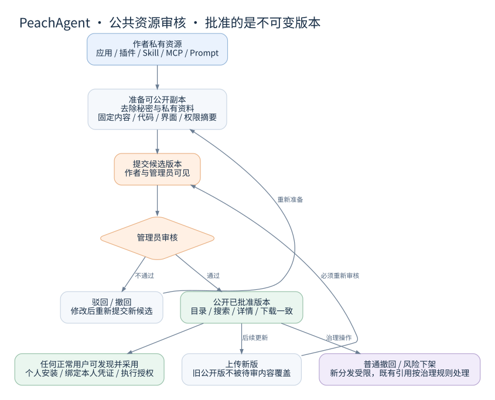
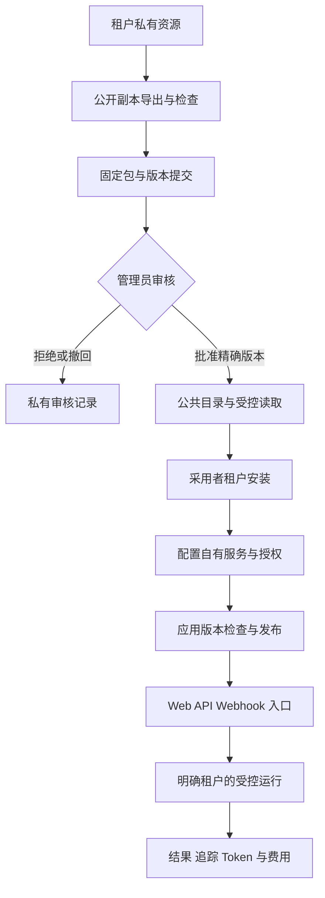
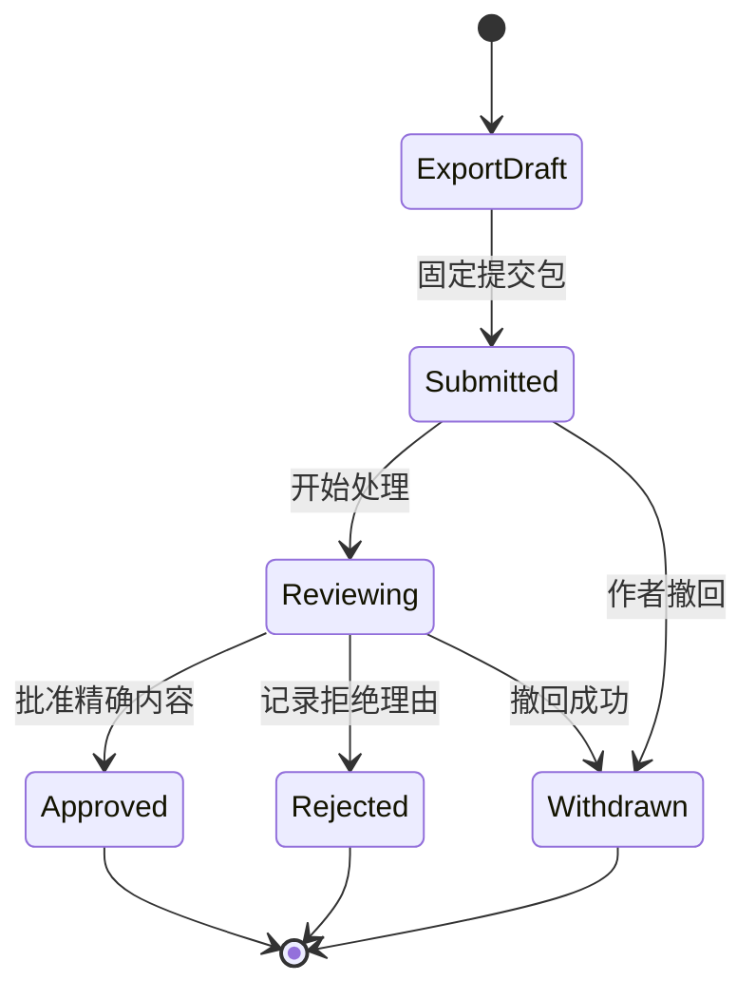
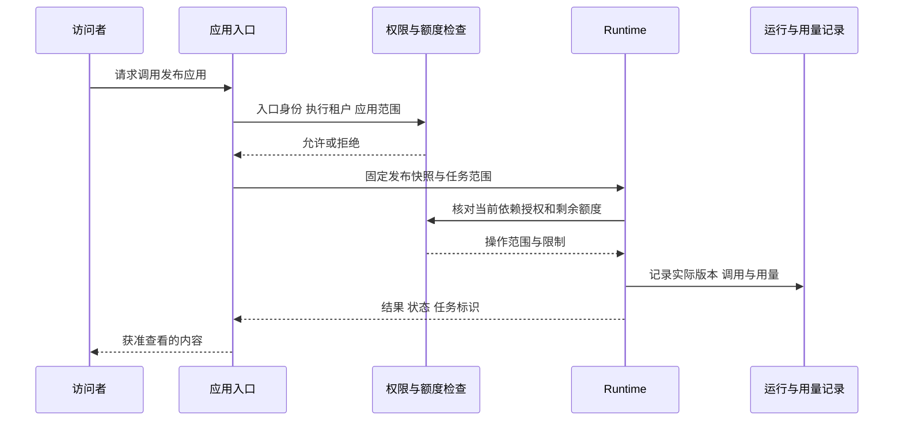

# 公共资源仓库与应用发布设计

> 版本：v0.2 · 日期：2026-11-23
>
> 类型：总体架构下的详细设计方案（Proposed），尚无产品实现。
>
> 需求依据：PA-HUB-001—PA-HUB-018、PA-P6-013—PA-P6-021，以及已确认的个人租户、用户自有凭据、动态插件和自定义前端边界。
>
> 本文中的对象、状态和操作名称是设计约定，不代表仓库已有类、接口或数据库表。

## 1. 设计目标与确定边界

公共仓库负责“将用户选择的一份资源版本，经管理员审核后提供给正常用户复用”。应用发布负责“让指定访问者在明确的执行租户和额度下调用一版应用”。两条流程共享版本和权限基础，但互不代替。

已确认的产品边界：

- 个人用户是租户，拥有全部产品功能；私用资源不依赖公共审核。
- 公共资源至少包括应用、插件、Skill、MCP、Prompt 模板；管理员审核通过的精确版本对所有正常用户可见。
- 模型和外部工具连接、凭据由用户配置；无平台共享模型池、免费服务额度或作者凭据自动共享。
- 插件包含后端和自定义前端；动态变更不重启整个平台或全部 Runtime，细节遵守[插件设计](02-plugin-runtime-and-ui.md)。
- 权限使用 Sa-Token 方案；本文不假定框架自动完成租户过滤、资源归属或后台任务权限检查，相关判定由平台执行。
- 阶段 6 完成产品发布运营能力，阶段 7 完成 Docker/Compose 部署和恢复验证；数据库、对象存储等基线遵循[总体架构](01-platform-architecture.md)。

### 1.1 三种对象必须分开

| 对象 | 所有者与可见范围 | 凭据与费用 | 修改规则 |
|---|---|---|---|
| 私有资源与安装 | 当前租户内获准主体 | 本租户自行配置的服务 | 可编辑草稿，形成私有版本 |
| 审核通过的公共包 | 作者保留来源，正常用户可读取批准副本 | 不含作者凭据，不提供调用余额 | 已批准版本不可原地改写；修改形成新提交 |
| 对外运行的应用版本 | 发布租户控制入口和访问范围 | 声明的执行租户使用其自行配置的凭据并承担消耗 | 入口可切换版本，在途任务保留原运行快照 |

采用公共应用的默认路径是复制配置到使用者租户，再配置其自己的连接和知识。只有应用负责人另行发布托管 Web/API 入口时，获准访问者才能在该入口指定的执行租户中发起任务；公共目录可见本身不授予这一能力。

## 2. 职责与主要数据流

导出不会把私有对象改成公共对象。审核针对固定包；安装生成采用者的记录；运行入口使用独立的访问凭据和权限。公共索引、预览和下载都必须经过当前公开状态检查，不能绕过审核记录直接访问底层文件。

本设计可作为同一平台内的独立职责模块实现，不要求为了公共仓库拆出额外微服务。跨模块采用明确操作和事件衔接，实际部署安排由总体架构确定。

## 3. 领域对象与关系

| 设计对象 | 核心信息 | 约束 |
|---|---|---|
| `PrivateAssetVersion` | 租户、项目、类型、私有版本、来源 | 始终按本租户权限访问；不能被公共目录直接引用正文 |
| `ExportDraft` | 私有来源版本、作者选择的文件和说明、待处理敏感项 | 可修改；只供作者准备公开材料 |
| `SubmissionPackage` | 原始发布包摘要、文件清单摘要、固定元信息、依赖、对象位置 | 提交后不可变；不含真实凭据或私有对象读取权 |
| `ReviewSubmission` | 提交包、作者、提交时间、状态、处理版本号 | 每次变更另提包；撤回和批准必须检查当前状态 |
| `ReviewDecision` | 处理人、决定、理由、时间、精确包摘要 | 追加记录；批准只指向对应提交内容 |
| `CatalogVersion` | 资源标识、类型、资源版本、批准记录、公开状态 | 只有当前批准且可公开的版本可被其他用户读取 |
| `TenantInstallation` | 安装租户、来源公共版本、采用时间、配置绑定、启用状态 | 不继承作者租户身份或真实凭据；明确新旧版本 |
| `ApplicationRelease` | 执行租户、应用版本、依赖快照、入口策略、检查结果 | 与公共包版本和平台软件版本分别管理 |
| `ApplicationEndpoint` | 所属应用、执行租户、访问主体/凭据、配额、启用状态 | 访问凭据限于相应入口，不能作为平台管理凭据 |
| `InvocationRecord` | 访问者、执行主体、入口、应用版本、根任务、事件来源 | 服务器确定执行租户；串联实际调用与用量 |
| `RiskRestriction` | 受影响精确版本或安装来源、理由、范围、恢复条件 | 可独立于普通目录撤回阻止危险的新执行 |
| `AuditEvent` / `Notification` | 操作者、对象、版本、状态变化、理由、受众 | 脱敏、按权限可见；通知重试不重做业务变更 |

同一个资源可以有多个私有版本、多个提交版本和多个公开版本；同一个公开版本可以被多个租户采用。版本之间保留来源，但不共享可变的私有配置。编号和标题可以调整，审核绑定的内容摘要与引用不能被同名资源替换。

## 4. 状态分层

### 4.1 审核状态

图中的完成表示该次提交的审核结束，不表示公共读取永远有效。修改被拒或已批准版本时，创建新的 `ExportDraft` 和提交记录，不将旧审核记录改回草稿。

### 4.2 公开、安装与运行状态分别存在

| 维度 | 设计状态示例 | 作用 |
|---|---|---|
| 审核 | 待审、审核中、通过、拒绝、撤回 | 说明某个固定包是否获得批准 |
| 公开 | 待生效、可公开、作者撤回、管理员下架、风险冻结 | 决定当前是否允许公共详情、下载与新安装 |
| 租户安装 | 待配置、待授权、可用、停用、升级中、移除中 | 决定采用者租户中的实际使用能力 |
| 应用版本 | 草稿、检查未通过、可发布、已发布、停止新请求 | 决定是否能作为运行入口的目标 |
| 调用 | 待执行、运行中、待人工处理、完成、失败、取消 | 说明任务事实，不随目录状态自动改写 |

审核通过但已下架的版本不能继续提供公共下载；目录普通撤回不等于删除所有租户私有安装；风险冻结可以增加执行限制；任务成功也不意味着资源适合公开。这些状态不能压缩成一个 `enabled` 标志。

## 5. 固定包、原包摘要与去密导出

### 5.1 导出顺序

1. 校验作者对私有来源版本的导出权，读取其明确选择的内容。
2. 生成独立公开副本；真实凭据、凭据引用、私人文档标识、私有运行输入及受限示例不能直接沿用，改为使用者需要填写的配置要求。
3. 检查附件、隐藏文件、示例、链接和依赖说明，展示未解决敏感项以及公开预览。
4. 作者确认后固定提交包，记录精确内容；不得修改私有源以完成“去密”。
5. 审核和最终公开都使用固定包，安装仅采用同一批准内容。

自动敏感项检查是辅助手段，不被描述为保证发现所有秘密；作者预览与管理员审核仍围绕真正公开的文件和说明进行。公开副本的清理规则应保留问题证据的脱敏摘要，而不是把发现的密钥复制进普通审计日志。

### 5.2 摘要层次

本方案建议为内容计算 SHA-256 完整性摘要，并记录以下不同用途的值：

| 摘要 | 计算对象 | 用途 |
|---|---|---|
| 私有来源版本摘要 | 本租户获准导出的来源快照 | 仅在私有导出记录中追溯，不能因此向审核者公开原件 |
| 原始发布包摘要 | 用户确认后提交的那一份公开发布包原始字节 | 防止审核前后原包被替换；这里的“原包”不是包含用户全部秘密的原工作空间 |
| 文件与元信息清单摘要 | 规范化的文件路径、每个文件摘要、受审说明、权限、依赖与版本 | 确保附件、前端文件、说明和依赖也属于批准范围 |
| 应用发布快照摘要 | 运行版本所使用的非秘密配置与固定依赖引用 | 使应用检查、版本切换和运行记录关联同一配置 |

摘要能用于内容一致性检查，不代表内容没有恶意行为或用户已授予执行权限。资源作者的声明也不能代替管理员批准与采用者授权。

上传解析阶段限制包大小、展开后大小、文件数量和路径范围；拒绝越界路径、意外链接和无法解释的包结构。预览阶段只读取材料，不自动执行其中脚本或加载自定义界面。远程可变文件不能充当审核后可被任意替换的插件执行内容；如资源包含外部参考，应区分“批准包内容”和“外部资料链接”。

## 6. 审核与公开的原子边界

管理员批准操作包含如下前置判断：

- 操作者具有公共仓库审核权限；普通租户作者身份不能批准自己的提交。
- 提交状态仍允许处理，未撤回，处理版本号与管理员看到的一致。
- 指定原包和清单仍存在，内容摘要与待审记录一致。
- 必需附件与依赖声明齐全，没有未解决的发布阻断项。

一次批准持久记录 `ReviewDecision` 及其精确包引用，并建立或推进相应 `CatalogVersion`。并发撤回、拒绝和批准通过状态条件与处理版本号进行比较：只有符合当前前置条件的一次变更生效，失败的一方返回已变化状态，不能覆盖另一处理结果。

公开检索索引和通知可以随后更新，但**读取授权以当前版本的权威公开记录为准**。索引尚未更新可能使新资源短暂不可发现，不能使未批准或已下架内容继续可读。采用可靠事件记录重试索引及通知更新，重复事件按业务变更标识去重，不生成多个版本或重复审核结果。

| 设计操作 | 必须满足的条件 | 结果 |
|---|---|---|
| 提交公开副本 | 作者权限、文件完整、确认公开范围 | 固定包与待审记录 |
| 批准 / 拒绝 | 管理权限、当前状态、精确摘要一致 | 不可覆盖的处理记录与明确状态 |
| 撤回待审 | 作者权限、尚未完成生效处理 | 该提交不可再获准公开 |
| 激活公开版本 | 对应批准存在，包仍一致且可读 | 当前可见版本记录 |
| 普通下架 / 风险冻结 | 相应管理权限与理由 | 公共入口限制；风险冻结另带执行限制 |

上述是逻辑操作，不是已经实现的 HTTP 路径或接口签名。

## 7. 身份、租户与公共读取检查

### 7.1 权限上下文

Sa-Token 承担已确认的身份和权限方案接入；应用层仍必须核对资源归属及动作。内部权限上下文建议明确区分：

- `actor`：正在进行操作的登录用户、审核管理员或获准应用访问主体。
- `actorTenant`：该主体通常归属的租户；管理员审核不通过切换成作者身份完成。
- `executionTenant`：一次实际任务绑定的执行租户，由受信入口或安装关系确定。
- `resourceScope`：资源版本、应用、项目、具体操作与可访问内容范围。

前端提供的租户、作者或执行身份只能作为待核查请求信息，不能覆盖服务器确定的授权范围。后台审核任务、索引任务、Webhook 和插件调用同样持有明确范围，不能因为没有交互式页面就跳过检查。

### 7.2 每个内容入口都检查当前状态

公共列表、搜索结果、详情、附件、图片预览、包下载、导出、安装和版本查询均在返回正文前校验：登录主体正常、目标版本已批准、当前公开状态有效、没有适用风险限制。私有源使用另外的租户授权，不从公共链接回源读取作者工作空间。

对象存储采用私有访问，默认产品基线遵循总体架构的 SeaweedFS 选择；本文不绑定具体客户端实现。公开内容经平台受控读取入口提供，不暴露能绕过当前公开状态的长期直达文件地址。搜索索引保存可公开摘要及版本引用，返回前仍过滤失效状态；旧索引命中、收藏和缓存键不构成访问授权。

下架先阻止新的受控读取，再清理索引、预览和相关缓存。已完成的合法下载无法远程撤回，正在传输或用户已读到的字节也不能被声称“从未泄露”；但后续新请求，包括预览分段和下载范围请求，必须重新遵守当前状态。

## 8. 五类资源的特殊处理

| 类型 | 包内固定内容 | 安装与执行规则 |
|---|---|---|
| 应用 | 可分享的 Agent/流程、Prompt 和依赖声明、公开示例；私有知识与凭据改为待绑定要求 | 创建采用者租户副本，验证其自有服务和权限后才能运行 |
| 插件 | 后端包、前端包、受审配置说明、能力和权限要求 | 交给插件管理器；公开批准不等于租户启用，不重启全部 Runtime；运行时按精确版本和当前授权检查 |
| Skill | 摘要、主指导、参考、脚本、模板的固定内容 | 渐进读取；脚本需已具备隔离与实际授权，恶意正文不能提升权限 |
| MCP | 连接器、连接说明、参数与凭据占位、能力及服务条件 | 用户配置自己的服务和凭据；分别发现工具、资源、提示模板，不能假定服务免费、公开或提供全部能力 |
| Prompt | 正文、变量定义、公开示例、适用说明 | 使用者自行提供输入和模型；不含私人会话、密钥或受限测试答案 |

MCP 连接器可以包含公开执行组件，也可以仅是连接说明；两者在目录中明确标注。外部 MCP 服务的授权来自该服务与使用者之间的关系，平台审核说明不产生第三方服务访问许可。

导入后的文档、README、MCP 返回资源和 Prompt 示例都是待处理内容。其中文字不能重写平台权限、请求审核者执行命令、伪造用户批准或自动读取秘密。渲染器使用受限展示方式处理说明和附件；插件自定义 UI 的实际加载只在租户启用、界面权限和隔离条件满足后进行，具体机制见插件设计。

## 9. 租户安装、升级与公开状态变化

采用公共资源时，固定 `CatalogVersion`、批准记录和包摘要，创建本租户安装记录；需要编辑的模板复制为本租户私有版本，并保留来源。依赖公共资源时锁定已批准版本；不能让“latest”在后台悄悄替换被批准内容或已发布应用依赖。

租户安装与公共更新的默认关系：

- 新公共版本经重审后才可供采用，租户自行决定是否升级。
- 新增权限、配置和外部依赖在租户升级时重新检查，不能沿用不适用的旧授权。
- 安装新版只提供可选择的新能力；完成用户明确采用及必要的应用版本切换后，新任务才使用对应新版，既有已发布应用的固定绑定不会自行改变。在途和待恢复任务保留所需旧版；独立插件 Worker 可替换，但整体 Runtime 不因单个插件变更重启。
- 停用和风险限制对未来调用生效，不因任务绑定了旧版而失效。
- 版本仍被应用、运行任务或等待恢复任务引用时，不进行无提示的物理清理；先显示影响并完成允许的停止或保留处理。

公共资源名称、作者主页和摘要不是执行定位依据。运行记录保存实际采用版本与来源，使同名资源、作者更名或新版发布不会改变旧任务解释。

## 10. 应用发布快照与检查

`ApplicationRelease` 固定下列非秘密内容和引用：

| 快照内容 | 发布时检查 | 运行时仍需检查 |
|---|---|---|
| Agent / 工作流版本 | 版本存在、配置有效、无不支持节点 | 当前运行授权、状态与限制 |
| Prompt / Skill / 插件版本 | 精确版本、依赖、兼容与必要权限 | 当前停用、风险、租户授权；不能凭快照恢复撤权 |
| 知识与检索配置 | 指定资料范围和版本可用 | 当前资料权限、删除与停用状态 |
| 模型和工具绑定要求 | 用户已经绑定本租户可用连接 | 当前凭据有效性、使用范围、服务可用性 |
| 输入与输出约束 | 必填输入、结果格式和公开范围明确 | 实际输入合规与结果访问范围 |
| 访问和额度规则 | 入口、访问主体、执行租户和限额明确 | 实时状态、总配额、调用次数和任务预算 |
| 质量材料 | 关联评测对象和版本、已知限制 | 不将旧评测视作当前外部服务永久保证 |

凭据只以本租户受控绑定引用存在，明文值不进入可导出快照；公共模板导出时连私有绑定引用也转换为待配置要求。凭据轮换或撤销遵守当前有效配置，不把发布时的秘密副本永久固化在应用中。

应用发布状态与公开资源审核独立：用户可以在本人租户发布私有应用而不提交公共仓库；提交公共模板也不自动创建可对外访问的服务入口。需要公开共享的包继续走审核，运行入口按应用权限开启。

## 11. Web / API 的执行身份与费用归属

每个运行入口绑定一个服务器确定的 `executionTenant` 和应用范围。访问者的身份用于判断能否调用以及能否查看结果，不允许访问者在请求体中改变执行租户、模型凭据所有者或可访问知识范围。

入口访问凭据与模型供应方凭据是两套不同用途的凭据。前者只授权调用指定应用，不能用于登录平台管理页面、枚举作者资源或读取服务密钥；后者只在执行租户的授权操作中使用，绝不返回访问者。

默认费用归属有两种清楚可见的情况：

1. **采用模板**：使用者复制到自己的租户，配置自己的模型和工具，全部调用记在自己的租户。
2. **获准调用托管应用**：应用负责人主动开放入口，访问者在该入口声明的执行租户内发起受限任务；运行记录同时保留访问主体和费用承担租户。不能将“访问者是谁”和“使用哪一租户的模型配置”混成一个隐式字段。

根任务、子任务、模型调用和工具调用共享稳定关联，阶段 5 的 Token 面板按实际调用记录归集。已报告、估计和未知用量独立呈现；缓存、推理等明细按供应方包含关系处理，不重复加到总量中。访问者只获得入口允许的结果与用量信息，不读取执行租户的全量账目。

## 12. Webhook 事件与通知

Webhook 入口同样绑定应用版本策略、执行租户、访问校验和额度。为每个接受事件保留来源、事件标识、接收时间、校验结果和关联根任务；对重放和重复事件按已约定的唯一标识及有效期判断，不能因为同一事件重复投递而无限启动任务。具体签名和字段协议在接口设计中固定，不由任意事件正文决定。

结果通知使用独立的投递记录，关联已经形成的任务结果。通知失败只重试受控通知，不重跑已完成任务。需要限制可接收目标、敏感字段、重试次数与有效期，变更目标重新检查权限；网络地址验证与出站限制沿用执行安全设计。

对外部副作用不宣称普遍“恰好执行一次”。若外部工具支持去重键或结果核查，则将事件与操作标识贯通；若结果不明且无法证明安全重试，进入人工核对或明确失败状态。事件去重不能被错误地当作所有外部写入都不会重复的保证。

## 13. 版本回退、撤回与风险下架

| 操作 | 新访问 / 新任务 | 已安装或在途任务 | 记录要求 |
|---|---|---|---|
| 新公共版本通过 | 新版可发现、采用 | 不自动改租户安装 | 新审批、精确摘要、版本差异 |
| 作者普通撤回 | 停止新公共读取和安装 | 默认保留合法私有安装，显示来源已撤回 | 原因、时间、影响与通知 |
| 管理员风险下架 | 停止公开访问和安装，并施加明确执行限制 | 对平台内明确受影响版本阻止后续危险调用，已执行动作如实保留 | 风险范围、依据、处置、恢复条件 |
| 应用版本回退 | 新请求路由至通过检查的旧版 | 既有任务保留原快照，不隐式重放 | 操作者、目标、依赖检查及影响 |
| 应用下线 | 入口不再接受新任务 | 显示完成、停止或待处理状态 | 入口状态、在途处理决定 |
| 删除私有源 | 不影响独立公共副本的内容一致性 | 先检查依赖，明确是否另需撤回公开版本 | 删除范围与保留理由 |

风险规则以资源精确版本、包摘要和安装来源关联为依据，不能凭同名名称误伤无关资源。平台可以限制其掌控的已知危险版本后续执行，不能保证删除平台外已下载副本；用户修改或重新发布资源仍需按私有授权或新的公共审核处理，不能借改名绕过已有来源限制。

回退应用前复核旧依赖是否还存在、仍获授权及未被风险冻结。失败时明确阻止，不能把缺失版本替换为另一个“最新版”。若旧执行环境不可恢复，应创建清楚关联的新任务并重新检查，不改写历史任务为仿佛从未发生变化。

## 14. 追踪、通知、清理与恢复一致性

审核和发布的操作审计至少关联操作者、身份范围、租户、资源与精确版本、原状态、新状态、原因、时间和相关任务。用户通知保存受众与业务事件关系，重试仅处理投递；通知未读或投递失败不逆转审批或发布。

公共素材、私有原件、租户安装副本、运行产物和审批记录分别定义保留周期。清理使用依赖关系和保留标记，不能删除仍被发布快照、运行中或待恢复任务引用的包。正文删除、引用保留、风险阻止和审计保留是不同处理结果，应在用户界面明确呈现。

阶段 7 的备份恢复应同时核对：

1. 资源版本、提交、批准、公开状态和风险限制记录是否一致。
2. 原始发布包及文件清单是否存在，摘要是否匹配。
3. 租户安装、应用发布快照和依赖引用是否仍指向同一版本。
4. 用户服务绑定与当前权限是否仍可用，恢复不能把已撤销秘密和权限无提示重新启用。
5. 已记录的删除、撤回与风险限制是否在恢复后继续生效。
6. 应用入口、未完成任务和用量记录是否能正确关联，恢复不重复记费或重做结果不明操作。

恢复完成前不开放缺失或不一致的公共版本。公共搜索索引从权威公开记录重新建立，不能依据旧索引反向恢复批准。包摘要不一致时隔离该版本并显示原因，不能自动修补内容后沿用旧审核；需要新内容时走新提交。

对象备份、密钥配置备份和数据库恢复的具体执行方法见[部署与恢复设计](06-docker-compose-deployment.md)。本文规定需要保持的对象关系与判定条件，不宣称已经执行恢复演练。

## 15. 实现验收与需求对应

| 验收重点 | 具体检查 | 需求对应 |
|---|---|---|
| 私有与公共隔离 | 私有源不变、未审核内容各入口不可读 | PA-HUB-002、PA-HUB-004、PA-HUB-009 |
| 内容不可替换 | 修改原包、前端文件或说明后不能沿用批准 | PA-HUB-005、PA-HUB-007、PA-HUB-012、PA-HUB-016 |
| 并发审核正确 | 批准与撤回竞争只有符合状态的操作生效 | PA-HUB-005—PA-HUB-008 |
| 五类资源可复用 | 另一正常个人用户逐类采用并完成自有配置 | PA-HUB-001、PA-HUB-010—PA-HUB-015 |
| 凭据归属清楚 | 作者密钥不在包、示例、预览或运行结果中；无共享模型池兜底 | PA-HUB-004、PA-HUB-010、PA-HUB-014、PA-P6-014 |
| 应用发布独立 | 公共模板批准不自动产生作者托管调用权 | PA-HUB-011、PA-P6-013、PA-P6-014 |
| 三种入口一致 | Web/API/Webhook 均绑定正确执行租户、当前权限和配额 | PA-P6-014、PA-P6-015、PA-P6-019 |
| 更新不伤害旧任务 | 公共新版、租户升级、应用切换的版本关系可追溯 | PA-HUB-016、PA-P6-009、PA-P6-016 |
| 普通撤回与风险处置分开 | 公共访问、合法副本、危险执行限制及通知符合各自规则 | PA-HUB-017、PA-HUB-018 |
| 恢复后没有复活旧权限 | 审核摘要、依赖、删除与撤权记录逐项检查 | PA-P6-021；阶段 7 部署验收 |

实现时将上述检查分解到对应 Issue 和 PR；本次文档修改只提交设计与需求，不代表这些行为已经通过产品测试。

## 16. 相关设计

[总体架构](01-platform-architecture.md) · [插件与前端扩展](02-plugin-runtime-and-ui.md) · [运行、上下文与安全](03-execution-context-and-security.md) · [知识、质量与用量](04-knowledge-quality-and-usage.md) · [Docker/Compose 部署](06-docker-compose-deployment.md) · [公共仓库需求](../requirements/topics/02-public-repositories.md) · [阶段 6 需求](../requirements/phases/phase-06-publishing-and-operations.md)

本文以已确认产品范围和本仓库需求编号为依据，方案中的状态、对象与操作为项目拟定设计。涉及 Sa-Token 的具体接入与接口使用由运行安全设计核验，未在此假定任何第三方组件自动提供公共审核、租户隔离、发布或恢复保证。
