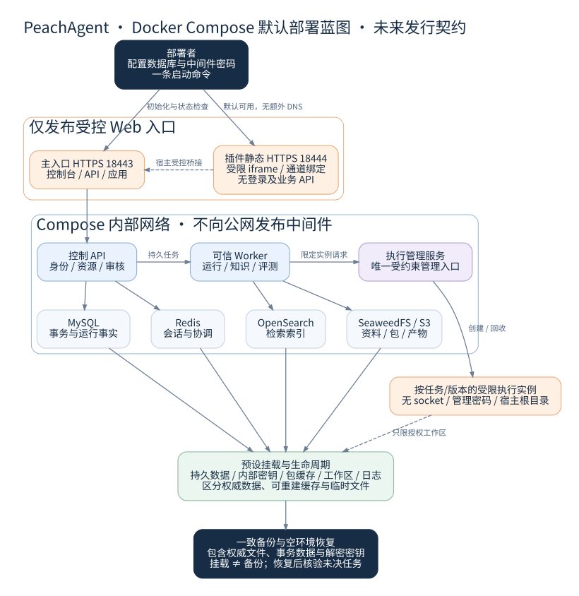
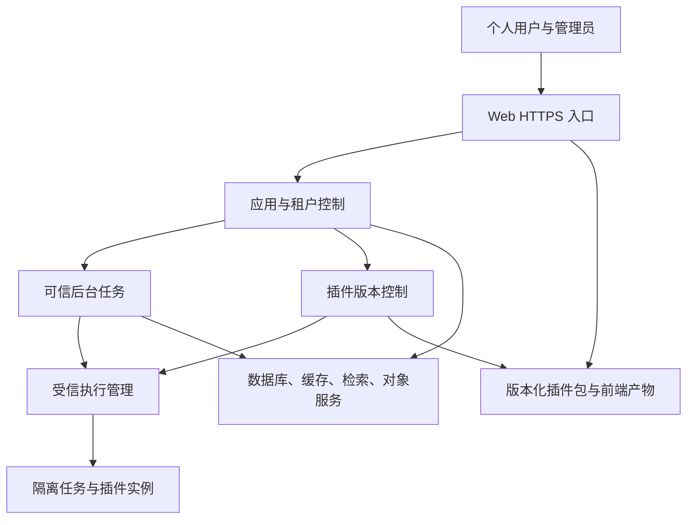
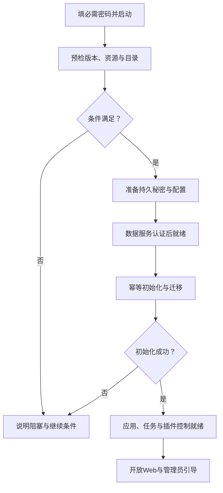

# 单主机 Docker Compose 部署技术设计

> 版本：v0.2 · 更新：2026-11-23
>
> 状态：Proposed，供后续实现遵循的技术蓝图；目前没有真实 Compose 文件、应用镜像、启动脚本或部署测试结果。
>
> 对应需求：[第 7 阶段部署需求](../requirements/phases/phase-07-docker-compose-deployment.md)。
>
> **本文的服务名、端口、目录、配置键、命令与交付文件均为拟定契约，不是仓库现有可执行入口。**

## 1. 目标与决策

正式交付采用单主机 Linux、Docker Engine 与 Docker Compose 插件。维护者提供完整版本包和可获取镜像；部署者满足公布的宿主条件后，只填写数据库与中间件的必要秘密，再通过一个启动入口完成默认安装。平台技术密钥、目录、服务发现、初始化和健康等待由交付包处理。

模型及工具执行采用个人 BYOK：平台启动不要求管理员填写全局模型 Key；每名用户登录后在 UI 配置自己的凭证。凭证的保存、授权与用量归属沿用个人用户租户和 Sa-Token 身份设计。公共应用、插件、Skill、MCP、Prompt 只公开经管理员批准的指定版本，不随包分享个人 Key。

| 决策 | 本版方案 | 边界与代价 |
|---|---|---|
| 部署形态 | 单主机 Compose，应用与必需中间件一起交付 | 不承诺多机高可用；宿主故障会影响整套服务 |
| 对象存储 | 默认推荐 SeaweedFS 单节点 S3；业务依赖 S3 兼容边界 | 发布前验证所需 S3 操作、权限、持久化和恢复；不是任意 S3 服务无差别兼容承诺 |
| 默认数据位置 | 宿主 `/srv/peachagent` 下按职责分目录，使用明确绑定挂载 | 便于维护和备份；需验证文件权限、磁盘与宿主约束 |
| 入口 | 主控制台 HTTPS `18443`、插件静态 HTTPS `18444`，不要求特权低端口和额外 DNS | 首启生成本机证书，核对指纹并建立两入口信任；公网可信证书或独立域名为可选配置 |
| 安装升级插件 | 插件控制与版本化执行实例独立于全平台重启 | 必须做版本路由、旧任务排空、隔离和失败恢复 |
| 开发流程 | AI 按 `ci` 模板推进，普通 PR 做必要真实验证 | 本期不建设需求提交触发 Issue 的自动流水线 |

阶段 1—6 的完整功能是阶段 7 部署联验对象。部署包不能通过关闭代码插件、自定义前端、公共审批或个人 BYOK 等已确认能力换取“可启动”。

## 2. 当前状态与正式支持边界

当前仓库交付的是需求和设计。本文件不声称存在 `compose.yaml`、镜像仓库地址、可执行辅助命令或成功日志。具体依赖版本必须经过阶段实现的兼容验证，并在发布清单固定镜像标签及摘要，不使用未验证的 `latest` 作为交付依据。

正式支持 Linux 上的 Docker Engine 和 Compose 插件；具体发行版、CPU 架构、版本范围与资源配置写入实际发布验证记录。Windows Docker Desktop 可以给出开发说明，但不自动增加一个正式上线平台承诺。Docker 官方给出了 Linux Compose 插件的安装途径，宿主必须先具备可用 Docker 环境。[Docker Compose 插件安装](https://docs.docker.com/compose/install/linux/)

“一次启动”的前提包括：

- 取得完整交付包，可访问包中锁定的镜像，或已准备相同摘要的离线镜像。
- 宿主具备经过发布验证的 CPU、内存、磁盘、文件权限和必要内核条件。
- 必需密码已填写，默认入口未冲突，数据目录可创建或复用。
- 操作者有权执行 Docker 和创建指定目录；安装辅助工具不得暗中提升权限。

OpenSearch 官方说明其 Linux 部署需满足宿主 `vm.max_map_count` 等条件；容器启动不能替代宿主检查。本方案在启动辅助中预检，发布说明固定适用值与诊断方式；需要修改宿主时明确指出影响和必要操作，不假装任意默认系统都能启动。[OpenSearch 安装条件](https://docs.opensearch.org/latest/install-and-configure/install-opensearch/)

支持环境需在交付前准备好相应宿主条件。用户不需要安装独立数据库、编辑内部服务地址或手写初始化 SQL；环境前置检查与“安装时仅填写必要密码”是不同层次。

## 3. 推荐服务与拓扑

以下为拟定 Compose 服务及逻辑角色职责，最终命名随实现固定在发布清单。默认常驻组合为 Web/入口、API、Worker、执行管理与四类数据服务；插件控制可由 API/Worker 内的受信模块承载，不强制再拆一套常驻服务。初始化和维护任务完成后退出。业务依赖和共享存储范围与总体架构保持一致。

| 服务 | 职责 | 可接触的范围 |
|---|---|---|
| `web` | Vue 控制台主入口与独立插件静态入口、HTTPS、业务代理及受控资源分发 | 两入口职责分开；插件入口不承载登录或平台API；发布产物只读 |
| `app` | Java/Spring 应用、Sa-Token 身份、租户与资源管理、执行编排、凭证与预算、审批 | 应用数据库、授权的数据服务、平台密钥；无 Docker 管理接口 |
| `worker` | 知识处理、评测及任务调度等可信后台工作 | 服务身份和任务授权；不在此进程直接运行用户代码 |
| `plugin-host`（逻辑角色） | 可信插件控制：版本注册、安装校验、实例路由及前端版本管理；默认可在 app/worker 的受信模块中承载 | 经验证的插件包、资源元数据与执行管理入口；不执行租户代码、不授予租户宿主权限 |
| `execution-manager` | 创建、限制、停止和回收隔离执行实例 | 仅固定执行规格；如需要 Docker 管理能力，仅此受信管理边界持有 |
| `mysql` | 用户、租户、配置版本、任务事实、评测、审批等结构化记录 | 仅内部应用和初始化／维护任务 |
| `redis` | 会话、必要临时状态、协调及缓存 | 内部受控客户端；缓存与可恢复事实分清 |
| `opensearch` | 文本与向量检索、关联索引版本 | 业务服务受控访问，禁止租户绕过授权直接查询 |
| `objectstore` | SeaweedFS 单节点 S3，对象资料、知识原文及正式产物 | S3 服务身份与业务授权；不开放内部管理界面 |
| `init` / `maintenance` | 短期初始化、版本迁移、备份和恢复 | 按任务授予的管理秘密及目录，完成后退出 |

图中的数据节点代表多项独立服务，不表示所有容器共享全部存储权限。业务服务、隔离执行实例与数据服务的网络访问另按第 7 节限制。

### 3.1 对象存储取舍

推荐 SeaweedFS 的单节点 S3 形态。其官方 README 和 `weed mini` 文档提供单节点容器使用及数据目录配置；本方案仍须对发布选定版本验证所用上传、下载、分段上传、签名、访问控制与恢复操作。[SeaweedFS 官方 README](https://github.com/seaweedfs/seaweedfs/blob/master/README.md) · [weed mini 官方指南](https://github.com/seaweedfs/seaweedfs/wiki/Quick-Start-with-weed-mini)

不默认采用历史 MinIO 社区镜像。当前 MinIO 官方 README 说明社区版转为源码分发、历史二进制不再维护；让安装者自行编译，或未经验证继续依赖旧镜像，不符合本项目现成部署包目标。这是本版的组件取舍，不宣称其他 S3 兼容实现不能使用。[MinIO 官方说明](https://github.com/minio/minio/blob/master/README.md)

SeaweedFS 官方指出，未配置凭证时 S3 可处于开放访问模式；因此本方案在首次接受业务请求之前完成认证配置，并验证未签名访问被拒绝。Master、Filer、管理界面等端口不向租户网络或宿主公网开放，不能仅凭 S3 已有密码就认为所有内部入口都安全。[SeaweedFS 认证说明](https://github.com/seaweedfs/seaweedfs/wiki/Quick-Start-with-weed-mini#default-s3-access)

## 4. 发布包契约与最小操作

### 4.1 计划交付文件

以下文件目前均未实现。开发时应按已确认契约补齐，不在本文中提供貌似可以运行的空 Compose 示例。

| 拟定文件 | 应包含内容 |
|---|---|
| `deploy/compose/compose.yaml` | 全部默认服务、固定镜像引用、网络、资源限制、挂载、健康和依赖关系 |
| `deploy/compose/peachagent` | 统一启动、状态、停止、维护操作入口及前置检查 |
| `deploy/compose/config/defaults.env` | 内部服务名、默认目录和端口等无需安装者逐项填写的值 |
| `deploy/compose/config/secrets.env.example` | 仅列必须填写的数据库和中间件秘密，不含可用默认密码 |
| `deploy/compose/config/secrets.env` | 操作者的受保护本地填写文件，不进入源码或公共发布包 |
| `deploy/compose/config/templates/` | 初始化需要的服务配置模板，不含真实秘密 |
| `deploy/compose/init/` | 初始化与迁移材料，按版本执行并记录状态 |
| `deploy/compose/health/` | 真实就绪检查与诊断规则，不能只检查进程存在 |
| `deploy/compose/release-manifest.json` | 应用与插件运行能力版本、镜像标签及摘要、兼容范围、文件校验信息 |
| `deploy/compose/OPERATIONS.md` | 安装、证书、BYOK、启停、升级、备份恢复和清理说明 |

操作者取得包后，从秘密示例生成本地填写文件，填写第 5 节必需密码。在已满足前置条件的发布包目录中，拟定启动入口为 `./peachagent up`。**这只是未来命令契约，当前不可执行，也未经过测试。**

维护入口同样计划由统一辅助命令提供 `status`、`stop`、`logs`、`backup`、`restore` 和 `upgrade`。最终名称、参数和行为须以实际实现及验证记录为准；不能把本文示意直接复制为已存在的操作说明。

### 4.2 安装者不需要完成的工作

默认包已经确定内部服务地址和凭证引用方式，不要求安装者连接数据库手工建表、修改容器 hosts、逐个补目录挂载、在浏览器配置内部数据库密码，或在安装机器上构建所有镜像。

有域名、受信 TLS 证书、非默认目录或入口需求时，可以使用明确的可选覆盖配置；这些不是默认安装的隐藏必填项。已有外部数据库或外部 S3 的接入可以后续支持，但本期完整默认包不依赖它们。

## 5. 秘密、初始化身份与 BYOK

### 5.1 安装输入表

表中字段为本项目拟定的统一填写键，不代表所有组件原生支持这些环境变量或 `_FILE` 变体。启动适配器应将其转换为选定版本实际支持的配置方式，并验证秘密没有暴露在命令参数或普通日志。

| 拟定字段 | 谁填写 | 用途与发放范围 |
|---|---|---|
| `PEACH_MYSQL_ADMIN_PASSWORD` | 部署者 | 数据库初始化与维护管理身份；日常应用不使用该管理账号 |
| `PEACH_MYSQL_APP_PASSWORD` | 部署者 | 限定业务库权限的应用身份 |
| `PEACH_REDIS_ADMIN_PASSWORD` | 部署者 | Redis 管理初始化；业务客户端使用限定命令和范围的身份 |
| `PEACH_SEARCH_ADMIN_PASSWORD` | 部署者 | 搜索安全初始化与维护；业务查询账号单独建立 |
| `PEACH_OBJECT_ADMIN_SECRET` | 部署者 | S3 认证初始化；应用对象访问权限单独限制 |
| 平台凭证加密密钥、内部服务身份、签名材料 | 首次启动生成 | 写入受保护持久目录，按服务最小范围分发 |
| 初次管理员引导材料 | 首次启动生成 | 一次性、短有效期，仅宿主部署者取得；使用后失效 |
| 入口证书和私钥 | 首次启动生成，或选择受信证书覆盖 | 入口服务使用；指纹在本机启动结果中展示 |
| 模型、工具、嵌入、重排、评测等个人 Key | 用户在部署后 UI 配置 | 按个人租户、服务及实际授权使用，不装入公共配置和插件包 |

秘密文件限制宿主读取权限；应用仅获得需要的秘密。Compose 支持按服务授予文件形式 secrets，但这不是自动加密宿主文件或完整密钥管理系统。本地文件权限、备份保护与密钥生命周期仍由平台交付方案负责。[Compose secrets](https://docs.docker.com/compose/how-tos/use-secrets/)

启动辅助不得把 `secrets.env` 当作任意 shell 代码执行；按规定格式解析，保留密码中特殊字符的原义，错误时说明字段而不打印秘密。实际组件只支持环境注入时，通过受控启动适配使用，不声称其原生支持未经验证的文件参数。

### 5.2 首次初始化与重启

1. 确认这是空安装、已有安装或未完成初始化，识别数据目录和部署标识。
2. 验证管理员填写的秘密，生成缺少的必要技术秘密；已有密钥必须复用。
3. 生成服务配置、目录权限和入口证书，记录证书指纹。
4. 等待数据服务认证后就绪，创建限定权限的业务身份、业务库、必要索引和对象命名空间。
5. 逐版本执行幂等初始化，记录成功、失败与可恢复位置。
6. 创建一次性管理员建立材料，只有部署者能从宿主本机取得。
7. 业务服务就绪后，显示访问地址和剩余需要在 UI 完成的个人配置。

已经初始化的安装不得因重启、替换镜像或初始化文件变动而重置密码、清空数据或生成新的加密主密钥。未完成步骤可以核对后继续，不能用“删除卷重来”作为普通修复方法。

首次管理员引导不是公开默认密码：建议由启动辅助在部署者终端显示一次性领取信息，必要副本放在宿主受限文件，不能进入所有容器可读日志；领取后失效。身份管理仍走 Sa-Token 所在应用的正式账号与权限流程。

### 5.3 公共资源不携带凭证

审批的是明确资源版本及可公开内容。安装公共应用、插件、Skill、MCP 或 Prompt 时，使用者得到定义、说明和经批准资源，而不是发布者的会话、知识、Key 或内部连接密码。

调用需要本人 Key 时，以 UI 配置或明确的授权引用完成；缺少时阻止对应外部调用。部署者填写的中间件密码服务于平台基础设施，不是个人用户的模型费用账户。

## 6. 默认目录、挂载与生命周期

以 `/srv/peachagent` 为默认数据根；发布包可位于另一目录。下表为拟定绑定挂载，安装辅助创建目录、分配经验证的 UID/GID 和权限；不能使用全目录可写来解决权限问题。

| 宿主相对目录 | 拟定容器位置／消费者 | 权限与生命周期 | 备份要求 |
|---|---|---|---|
| `data/mysql` | MySQL 实际数据目录 | 仅数据库服务写；长期保存；停止不删除 | 一致备份必需，恢复到匹配版本 |
| `data/redis` | Redis 持久状态目录 | 仅 Redis 写；缓存、锁、会话等语义分类 | 记录持久状态；恢复时不盲复活过期锁与授权 |
| `data/opensearch` | OpenSearch 实际数据目录 | 仅搜索服务写；索引版本受控 | 首期完整冷备覆盖；可重建内容也保留来源与重建说明 |
| `data/objectstore` | SeaweedFS `/data`（按锁定版本核实） | 包含对象及所需元数据，S3 身份控制 | 对象与元数据必须成套备份 |
| `plugins/packages` | 可信插件控制可写，执行实例仅挂其指定版本只读 | S3 权威包的版本化本地解包／分发副本；校验一致，不因升级立即删旧任务所需包 | 保存可加快恢复；缺失时按固定版本与摘要从权威包重建 |
| `plugins/ui` | 前端资源入口只读，可信安装过程写 | S3 权威前端包的本地发布副本；按插件版本隔离，私有访问校验，非任意目录公开 | 保存关联版本；可从权威产物按摘要重建 |
| `tasks/tmp` | 指定任务的暂存子目录 | 执行实例仅能读写所属任务范围；到期清理 | 默认非正式备份，可恢复任务必要材料另行保留 |
| `tasks/outputs` | 输出暂存交接，随后归档对象服务 | 区分未归档、已归档与失败；避免清理未完成交付 | 未归档正式成果纳入一致备份 |
| `logs/audit` | 授权业务服务写，维护读取 | 脱敏、按保留规则归档；用户仅查看有权事件 | 纳入约定审计保留范围 |
| `logs/runtime` | 各服务限定日志目录或受控日志驱动 | 限量轮转，不无限增长；不能含 Key | 保留故障所需窗口，非全部永久保存 |
| `state/platform-secrets` | 仅所需业务服务只读；受控生成和轮换流程写 | 加密主密钥和服务身份长期保存；租户代码不得挂载 | 与对应密文和版本匹配地加密备份 |
| `state/tls` | Web 证书只读；证书维护流程写 | 持久化，重启不无说明换指纹 | 纳入恢复计划；受信证书按管理规则处理 |
| `state/init` | 初始化与维护任务 | 安装标识、迁移记录与一次性引导状态；不作为唯一业务事实 | 与数据库版本核对 |
| `backups` | 仅维护任务写，宿主授权人员读 | 每次备份独立目录、清单、校验、版本；不被应用随意覆盖 | 必须支持复制到独立故障域；同机副本不等于异机保护 |

具体 MySQL、Redis、OpenSearch 容器内部路径必须由选定镜像确认，不能根据示例猜测。数据根不会整体挂进 `app`、插件实例或用户任务，只有明确所需子目录才能进入相应服务。

Docker 绑定挂载可以让容器改写宿主文件；只读挂载和宿主路径选择是本方案的权限边界之一，不能认为“用了挂载”就天然安全。[Docker bind mounts](https://docs.docker.com/engine/storage/bind-mounts/)

普通 `stop` 保留目录；清理命令只处理可清理暂存、旧运行日志和确认不再引用的包。正式数据重置、卸载并清除资料须采用独立、明确影响范围的操作。持久化和备份是不同能力，不能把挂载存在当作已验证可恢复。

## 7. 网络、端口和执行隔离

### 7.1 网络与入口

设计区分入口网络、可信服务网络、数据网络与受限执行网络。服务只加入所需网络；租户代码实例不加入数据网络，不直接连接 MySQL、Redis、OpenSearch、SeaweedFS 管理端或平台凭证库。

默认只发布两类 Web 入口：主控制台 `https://<服务器地址>:18443`，插件静态内容 `https://<同一服务器地址>:18444`。内部 API、管理接口和对象读取通过受控主入口处理；插件入口不代理平台业务 API、不承载登录。必要 MCP 回调优先复用主 HTTPS 入口和明确路由，不为每个插件开放任意宿主端口。使用默认 IP 入口不要求用户编辑 DNS 或 hosts；独立内容域名是可选覆盖方式。

发布配置必须写明绑定地址和预期访问范围。Docker 端口发布的默认可达范围不能当作安全策略；还要考虑宿主防火墙与 Docker 自身网络规则。[Docker 端口发布](https://docs.docker.com/engine/network/port-publishing/) · [Compose 网络](https://docs.docker.com/compose/how-tos/networking/)

本机自动证书覆盖检测到的实际入口地址，提供加密材料，但不等于浏览器或公网服务已经信任它。启动输出两个 Web 地址及证书指纹，部署者核对并为实际入口建立信任；正式公网域名可以配置受信证书。地址无法可靠确定时明确说明，不凭空生成一个看似可用域名。无法被外部服务信任的回调地址应明确不可用，不通过忽略证书校验伪装成功。提交个人 Key 前必须有可验证的受保护连接。

### 7.2 用户代码与宿主管理

`worker` 和 `plugin-host` 的控制部分只执行受信平台代码。用户插件代码、辅助脚本和任务执行进入独立实例，不与管理进程共用可访问全部秘密的执行环境。

执行实例必须具备：非 root 身份、最小能力集合、禁止提权、受限进程数量、CPU/内存/执行时间限制、只读基础文件系统和指定可写暂存、明确文件白名单、受控外网访问、停止及回收。不得挂载宿主根目录、整个平台数据根、其他租户目录或平台密钥；不使用宿主网络、进程命名空间或任意设备访问。资源限制需要显式配置，不能假定容器自行限制所有消耗。[Docker 资源限制](https://docs.docker.com/engine/containers/resource_constraints/)

默认 API、普通 worker 和任何用户执行实例都不挂载 Docker socket。实现若通过 Docker 创建动态实例，管理接口只交给独立受信 `execution-manager`；它不加载租户代码，接口仅接受经过平台授权的固定规格，禁止任意镜像、任意宿主挂载或任意 Docker 参数。socket 文件即便以只读挂载，也不意味着 Docker API 只读。

执行管理边界必须视为高权限控制面：不公开端口、不将其凭证交给租户、仅接受经过身份和操作范围校验的请求。实例启动只能使用发布时允许的基础镜像与已验证插件包；实例获得任务级能力引用，不获得管理账号和全部用户 Key。

Docker 官方指出守护进程具有较强宿主控制能力，容器隔离还受权限、挂载和内核风险影响。上述限制与恶意越界场景验证共同构成基线，不能声称 Docker 本身提供绝对多租户安全。若选定后端无法满足隔离要求，必须修正执行方案；不能通过关闭已经承诺的插件能力来宣布完整部署验收。[Docker Engine security](https://docs.docker.com/engine/security/)

### 7.3 默认自定义前端可用且不要求 DNS 配置

插件前端按明确插件版本生成和保存产物，由 `18444` 静态入口加载；更新不要求重建整个平台控制台镜像。私有产物访问遵守个人租户和版本可见范围，不能把所有插件目录变成匿名公开目录。

默认每个插件界面在不开放 `allow-same-origin` 的 sandbox iframe 中运行，形成 opaque origin；独立端口负责入口分工，**不同端口不隔离 Cookie**，也不能仅凭所有插件共享一个静态端口就宣称它们彼此隔离。插件 HTML 直接访问时也必须保留相应响应约束，不能在脱离预期承载页面后获得可读宿主 Cookie 的路径。[HTTP Cookie 标准的端口边界说明](https://www.rfc-editor.org/rfc/rfc6265#section-8.5)

初始握手只传最少的非敏感会话挑战和通道材料；不能把来源字符串 `null` 或通配目标当作可信身份。宿主按预期发送窗口、一次性 nonce、当前安装/版本/租户和界面生命周期建立专用 MessageChannel，后续限定动作、载荷和会话有效期。导航、卸载、切换租户、退出和撤权时通道失效。精确规则及浏览器验证按[插件前端设计](02-plugin-runtime-and-ui.md)落实，本文不把跨页面通信简化为“收到消息就执行”。

平台 API 不信任来自 `null` 来源的浏览器跨域请求；CORS、CSRF 与实际后端权限检查共同生效。插件静态入口不设置平台登录状态；浏览器可能附带的同主机 Cookie 由可信入口忽略，不回显、不转发给插件服务或普通日志。模型 Key、完整登录令牌、中间件秘密和任意后端调用权不发送给插件界面。

支持真实独立域名时可提供精确 origin 的可选承载模式，采用明确 targetOrigin 及来源校验；不能把这个可选部署条件变成默认安装的隐藏必填项。插件能力通过受控宿主桥接取得，不直接复用主站私有状态。

iframe 与 CSP 不保证插件对已经获准显示的业务内容绝对无法外传，也不保证独立浏览器进程和硬资源配额。平台限制可传内容、网络与消息能力，授权时明确范围，并验证默认承载下多插件互访、导航、重复消息和越权请求。默认包必须真实跑通自定义前端，不能只留下“未配置域名所以不可用”的入口。

## 8. 启动顺序与真实就绪

Compose 的普通依赖顺序不保证服务可以处理业务请求。设计使用真实健康条件等待持久数据服务，初始化任务成功结束后再允许应用对外就绪；选定 Compose 版本需验证 `service_healthy`、`service_completed_successfully` 等能力。依赖在后续运行中故障，仍需应用重连、超时与就绪状态处理，不能误以为启动依赖解决全部故障。[Docker 启动顺序](https://docs.docker.com/compose/how-tos/startup-order/)

| 检查对象 | 计划判定内容 | 不能作为成功依据 |
|---|---|---|
| MySQL | 认证和业务库可用，迁移状态正确 | 进程存在或端口打开 |
| Redis | 指定业务身份可完成必要操作 | 无认证 PING 成功但业务账号不可用 |
| OpenSearch | 安全配置、目标单节点状态与必要索引可访问 | 套用多节点健康目标导致永久误判，或只检查 HTTP 可连接 |
| 对象服务 | 认证开启，业务身份能操作受控测试对象并清理 | 管理首页能打开、未签名请求也成功 |
| 初始化 | 预期版本步骤有完成记录且与实际数据一致 | 某个文件标志存在 |
| 应用与任务 | 依赖、身份、运行记录和调度入口满足所声明能力 | 无个人模型 Key 就把整个平台判死，或忽略必要依赖失败 |
| 插件执行 | 受控实例可启动、限制有效、回收可查 | 仅插件列表页加载成功 |

健康检查不得打印秘密或产生不可控收费调用。外部模型、工具和个人余额的验证通过用户授权的试用流程记录，与平台基础就绪分开。

## 9. 插件动态安装、升级和故障

1. 安装过程取得明确版本包，验证结构、兼容范围、内容校验、所需权限和可见状态。
2. 代码与前端产物写入新版本位置，旧可用版本保持不变。
3. 可信执行管理启动或准备新版本实例，进行不越权的就绪检查。
4. 仅当所需检查通过后，使新任务路由至新版本；既有任务保持原版本或按明确策略结束。
5. 新前端入口解析到匹配版本，不要求整个控制台重新构建或全部 Runtime 重启。
6. 旧实例完成任务后回收；旧包只有在无运行、版本和恢复引用后才能清理。

安装失败不改变当前可用版本。运行中插件故障只影响其受控调用和对应任务，整体平台继续显示真实状态。公开版本需管理员批准，已安装私有版本不因另一版本获批而自动公开。

插件版本切换与整个平台镜像升级分别处理；本方案不以 `docker compose restart` 全体服务实现所谓热升级。

## 10. 备份与恢复

### 10.1 首期选择：可说明停机窗口的一致冷备

为简化单主机的一致性，首期采用可控维护窗口：暂停新的收费调用、资源发布和资料写入，等待或受控结束在途任务，记录未决外部操作；确认所有写入者停止后，对匹配版本的持久状态形成一份完整备份。可以接受明确停机窗口，不假装已经支持不停机一致备份。

备份清单包括数据库、Redis 中需保留的状态、搜索数据或验证过的重建依据、SeaweedFS 对象与元数据、插件包和前端产物、未归档正式输出、必要审计、配置与发布清单，以及对应密文所需的加密密钥和服务身份。

不能对持续写入的数据目录随意打包后声称一致。Docker 提供数据卷备份恢复的基础操作，但应用跨服务一致性、密钥配套和业务复核由 PeachAgent 的维护流程负责。[Docker 数据卷与备份](https://docs.docker.com/engine/storage/volumes/#back-up-restore-or-migrate-data-volumes)

### 10.2 备份记录

每份备份包含时间点、应用/中间件/插件版本、任务状态、目录和对象清单、文件校验、加密信息、必要恢复条件与完成结果。秘密与数据受保护保存；应支持复制到独立磁盘或外部目标。只存放在原宿主 `backups` 的副本不能抵御整机或磁盘同时丢失。

默认备份不把已过期缓存和无意义暂存当作业务事实恢复，也不通过备份复活已撤销访问权。对需要保留的会话和任务状态，恢复后根据当前事实检查有效性。

### 10.3 恢复流程

1. 在隔离的空环境读取备份清单，核对数据、密钥、版本和校验信息完整。恢复环境先保持维护状态，不自动调度旧任务或开放任意外部效果。
2. 准备匹配的目录权限与服务版本，恢复同一备份时间点的数据和秘密。确认旧安装的调度与恢复环境不会双活，重新核验任务租约和执行实例身份；这不等于替换仍需解密旧资料的主密钥。
3. 按数据服务、初始化状态核对、业务服务的顺序恢复，禁止执行破坏性重复初始化。
4. 检查两名用户的资料隔离、个人凭证解密与授权调用、公共审批版本、插件前端及代码能力、知识检索和任务状态。
5. 外部结果不明的任务保留待核实，不因恢复再次发送外部操作。
6. 输出恢复报告；缺少密钥或必要对象时明确失败或列出不完整范围，不显示整体成功。

备份存在不等于恢复可用。阶段 7 至少需要一次在隔离空环境的完整恢复证据。

## 11. 平台升级与兼容恢复

升级前核对目标版本、数据迁移、依赖版本、插件兼容和剩余空间，建立已验证的升级前恢复点。进入维护状态后执行必要迁移，完成健康与关键场景检查再恢复正常访问；固定新旧版本和结果。

若新版本修改了数据格式，回退不能只换成旧镜像。仅当旧程序与当前数据明确兼容时可采用应用回退；否则恢复相互匹配的旧数据、对象、插件与秘密。恢复到升级前备份可能影响备份后的写入，必须说明时间范围，不能静默丢弃。

部署者修改初始密码文件也不等于现有数据库或中间件已完成密码轮换。对已有安装，凭证修改需要受控轮换、客户端同步和验证；初始化变量只影响首次创建的组件必须如实记录。

阶段 7 的发布不能依赖一个未提供的“自建镜像流水线”。维护者交付已锁定的镜像与包，现场操作只负责取得和启动它们。

## 12. 日志、容量与清理

运行日志、业务审计和任务输出分别管理。日志携带版本、租户及运行关联标识，并按权限展示；不得包含完整个人 Key、中间件密码或无权正文。日志驱动和目录有明确保留与大小限制，避免占满宿主磁盘。

对搜索、对象资料、插件版本、暂存和备份分别记录空间；接近已配置限制时提醒并限制可判断的新写入。资源数字应由实际版本和首批负载确定，发布包必须给出验证过的预置值和适用规模，不能把未测试的机器配置当作最低承诺。

清理时先检查引用：运行中的任务、当前批准版本、恢复点仍需使用的插件包或产物不能删。临时文件清理范围与正式产物归档状态分清。平台数据重置与日常维护入口分开，明确影响后才执行。

## 13. 验证场景与完成证据

| 场景 | 核对重点 | 对应需求 |
|---|---|---|
| 干净宿主部署 | 必需密码之外无临时服务配置，一次入口完成启动 | PA-P7-001、PA-P7-002 |
| 秘密与首次引导 | 自动秘密持久化、无默认管理员密码、引导用后失效 | PA-P7-003、PA-P7-004 |
| 两名用户 BYOK | UI 配置本人凭证，调用和费用归属正确，公共资源不共享秘密 | PA-P7-005、PA-P7-014 |
| 重复启动及重启 | 不重置账号、密码和资料；未决外部结果不盲重放 | PA-P7-006、PA-P7-008 |
| 依赖慢启动与故障 | 真实等待/失败，不把端口打开当完整就绪 | PA-P7-007、PA-P7-009 |
| 网络与执行越界 | 仅两类Web入口、默认opaque界面桥接有效、任务无宿主和其他租户权限、资源限制有效 | PA-P7-010 |
| 插件含前端升级 | 新旧版本清楚，不重启全部 Runtime，失败不破坏无关用户 | PA-P7-011 |
| 完整冷备恢复 | 数据、对象、插件、Key 解密关系一致，空环境实际使用 | PA-P7-012 |
| 平台升级失败恢复 | 数据和镜像兼容，迁移结果可核查 | PA-P7-013 |
| 全功能独立交付 | 六期逐需求覆盖、非开发者按说明使用和维护 | PA-P7-014、PA-P7-015 |

验收记录必须保留实际 main 提交、交付包、镜像摘要、宿主环境、操作、结果和未通过项，填写[发布部署验收模板](../ci/release-acceptance-template.md)。本文仅完成方案设计，不代表表中任何场景已经通过。

## 14. 风险与后续实现检查

- 单主机无跨主机容灾，必须如实说明故障影响；备份独立保存和恢复验证不能省略。
- SeaweedFS 单节点 S3 仅使用经过本项目验证的功能集，不能由“S3 兼容”推断全部供应商特性一致。
- 受信执行管理若持有 Docker 管理权限，是必须独立保护的高权限边界；任务实例不能直接接触它的底层接口。
- 本机证书需要部署者建立信任，外部回调与公网浏览器可能需要受信证书；自动生成不等于自动获得公网信任。
- OpenSearch 的宿主条件、镜像架构、目录 UID/GID、组件密码初始化方式须在真实镜像中验证，不通过关闭认证或全局放宽权限解决。
- 初次平台版本仍需验证空环境恢复；平台升级用实际可复现的前后版本验证，不编造尚不存在的历史版本测试。

实现工作按 P7-T01—P7-T08 拆分，并遵循[AI 执行指南](../ci/ai-execution-guide.md)。后续如调整默认组件、端口、目录或执行后端，需要同步总体架构、需求、发布清单与实际验证记录。

## 15. 官方依据

以下资料于 2026-11-23 核对，用于支撑外部组件行为；PeachAgent 的具体服务与目录仍是本项目设计。

- [Docker Compose 插件安装](https://docs.docker.com/compose/install/linux/)
- [Compose 启动与依赖就绪](https://docs.docker.com/compose/how-tos/startup-order/)
- [Compose secrets](https://docs.docker.com/compose/how-tos/use-secrets/)
- [Compose 网络](https://docs.docker.com/compose/how-tos/networking/)
- [Docker 端口发布](https://docs.docker.com/engine/network/port-publishing/)
- [Docker 绑定挂载](https://docs.docker.com/engine/storage/bind-mounts/)
- [Docker 数据卷与备份恢复](https://docs.docker.com/engine/storage/volumes/)
- [Docker Engine 安全边界](https://docs.docker.com/engine/security/)
- [Docker 资源限制](https://docs.docker.com/engine/containers/resource_constraints/)
- [HTTP Cookie 标准：端口与保密边界](https://www.rfc-editor.org/rfc/rfc6265#section-8.5)
- [OpenSearch Docker 安装与前置条件](https://docs.opensearch.org/latest/install-and-configure/install-opensearch/docker/)
- [SeaweedFS 官方 README](https://github.com/seaweedfs/seaweedfs/blob/master/README.md)
- [SeaweedFS 单节点指南](https://github.com/seaweedfs/seaweedfs/wiki/Quick-Start-with-weed-mini)
- [MinIO 社区分发说明](https://github.com/minio/minio/blob/master/README.md)
