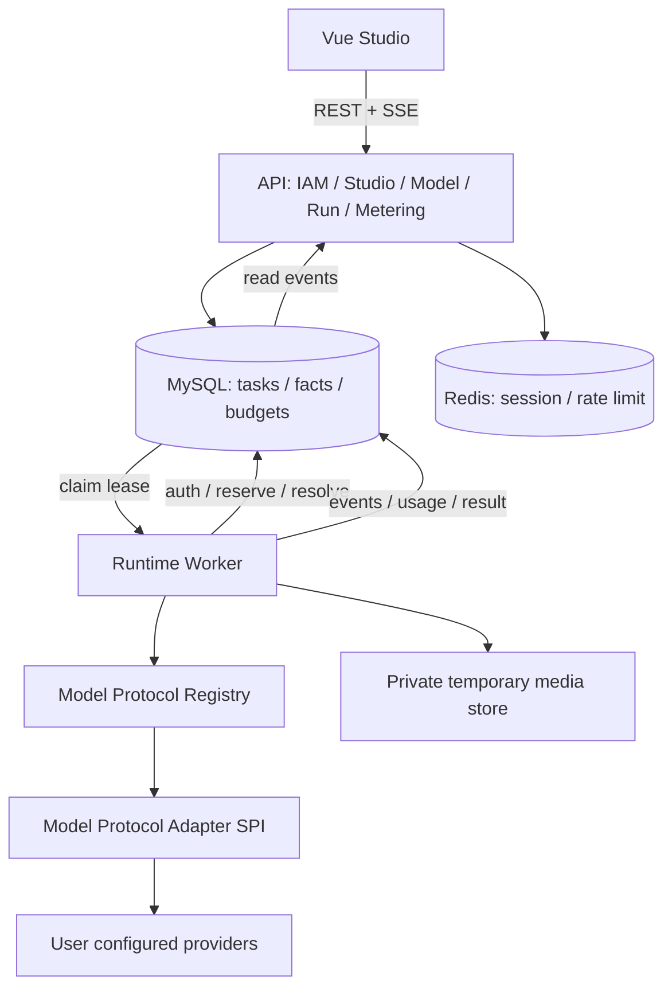
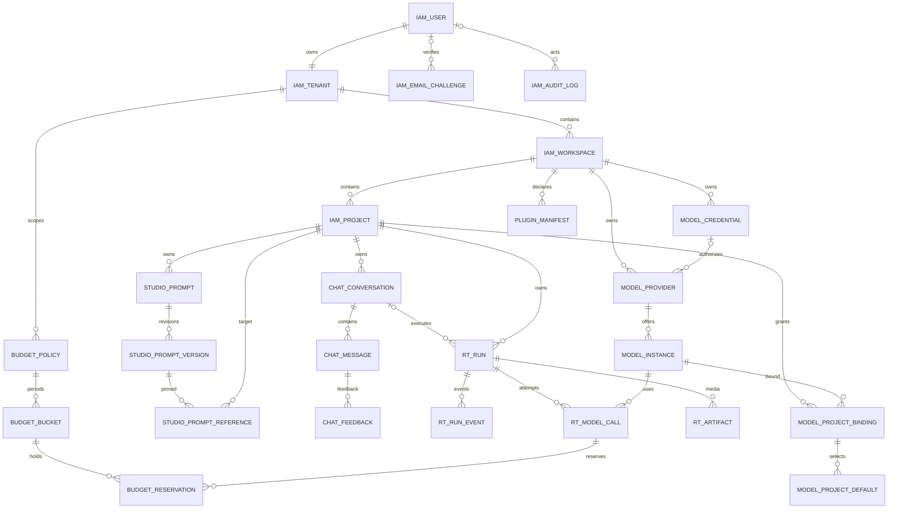
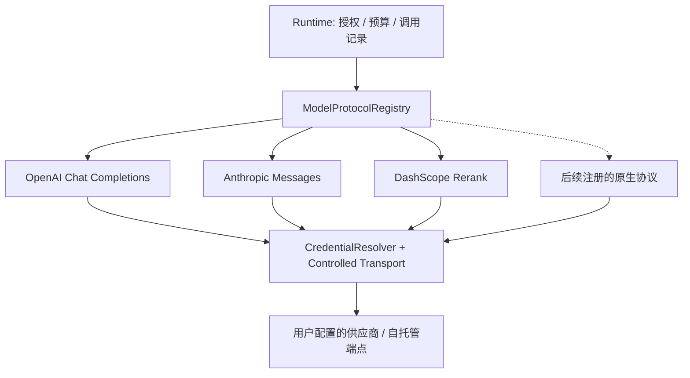
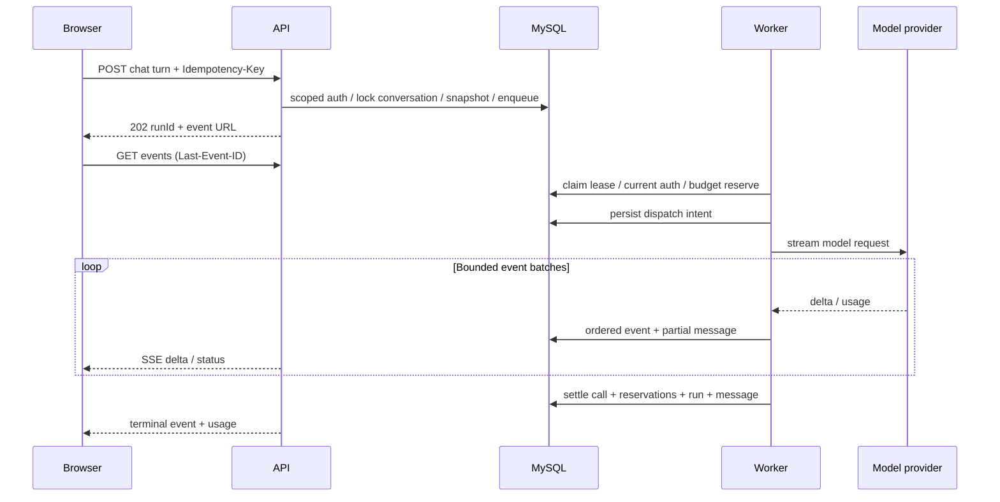

# P1-Review-1.2｜基础工作台技术方案

**状态：已批准，主体实现已合入 main；整期验收尚未完成。** 定稿日期：2026-11-24。基线 main [404e3e5](https://github.com/Ryan-Guizhou/PeachAgent/commit/404e3e50438d4babd067570bd5e3ab3e79ca9d34)。依据 [PRD §6.4 P1.1–P1.5、§6.5–6.7、§7](https://github.com/Ryan-Guizhou/PeachAgent/blob/404e3e50438d4babd067570bd5e3ab3e79ca9d34/requirements/PRD-PeachAgent.md)、[技术基线](https://github.com/Ryan-Guizhou/PeachAgent/blob/404e3e50438d4babd067570bd5e3ab3e79ca9d34/technical/README.md)、[评审流程](https://github.com/Ryan-Guizhou/PeachAgent/blob/404e3e50438d4babd067570bd5e3ab3e79ca9d34/ci/README.md)。前置原型 #16/#17 已合并，离线与 Chrome smoke 通过；尚非真实服务端，复杂原型文案与人工视觉缺口不作为已验收生产能力。正式 P1 页面需按当期验收完成。

### 评审修订记录

| 版本 | 决定与变更 |
|---|---|
| 1.0 | 初始评审方案，未获开工授权。 |
| 1.1 | 2026-11-24 用户反馈：认可技术基座、服务架构、资源归属、数据库、模型范围、安全与计量、研发流程；补充要求“时间统一用字符串，模型协议定义应该要预留接口 后续肯定是需要兼容大部分的模型协议的”。用户明确暂不开始开发。本次仅修订时间字段与模型协议扩展契约及其相应字段、接口、验收，不改变本期业务范围和表数量。 |
| 1.2 | 2026-11-24 用户明确要求：时间字段统一为年月日时分秒字符串、SQL 全部大写、数据库大小写不敏感；定稿技术文档和 SQL 后直接按需求及 UI 完成 P1。该指令构成本期开发授权，不批准 P2–P7。 |
| 1.3 | 2026-11-25 用户要求兼容 Redis 3.x；明确 Redis Server 3.0.7 / 3.2.12 的 standalone RESP2 + 密码认证兼容基线，Redis 7.4 继续作为默认版本，并补充真实服务端 CI。该修订不增加 P1 业务范围。 |

## 1. 目标与范围

一个用户注册后自动获得个人租户、默认工作空间及默认项目，自行配置真实模型/凭证，在不同空间和项目中使用模型与版本化 Prompt 进行真实流式对话，看到运行、失败、取消、历史、Token、费用和预算。

| PRD | 本期交付 |
|---|---|
| P1.1；PA-P1-001～002、014、N-01 | 注册邮箱验证、登录/退出/恢复、会话失效、个人租户、多空间/项目、归档和授权隔离 |
| P1.2；PA-P1-003～004、N-02 | 连接/凭证/实例分离，六类模型登记与按类型真实调试，能力/适配/验证分离，动态配置、启停、引用、轮换及撤销 |
| P1.3；PA-P1-005～007、012～013 | Chat SSE、历史、停止/重试、上下文选择、Prompt 变量预览/版本、复制与反馈 |
| P1.4；PA-P1-008～010、016 | 持久 Run/事件/调用/用量，租户/空间/项目周期预算及单 Run 限制，未知用量与费用如实记录 |
| P1.5；PA-P1-011、015、PA-PLG-001～003、N-03 | 工作台配置引导、最近运行、三主题、当期页面中英、导航滚动/编辑保护；私有插件 manifest 声明和 schema 校验，不执行插件 |

**排除** Workflow/节点引擎、Agent 自动规划/工具循环、MCP/Skill 执行、长期记忆/LLM 自动压缩、RAG/向量库、沙箱、评测、公共市场、应用发布/API Key、商业计费/组织机构/RBAC 多成员体系、跨进程断点续跑、P7 正式发布包。只提供 P1 需要的扩展契约，不建立未来阶段空表和假入口。原型 localStorage 不导入正式数据库；P1 正式账号和数据从真实初始化开始。

## 2. 架构与版本选择（拟批准）

建议模块化应用、API 和 Worker 双角色运行，同一 Maven 工程和发行镜像。API 负责鉴权、管理、任务受理和事件订阅；Worker 负责租约、实际模型请求、计量、事件与结果。P1 不部署 Nacos、独立网关、MQ、向量库、K8s。MySQL 是权威事实，Redis 只负责 Sa-Token、限流、缓存/可选唤醒；不能以 Redis 计数替代账本。

Redis 兼容契约：应用使用 standalone Redis、RESP2 与传统密码认证 AUTH；Sa-Token Redis Template 使用基础 Session/Key 操作，账号限流脚本只调用 Redis 2.6 已支持的 INCR 与 EXPIRE。CI 真实验证 Redis Server 3.0.7、3.2.12 和 7.4。Redis 3.x 已停止维护，不具备 ACL 用户、RESP3 和原生 TLS；当前应用也未配置 Sentinel/Cluster。Redis 7.4 仍为 Compose 默认，切换旧版服务端必须使用独立数据卷，避免旧服务端读取新版 RDB 快照。

- JDK 21 LTS 安全补丁、Maven（当前 CI 使用 Maven，Wrapper 待补）；Spring Boot 4.1.3、Spring AI 2.0.3、Sa-Token 1.46.0 Boot4 starter、MyBatis-Plus 3.5.18 Boot4 starter、MySQL 5.7.44（兼容）/ 8.4 LTS、Redis Server 3.0.7 / 3.2.12 兼容（RESP2 + AUTH，7.4 为默认）、Flyway；Vue 3/TypeScript/Vite/Pinia/Vue Router/i18n。API Spring MVC + SSE；模型适配器使用有界 HTTP/流式客户端，JDBC 在阻塞执行器/虚拟线程中执行，不阻塞 Reactor event loop。Micrometer/Actuator/OTel，结构化日志只记 ID 和错误码。
- Boot 3.5.16 为最后 OSS 发布（[官方](https://spring.io/blog/2026/06/25/spring-boot-3-5-16-available-now/)）；Boot 4.1.3 为已发布维护版本（[官方版本目录](https://docs.spring.io/spring-boot/)），AI 2.0.3 已发布且包含近期安全修复（[官方](https://spring.io/blog/2026/11/20/spring-ai-2-1-0-GA-available-now/)）。Spring AI 2.0 兼容 Boot 4.0/4.1（[官方](https://spring.io/blog/2026/06/12/spring-ai-2-0-0-GA-available-now/)）。MyBatis-Plus 支持 Boot4（[官方](https://baomidou.com/getting-started/install/)）；Sa-Token Boot4 支持（[官方](https://github.com/dromara/Sa-Token/blob/dev/sa-token-doc-new/docs/start/download.md)）。SAA 已核查的 1.1.2.2 使用 Boot3.5，2.0 milestone 不作为 P1 生产依赖（[发行记录](https://github.com/alibaba/spring-ai-alibaba/releases)）。本期不引入 SAA Agent Graph；P2/P3 各自复审稳定兼容版本。若用户坚持 Boot3/SAA1.x，需明确维护风险并另审。完整依赖组合尚未编译，批准后先 BOM/锁文件、dependency tree、CVE 扫描、启动及调用验证；不通过则提出差异重新评审，不静默降级。 
- 工程建议：`backend/peachagent-common`（错误、ID、统一 TimeCodec/Clock、scope、审计接口）、`peachagent-iam`、`peachagent-studio`（项目服务由 IAM 维护归属，Studio 维护 Prompt/Chat/插件声明）、`peachagent-model`（模型注册表、凭证、Protocol SPI、受控传输）、`peachagent-runtime`（Run/事件/模型执行）、`peachagent-metering`（预算和账本查询）、`peachagent-bootstrap`（api/worker profile、迁移、装配）；`frontend/`。模块不循环依赖，禁止其他模块直接操作 IAM/凭证表或绕过 Runtime 调模型。数据库初始化一次、Flyway 迁移由 API/专门迁移任务执行，Worker 在 schema ready 后启动。
- SPI 只定义当期 ModelProtocolAdapter、ModelProtocolRegistry、CredentialResolver、RunDispatcher、RunEventPublisher、UsageRecorder、BlobStore、PluginManifestValidator 的输入输出/错误/能力。ModelProtocolAdapter 取代初稿 ModelAdapter 命名，不并列建立两套适配器 SPI。Spring AI SDK 对象不进入领域模型、DB JSON 或前端接口；不启用自动工具执行、隐式 SDK 重试和隐式模型 fallback。协议由受信代码 Bean/SPI 注册，配置动态更新，非任意脚本执行。缓存按 tenant/space/provider revision/model revision/credential revision/protocol key/version/adapter key/version 隔离、限量与过期，调用前读当前状态；撤权/换密失效旧缓存，旧客户端在途完成后回收。



## 3. 身份、数据归属与资源授权

一账号一租户，租户 owner 唯一。普通用户可使用所有本期功能；平台管理员仅管理账号、健康和安全审计，不自动拥有私有会话、Prompt、模型密钥读权限。P1 无组织部门、成员邀请、权限菜单配置及年度概念，避免过早复制企业 RBAC。Sa-Token loginId 使用 user_id；后端从可信登录态解析 tenant_id，不接受客户端传入 tenant_id 作为授权依据；每个空间/项目请求携带路径中的 workspace_id/project_id，后端验证归属和 ACTIVE 状态。每个浏览器标签独立上下文，不把 activeWorkspace 作为全局 Redis Session 权限字段。

建议模型连接、模型和凭证在空间级维护：同一空间各项目可显式授权引用模型实例；模型的连接/凭证由空间所有者维护，项目只能使用已绑定模型，不能通过项目接口读取凭证明文。不同空间默认不共享；模型配置允许显式复制非秘密配置后重新绑定，但不开放跨空间实时引用。Prompt 归项目，其他项目需显式建立同空间的固定版本引用，引用撤销后禁止新调用，旧历史不被篡改。P1 不为 KB/Agent/Workflow 创建授权表。空间/项目归档保留事实、阻止新执行，当前活跃任务先请求停止并待终态；默认空间/项目不可归档，非默认归档可恢复。历史通过显式归档只读视图访问，当前被停用账号不可访问。

注册：邮箱挑战验证、密码 Argon2id 加盐、同事务建立 user、tenant、默认 workspace、project、三级 budget policy，任一步失败全回滚。邮件默认使用 QQ SMTP（465 隐式 SSL，授权码由环境变量提供），CI 使用回环 SMTP fixture；恢复使用高熵一次性短期链接（建议 15 分钟，服务端仅留 hash；前端 POST token，不进 access log），不泄露账号存在性，限速，消费与改密同事务，auth_epoch 增加并撤销所有 Session。Session 用 Sa-Token 随机令牌 + Redis、HttpOnly/Secure/SameSite Cookie；同源部署，写操作 CSRF token + Origin 校验，不在 URL 或 localStorage 放登录令牌；建议绝对 7 天、空闲 2 小时，非记住会话 24 小时绝对期限。普通退出只撤销当前登录会话，不取消已受理任务；账号停用/模型撤权/明确停止才阻止后续动作。SSE 建连、重连及周期性鉴权；认证 Redis 不可用时新请求 fail closed，已受理 Worker 从 DB 验证任务身份及当前状态。管理员引导由部署端一次性初始化，不在代码/默认数据中硬编码账号密码。

## 4. MySQL 数据模型设计（25 张业务表，正式迁移契约）

以下为本期完整数据字典，配套权威可执行迁移 SQL：[V1__INITIAL_SCHEMA.sql](../backend/peachagent-bootstrap/src/main/resources/db/migration/V1__INITIAL_SCHEMA.sql)；数据库初始化 [INIT_DATABASE.SQL](../database/INIT_DATABASE.SQL)，数据库验收 [verify-schema.sh](../database/verify-schema.sh)。不在生产数据目录上直接执行测试脚本。Flyway history 等框架内部表不计业务表。

**公共约定**：主键统一 `id CHAR(36) NOT NULL PRIMARY KEY`，应用生成 UUIDv7，通过 IdGenerator SPI 可切换，禁止自增；业务可见的 tenant/workspace/project code 单独存在，永不复用。其他对象直接用稳定 UUID，不额外复制相同含义的 ID。外键同类型。字符串按项目数据库默认编码，不在每张表硬编码 ENGINE 或 COLLATE。数据库初始化统一 UTF8MB4 + UTF8MB4_UNICODE_CI，MySQL 初始化前配置 LOWER_CASE_TABLE_NAMES=1，确保文本比较及库表名不区分大小写；SQL 关键字、表名、字段名、索引名和约束名统一大写，数据值、外部模型名、JSON、URL 与密钥保留原样，不得对 SQL 全文直接 TOUPPERCASE；对大小写敏感的外部 ID 用精确值哈希键，名称和邮箱按约定规范化得到唯一键。所有业务时间点统一采用固定长度 UTC 字符串 `CHAR(14)`，格式为 固定 14 位数字 `yyyyMMddHHmmss`，例如 `20261124030200`；不使用 DATETIME/TIMESTAMP/DATE/TIME 作为业务时间点字段类型；金额 `DECIMAL(20,8)`，数量 `BIGINT UNSIGNED`；状态用受控 VARCHAR/枚举，不用 MySQL ENUM。行级修改使用 `row_version BIGINT UNSIGNED NOT NULL DEFAULT 0` 乐观锁。默认状态与空值需显式，未知数值为 NULL，不伪造 0。

字段简写：ID=CHAR(36)，V(n)=VARCHAR(n)，TS=CHAR(14)（规范 UTC 时间字符串），N=BIGINT UNSIGNED，I=INT UNSIGNED，M=DECIMAL(20,8)，J=JSON，T=TEXT，MT=MEDIUMTEXT，B=BOOLEAN。除标 ? 外必填（可带 DEFAULT）；U=唯一约束，IX=索引。每表均有 id。A=created_at TS、created_by ID?、updated_at TS、updated_by ID?、row_version N；F=created_at TS（不可变事实），Tn=tenant_id ID；Ws=Tn+workspace_id ID；Pr=Ws+project_id ID。审计与任务事实有独立生命周期字段，不对不可变事件套用逻辑删除。数据库 FK 对租户/空间/项目链及稳定关系使用 RESTRICT/NO ACTION；复合 FK 必要时父表添加 U(tenant_id,workspace_id,id)、U(tenant_id,workspace_id,project_id,id)，所有下级资源必须匹配完整作用域。禁止 CASCADE 删除运行/调用/使用事实。跨域多态引用和当前状态在业务事务显式验证。涉及历史数据的归档不复用名称/业务编码、不依赖 deleted=0 联合键。

**统一时间契约（适用全部 25 张业务表及 API）**：
- Java Entity/DTO/VO、JSON/OpenAPI/TypeScript 时间点统一 String/string，必填与可空规则沿用各字段定义；包括 created_at、updated_at、archived_at、expires_at、verified_at、deadline_at、lease_until、period_start/end 等。不用空字符串、零日期、本地无时区时间或数字 Unix 时间戳替代；日期/月份查询输入如 YYYY-MM-DD、YYYY-MM 也是字符串，解析后形成 UTC [start,end) 范围。时长和计数（duration_ms、timeout_ms、max_run_seconds、Token 等）仍为数值，不混用。
- common 模块 TimeCodec/TimeProvider 统一严格解析、格式化、校验和加减比较，内部临时使用 Instant/Duration（UTC，秒级截断）避免字符串运算；前端仅在展示层转换用户时区。写入时生成标准时间，按 UTC 解释无时区的 14 位字符串，拒绝无效日期、非固定长度或非数字字符串；必要时先由明确转换入口标准化。业务表不使用 CURRENT_TIMESTAMP 默认值或自动更新，不依赖数据库/机器隐式时区。
- 分布式租约、任务 deadline、邮箱挑战消费及预算周期，以 MySQL UTC 时钟为权威：短事务取得一次 DB UTC 时间并由 TimeCodec 转为标准字符串，计算当前操作所需过期点；所有领取、续租、到期判断和预算结算用同一时钟规范。普通审计时间使用注入 Clock 并同步主机时间；本地耗时用单调时钟，不能直接以墙钟差替代。框架内部 Redis TTL、Flyway 等不受业务列类型约束。
- 全部字符串长度、时区、精度一致，范围与排序使用直接字符串比较（如 lease_until <= :now、created_at >= :start AND created_at < :end），同秒用稳定 ID/事件序号作为次排序键，禁止逐行 STR_TO_DATE/DATE_FORMAT 转换索引列。部署所用默认排序规则下验证比较语义、复合索引、EXPLAIN、跨 UTC 日/月、闰日、夏令时展示、并发时钟偏差与过期边界；验证默认大小写不敏感排序规则下 14 位数字的字典序；时间条件不使用函数包装索引列。LOWER_CASE_TABLE_NAMES=1 只可在空数据目录初始化时确定，不允许对已有数据目录直接切换该参数。安全令牌与外部模型精确身份使用 BINARY 哈希，不受文本排序规则影响。

### 4.1 IAM 与审计（6 张）

| 表 | 字段（不含 id） | 关键约束与索引 |
|---|---|---|
| iam_user | email V(254), email_key V(254), password_hash V(255), display_name V(80), platform_role V(16) USER/ADMIN, status V(16) ACTIVE/DISABLED, email_verified_at TS, auth_epoch N, locale V(16), theme V(32), last_login_at TS?, A | U(email_key)；IX(status,created_at)。邮箱登录策略大小写不敏感，密码仅 hash |
| iam_tenant | owner_user_id ID, tenant_code V(40), name V(100), status V(16), default_workspace_id ID?, currency CHAR(3), A | U(owner_user_id), U(tenant_code)；FK owner；默认空间同租户，事务建完后非空；货币 USD 或 CNY，首次计费记录后锁定 |
| iam_email_challenge | user_id ID?, email_key V(254), purpose V(24) REGISTER/RESET, token_hash BINARY(32), expires_at TS, consumed_at TS?, attempt_count I, created_at TS | U(token_hash), IX(email_key,purpose,expires_at), IX(expires_at)；注册前 user 可空；同事务一次性消费 |
| iam_workspace | Tn, workspace_code V(40), name V(100), name_key V(100), description V(500)?, status V(16) ACTIVE/ARCHIVED, default_project_id ID?, archived_at TS?, A | U(workspace_code), U(tenant_id,name_key), U(tenant_id,id), IX(tenant_id,status,updated_at)；FK tenant/default project（同 scope） |
| iam_project | Ws, project_code V(40), name V(100), name_key V(100), description V(500)?, status V(16), archived_at TS?, A | U(project_code), U(tenant_id,workspace_id,name_key), U(tenant_id,workspace_id,id), IX(tenant_id,workspace_id,status,updated_at) |
| iam_audit_log | tenant_id ID?, workspace_id ID?, project_id ID?, actor_user_id ID?, action V(80), target_type V(40), target_id ID?, request_id V(64), result V(16), reason_code V(64)?, detail J?, F | IX(tenant_id,created_at,id), IX(actor_user_id,created_at), IX(request_id)；未登录安全事件 scope 可空；仅白名单元数据，不含密码/Token/内容 |

### 4.2 模型中心与凭证（5 张）

| 表 | 字段（不含 id） | 关键约束与索引 |
|---|---|---|
| model_credential | Ws, name V(100), name_key V(100), secret_type V(64)（P1 API_KEY/BEARER；受信凭证解析器扩展）, allowed_origin V(512), ciphertext BLOB?, nonce VARBINARY(12)?, wrapped_dek BLOB?, kek_version V(32)?, secret_revision N, masked_hint V(16)?, status V(16) ACTIVE/REVOKED, rotated_at TS?, revoked_at TS?, A | U(tenant_id,workspace_id,name_key), U(tenant_id,workspace_id,id)；撤销清除可用密文/包裹密钥，保留元数据。origin=scheme/host/port 规范值 |
| model_provider | Ws, name V(100), name_key V(100), vendor_key V(64), base_url V(1024), auth_method V(64)（P1 NONE/BEARER/API_KEY；非数据库/Java 封闭枚举）, credential_id ID?, protocol_config J（按协议 key/version 分组的非秘密连接配置）, timeout_ms I, enabled B, status V(16) ACTIVE/ARCHIVED, config_revision N, verify_status V(20), verified_config_revision N?, verified_credential_revision N?, verified_at TS?, verify_error_code V(64)?, A | U(scope,name_key), U(scope,id), IX(scope,credential_id), FK 同空间 credential；verify 结果绑定当前 revision，更新清除验证。NONE 仅明确无认证连接 |
| model_instance | Ws, provider_id ID, name V(100), name_key V(100), external_model_id V(240), external_model_key BINARY(32), model_type V(16), protocol_key V(100), protocol_version V(40), protocol_options J, capabilities J, options_schema_version I, model_options J, pricing J?, enabled B, status V(16), config_revision N, verify_status V(20), verified_config_revision N?, verified_provider_revision N?, verified_credential_revision N?, verified_adapter_key V(100)?, verified_adapter_version V(40)?, verified_at TS?, verify_error_code V(64)?, A | U(scope,name_key), U(provider_id,model_type,protocol_key,protocol_version,external_model_key), U(scope,id), IX(scope,model_type,status,enabled), IX(protocol_key,protocol_version)；FK 同空间 provider。model_type 有 LLM/EMBEDDING/RERANK/IMAGE/STT/TTS；protocol_key/version 为开放字符串，按注册描述符校验支持类型、认证方式和配置 Schema，不将协议写成固定枚举 |
| model_project_binding | Pr, model_id ID, status V(16) ACTIVE/REVOKED, revoked_at TS?, A | U(project_id,model_id), U(tenant_id,workspace_id,project_id,model_id), IX(tenant_id,workspace_id,model_id,status)；FK 同空间 model 与 project。仅显式绑定可运行 |
| model_project_default | Pr, purpose V(32) CHAT/EMBEDDING/RERANK/IMAGE/STT/TTS, model_id ID, A | U(project_id,purpose)，FK (tenant_id,workspace_id,project_id,model_id) → binding；启停/撤销后标不可用而非自动回退；更新与类型校验同事务 |

上表 scope=tenant_id,workspace_id。版本语义：provider/instance 业务配置变更增加 config_revision（与 row_version 乐观锁独立）；验证状态更新不增加 config_revision；验证成功仅当所验证的 model/provider/credential revision、协议 key/version 和 adapter key/version 均仍一致才写入，轮换、适配器更新或任何相关配置变动使旧验证失效；运行保存完整无密配置快照和 revision，价格随快照冻结；无需为每个可变连接再建版本表。凭证只保存当前加密值和 revision，历史不保存可解密秘密。模型 ID 是平台实例 ID，external_model_id 是供应商部署名，不能混用。支持当前验证状态、声明能力、适配器支持、已验证真实调用四种事实的独立显示。供应商 vendor_key、模型能力分类 model_type、外部模型名 external_model_id、线上协议 protocol_key/version 和实现 adapter_key/version 相互独立。同一供应商连接可有多个协议模型实例；P1 同一连接使用同一个获准 base_url 和认证/凭证，不同端点/凭证/认证方法应分别建连接。provider.protocol_config 与 instance.protocol_options 的 Schema 来自协议描述符；无任意 Header/URL/脚本执行能力。实际适配器由注册表唯一解析，不把实现类名或固定厂商写死在 model_instance。无需新增协议数据库表；P1 注册表为可信运行时能力目录，数据库只持久化选择和配置，未注册协议可作为待支持配置保留但不能调用。

### 4.3 Prompt 及引用（3 张）

| 表 | 字段（不含 id） | 关键约束与索引 |
|---|---|---|
| studio_prompt | Pr, name V(100), name_key V(100), description V(500)?, draft_content MT, draft_variables J, status V(16) ACTIVE/ARCHIVED, latest_version_id ID?, next_version_no I, archived_at TS?, A | U(project_id,name_key), U(tenant_id,workspace_id,project_id,id), IX(tenant_id,workspace_id,project_id,status,updated_at) |
| studio_prompt_version | Pr, prompt_id ID, version_no I, content MT, variable_schema J, content_hash BINARY(32), change_note V(500)?, created_by ID, F | U(prompt_id,version_no), U(tenant_id,workspace_id,project_id,prompt_id,id), FK prompt 同 scope；只追加不可变；latest_version 同 prompt |
| studio_prompt_reference | Ws, source_project_id ID, target_project_id ID, prompt_id ID, prompt_version_id ID, alias V(100), status V(16) ACTIVE/REVOKED, revoked_at TS?, A | U(target_project_id,prompt_version_id), IX(target_project_id,status), IX(prompt_id,status)；source!=target，双 project 同空间；复合 FK 版本匹配 source project/prompt；引用固定版本，不随最新版本漂移 |

模板只做 `{{variable}}` 的一次字面值替换；schema 类型/必填/默认值校验，缺少变量拒绝请求，禁止任意表达式、SpEL/Jinja 代码执行；发布事务锁 prompt 行分配递增 version_no。Chat 使用明确版本，草稿可预览但不能作为可复用固定版本。源 Prompt 归档/引用撤销禁止新使用；复制生成新的本地 Prompt，记录来源可放入 change_note，不继承权限或秘密。

### 4.4 会话与消息（3 张）

| 表 | 字段（不含 id） | 关键约束与索引 |
|---|---|---|
| chat_conversation | Pr, owner_user_id ID, title V(200), status V(16) ACTIVE/ARCHIVED/REDACTED, selected_model_id ID?, selected_prompt_version_id ID?, next_message_seq N, active_run_id ID?, last_message_at TS?, redacted_at TS?, A | IX(scope,last_message_at,id), U(tenant_id,workspace_id,project_id,id)；选中模型/Prompt 是偏好，不是授权；创建 Run 再校验 |
| chat_message | Pr, conversation_id ID, seq N, role V(16) USER/ASSISTANT, content MT?, status V(16) COMPLETE/PARTIAL/FAILED/CANCELLED/REDACTED, reply_to_message_id ID?, preferred_reply_id ID?, finished_at TS?, redacted_at TS?, A | U(conversation_id,seq), IX(conversation_id,reply_to_message_id), U(scope,conversation_id,id)；同会话自引用；USER/ASSISTANT 字段按角色约束 |
| chat_feedback | Pr, conversation_id ID, message_id ID, actor_user_id ID, rating V(8) UP/DOWN, reason V(500)?, A | U(message_id,actor_user_id), IX(project_id,created_at)；FK 同会话 ASSISTANT 消息 |

scope=tenant_id,workspace_id,project_id。用户消息与助手占位消息、Run 同事务创建；锁 conversation 保证同一会话仅一个活跃 Run。重试仅最新轮，保留原失败/取消及历史回复，创建新 ASSISTANT、Run 和 call；成功后把 USER.preferred_reply_id 指向采用的助手消息，后续上下文只读取采用的完整轮次，不串入失败/旧替代回复。用户可编辑新消息但不改写已发送历史。系统提示词+明确版本+用户输入+选中的完整历史轮次组成无秘密快照；上下文超限先按整轮裁剪最旧历史，保留最新用户输入和系统约束，仍超限明确拒绝；本期不做 LLM 自动摘要/长期记忆。会话归档只读；主动清除会话内容必须显式二次确认并清除消息/Run 请求正文/事件正文，保留不含内容的计量和审计事实，历史显示已清除；不得承诺从供应商或备份同步删除。活跃任务先停止后清除。

### 4.5 Runtime 与调用事实（4 张）

| 表 | 字段（不含 id） | 关键约束与索引 |
|---|---|---|
| rt_run | Pr, actor_user_id ID, run_type V(24) CHAT/MODEL_DEBUG, trace_id CHAR(32), conversation_id ID?, user_message_id ID?, assistant_message_id ID?, retry_of_run_id ID?, idempotency_key V(80), request_hash BINARY(32), status V(24), request_snapshot J?, limit_snapshot J, next_event_seq N, lease_owner V(80)?, lease_epoch N, lease_until TS?, heartbeat_at TS?, queued_at TS, started_at TS?, deadline_at TS, cancel_requested_at TS?, finished_at TS?, error_code V(64)?, error_summary V(500)?, redacted_at TS?, A | U(scope,actor_user_id,idempotency_key), U(scope,id), IX(status,queued_at,id), IX(status,lease_until), IX(scope,created_at,id), IX(trace_id), IX(conversation_id,created_at)；CHAT FK 同会话消息；DEBUG 可空，retry 同 scope |
| rt_run_event | Pr, run_id ID, seq N, event_type V(40), payload J?, F | U(run_id,seq), IX(created_at), FK 同 scope run；仅有序追加，用户内容与错误先脱敏，清除正文时 payload 置空 |
| rt_model_call | Pr, run_id ID, attempt_no I, model_id ID, provider_id ID, credential_id ID?, credential_revision N?, model_type V(16), protocol_key V(100), protocol_version V(40), adapter_key V(100), adapter_version V(40), model_snapshot J, price_snapshot J?, trace_id CHAR(32), span_id CHAR(16), provider_request_id V(200)?, status V(24), dispatch_intent_at TS?, first_token_at TS?, finished_at TS?, duration_ms N?, input_tokens N?, output_tokens N?, total_tokens N?, cached_tokens N?, reasoning_tokens N?, usage_detail J?, usage_source V(16) REPORTED/ESTIMATED/UNKNOWN, cost_amount M?, cost_currency CHAR(3), cost_source V(16), error_code V(64)?, error_summary V(500)?, A | U(run_id,attempt_no), U(scope,id), IX(scope,created_at,id), IX(tenant_id,created_at), IX(model_id,created_at), IX(trace_id), IX(status,updated_at)；同 scope run、同 workspace model/provider/credential；不保存秘密/完整 raw provider payload |
| rt_artifact | Pr, run_id ID, call_id ID?, direction V(8) INPUT/OUTPUT, storage_key V(256), file_name V(200), mime_type V(100), size_bytes N, sha256 BINARY(32), status V(16) STAGED/READY/EXPIRED/FAILED, expires_at TS, F | U(storage_key), IX(run_id,direction), IX(status,expires_at)，FK 同 scope run/call；路径服务端生成，非公开访问。仅 P1 模型调试音频/图像短期结果 |

rt_run.status：QUEUED/RUNNING/CANCEL_REQUESTED/SUCCEEDED/FAILED/CANCELLED/INTERRUPTED；call.status：PREPARED/DISPATCHING/SUCCEEDED/FAILED/CANCELLED/UNKNOWN。Run 是否结束、是否生成部分输出与外部消费是否已知分开；未知用量绝不能因 Run CANCELLED 置零。trace_id 不是唯一约束，后续父子 Run 可共享。P1 不建 node_execution、approval、checkpoint、task_graph 表。

### 4.6 计量与预算（3 张）

| 表 | 字段（不含 id） | 关键约束与索引 |
|---|---|---|
| budget_policy | Tn, workspace_id ID?, project_id ID?, scope_type V(16) TENANT/WORKSPACE/PROJECT, scope_id ID, period_type V(12) DAY/MONTH, max_calls N?, max_tokens N?, max_cost M?, currency CHAR(3), max_concurrency I, max_run_seconds I, max_run_tokens N?, max_run_cost M?, inflight_count I, status V(16), A | U(tenant_id,scope_type,scope_id)；CHECK scope_type/nullable workspace/project 和 scope_id 一致；父 scope FK，currency 同 tenant；政策一 scope 一条，周期变更下周期生效或拒绝本期变更 |
| budget_bucket | Tn, policy_id ID, period_start TS, period_end TS, consumed_calls N, consumed_tokens N, consumed_cost M, reserved_calls N, reserved_tokens N, reserved_cost M, unknown_calls N, A | U(policy_id,period_start), IX(tenant_id,period_start), FK tenant/policy；UTC 日/月；不把历史未知值混入已确认值，估算/报告分类以 call 为准 |
| budget_reservation | Tn, call_id ID, bucket_id ID, policy_id ID, policy_revision N, reserved_calls N, reserved_tokens N?, reserved_cost M?, actual_calls N?, actual_tokens N?, actual_cost M?, state V(20) HELD/SETTLED/RELEASED/UNCERTAIN, concurrency_released B, settled_at TS?, reason_code V(64)?, A | U(call_id,policy_id), IX(bucket_id,state), IX(state,updated_at)；同 tenant call/policy/bucket；记录所在 scope 和当次策略 row_version（policy_revision） |

budget_policy 三级初始化：tenant、workspace、project 各一条。每个真实模型调用先锁定策略及当期 bucket（tenant → space → project 固定顺序），检查 inflight、用量+预占+本次上限、单 Run deadline/上限；同事务写 call PREPARED、三个 reservation 和 counters；不持锁调用外部。结算事务按 call 唯一键和 state CAS 只执行一次。跨日/月在原预占桶结算，inflight 跨周期由 policy 单独维护，不被换桶重置。失败/取消确认未发出则 RELEASED，发出/可能发出计一次调用，实际用量可核实则 SETTLED，不能核实则 UNCERTAIN 保留额度占用并释放确实已停止的本地并发槽；不按 TTL 自动释放不明费用。后续用可靠供应商证据人工核对，保留审计；不允许通过改政策抹除历史。超出预估上限的实际用量如实入账，阻断下一次调用。普通项目报表直接查询 rt_model_call，禁止重复建立另一份总账/重复叠加三级 reservation。P1 以 SQL 索引、分页和时间范围聚合，P5 才增加完整分析/价格更新。 
- Token 指标只对适用的模型调用计算；图片张数/音频秒数/字符/文档数/向量维度等放 usage_detail（每个单位及 source）。缓存/推理 Token 是否包含在 input/output/total 由 adapter 声明，不可再次加总。provider 报告用量、可解释估算、未知分开，费用估算与实际供应商报告分开，NULL≠0。
- 价格 JSON 为带 schema_version 的类型化计价单位及单价；单位如每百万输入/输出 Token、每图、每音频分钟、每千字符、每次请求。货币固定租户 USD/CNY，P1 不做自动汇兑、充值/商业计费。可计算金额用快照和 Decimal 精度；无价格、无可证实上限时，若设置硬金额额度则拒绝本次调用，否则明确未知风险并允许。Token 硬额度同理：可证明的输入上限（必要时保守使用窗口容量）+供应商实际支持的 max output（含可能计费的推理等），无法给出上限不承诺严格封顶。第三方额外计费不能保证与平台预算完全相同。每 Run 至多一次自动推理请求，SDK 不重试；用户重试为新 Run，计量重新预占。诊断若实际推理也走同一路径。

### 4.7 插件声明（1 张）

| 表 | 字段（不含 id） | 关键约束与索引 |
|---|---|---|
| plugin_manifest | Ws, plugin_key V(100), plugin_version V(40), name V(100), description V(500)?, manifest_schema_version I, config_schema J, declared_permissions J, extension_points J, manifest_hash BINARY(32), status V(16) DRAFT/DECLARED/ARCHIVED, declared_at TS?, A | U(tenant_id,workspace_id,plugin_key,plugin_version)，IX(scope,status,updated_at)；声明后不可变，新版另行新增。仅私有 manifest 元数据及 schema 校验，无代码上传/执行/安装/动态 UI，声明权限不等于授权 |

### 4.8 ER 关系及一致性



图省略复合 FK、默认对象环形引用、actor 和自引用；以字段表为准。初始化默认对象时先插入 tenant/workspace (default id NULL)，插入 project 后同事务设置默认值与预算；DDL 先建主表后 ALTER 加循环 FK。FK 防错归属不代替授权：TenantLineInnerInterceptor 仅为防御层之一，所有 Repository 方法要求 ScopeContext/显式条件，JOIN/子查询/后台任务/导出均测试；全局账号登录与必要后台扫描只能通过受控 mapper 方法，禁止调用者任意跳过租户插件。关系数据分页 cursor 使用 (created_at,id) 或 (updated_at,id)，限制 page size；所有常用索引按真实 EXPLAIN 调整，避免全表 scans。金额、Token 预占/结算、回执、状态与事件在短事务中写入，外部请求不占 DB 锁。

## 5. 模型能力和凭证实现

### 5.1 本期真实适配范围

拟交付六类真实调用的**最小可测试适配路径**，不是所有厂商全兼容。模型目录为用户动态录入、校验并启用；不把静态厂商列表当能力。每类至少一个真实服务商完成 smoke，需要用户本人在部署/测试环境注入凭证，不在对话、GitHub、日志、测试 fixture 里填写 Key；CI 使用 mock HTTP 验证协议并记录真实 smoke 独立证据。如果缺真实凭证，保留待验收，不标已通过。

| 类型 | P1 首批真实适配 | 最小验收 |
|---|---|---|
| LLM | OpenAI Chat Completions 兼容；Anthropic Messages；DashScope/OpenAI-compatible；兼容模型按协议验证 | 真实 SSE、部分输出、停止、用量、输入/输出上限与错误；工具调用/推理块声明不代表执行支持 |
| Embedding | OpenAI-compatible embeddings | 文本 → 向量，校验维度、返回元素和计量；不建向量库 |
| Rerank | DashScope Text Rerank HTTP；受控 adapter（[接口](https://help.aliyun.com/en/model-studio/text-rerank-api)） | query + 候选文本 → 索引/分数排序，验证索引范围、数量 |
| Image | OpenAI-compatible image generation 的已验证子集 | 文本生成一张图、预览/授权下载、计量 |
| STT | OpenAI-compatible audio transcription 的已验证子集 | 小音频 → 文本，格式/容量校验 |
| TTS | OpenAI-compatible audio speech 的已验证子集 | 文本 → 音频、播放/下载 |

P1 单文本对话，不承诺所有多模态输入、流式音频、工具或结构化输出协议；显示 REGISTERED/ADAPTER_SUPPORTED/VERIFIED/UNSUPPORTED 等明确状态。型号能力和 adapter 能力取交集，未知参数不透传；连接测试与模型测试分开，测试状态绑定配置 revision，模型停用或撤权立即禁止新调用。按用途显式选择项目模型，不静默替换。动态配置构建 per-invocation client 或受限缓存；不修改全局 spring.ai.api-key、系统属性，不把用户凭证塞进环境全局 Bean。

### 5.2 开放协议注册与适配接口（P1 必交付）

协议层独立于供应商、模型和 Spring AI 实现；未来兼容更多协议时新增受信适配器，不修改 Runtime、Chat、预算、模型核心表结构或前端硬编码协议列表。既支持 OpenAI-compatible 接口复用，也支持具有不同认证、路由、媒体格式、流事件、错误和用量语义的原生协议。**接口可扩展不等于已经适配所有协议**；P1 真实适配范围仍为 §5.1。

| 概念 | 作用与示例 |
|---|---|
| Vendor | 供应商/部署端标识，如 openai、deepseek、自建服务；开放字符串，不与协议一对一绑定 |
| ModelType | LLM、EMBEDDING、RERANK、IMAGE、STT、TTS 六种能力类型 |
| ModelProtocol | 开放、命名空间化的 protocol_key + protocol_version，描述网络契约；例如 openai.chat-completions/v1、anthropic.messages/v1、dashscope.text-rerank/v1 |
| ModelOperation | 实际调用操作，例如 CHAT、EMBED、RERANK、GENERATE_IMAGE、TRANSCRIBE、SYNTHESIZE；受支持操作由 descriptor 声明，未来扩展可加入响应式/多模态等契约 |
| Adapter | 可信代码实现，具有独立 adapter_key 和 adapter_version；不以供应商名、外部 model ID 或 Java 类名决定路由 |
| ProtocolDescriptor | 协议 key/version、适用模型类型和操作、支持认证方案、能力和流式/取消语义、连接与模型参数 Schema、用量语义、传输及安全限制、实现标识/版本 |

以下 Java 签名仅为本轮评审契约，批准后再实现：

```java
public interface ModelProtocolAdapter {
    ProtocolDescriptor descriptor();
    ValidationResult validate(ProtocolConfiguration config);
    ModelExecution execute(ModelExecutionRequest request,
                           ModelExecutionContext context);
}

public interface ModelProtocolRegistry {
    void register(ModelProtocolAdapter adapter);
    List<ProtocolDescriptor> list();
    ModelProtocolAdapter resolve(ProtocolKey protocol,
                                 ModelType type,
                                 ModelOperation operation);
}
```

ModelExecution 对同步、流式、二进制产物提供统一结果/事件、完成、错误和取消契约（由执行句柄管理关闭资源），非流式能力不伪造流事件；标准化请求包含 operation、模型实例/外部模型、输入内容、受控参数、预算和执行上下文；标准化结果包括 delta、完成状态、错误码、providerRequestId、Token/媒体用量及来源。Spring AI 可作为具体 adapter 内部实现，直接 HTTP 或厂商 SDK 也可以；所有路径必须通过受控 transport、CredentialResolver、当前授权/预算检查、取消、调用计量和审计，不允许 adapter 自行绕开网关发起未计量调用。未知扩展参数拒绝，非秘密协议原始配置按 Schema 校验，供应商特有返回值仅允许白名单保留并脱敏。



- P1 通过受信 Spring Bean/SPI 注册；注册 key/version 使用稳定规范化字符串，重复或重叠的 protocol/type/operation 路由必须在启动/注册时明确报错；不按注册顺序覆盖、不偷偷回退到 OpenAI-compatible。新增代码协议允许由部署者发布受信版本，本期不承诺热加载任意 JAR 或插件上传。已有连接、参数、凭证和模型绑定的修改无需重启 API/Worker；后续动态插件机制复审时保持协议注册契约。
- GET /api/v1/model-protocols 返回受信注册目录、descriptor 与配置 Schema（无密钥、无其他租户配置）。前端根据注册表生成协议选项/配置表单，不维护固定供应商协议枚举。用户可登记未适配协议，标为 UNSUPPORTED，不提供虚假验证或执行。已注册但不支持对应 operation/type/auth 组合同样拒绝。
- 供应商连接、协议版本、模型参数与 adapter 实现版本均进入调用快照与缓存 key。运行受理固定协议版本和实现版本；Worker 再次解析并验证当前授权。旧协议/实现不可用或不具备明确兼容契约时以 MODEL_PROTOCOL_UNAVAILABLE / MODEL_PROTOCOL_VERSION_UNSUPPORTED 阻止发出调用，不默默切换。历史记录可查询，不因此修改旧调用事实。
- 未来候选扩展（不计本期承诺）：OpenAI Responses、Gemini 原生、Ollama 原生、Azure OpenAI、Amazon Bedrock、Vertex AI 及更多供应商协议。认证扩展可逐期新增 OAuth、签名认证等 CredentialResolver/auth descriptor，不在 P1 承诺尚未验证的认证方式；若未来需要不同凭证结构再评审迁移，不在 JSON 里存明文秘密。
- 验收：通过只新增一个测试专用 Mock 原生协议 adapter 的方式验证注册、目录、Schema、动态表单、正确路由、流式/非流式、错误/取消、真实调用记录/预算、缓存和版本冻结；不改既有 Runtime、DB 表定义、Chat 或前端固定协议映射。覆盖未知协议、重复注册、错误模型类型、未知配置、不可用版本、旧 adapter 验证失效及受控传输/凭证检查。首批真实适配仍独立进行真实调用 smoke，不能以此测试代替。

### 5.3 凭证与传输安全

密钥：每条凭证用随机 DEK 加密 AES-256-GCM（随机 96-bit nonce，AAD=tenant/workspace/credential/id/revision/origin），DEK 由部署注入 KEK 包裹、记录 kek_version；KEK 不入数据库/Git，生产挂载 secret 文件或外部保密服务。备份须配套解密材料，P7 做恢复整体验证。明文只在输入和实际调用短时内存使用、响应仅掩码，不进入 Prompt、模型请求快照、SSE、审计、日志、trace baggage；避免声称 JVM 能彻底抹除所有 String。轮换保留 ID、增加 revision、覆盖可用秘密；撤销不可恢复，需新建/绑定。并发边界：调用受理、dispatch 前重读当前授权/连接 identity/origin/凭证状态；旧快照使用相同连接身份的当前有效密钥，endpoint 或 credential binding 被改变则拒绝旧配置重放，重新显式采用新配置；已发送请求只能尽力取消，不保证供应商不计费。凭证 origin 约束防止秘密发送到未经确认的地址。 
SSRF：用户自定义连接默认公共 HTTPS；受控出站网络层阻断 loopback/link-local/私有/metadata/IPv6 映射等及 DNS rebinding，连接目标 IP 与预检一致，保留 TLS hostname 校验，禁自动跳转和任意代理，限制端口/相对 API path。自托管私有端点只由部署者显式 allowlist，禁止 metadata 地址，即便 allowlist；供应商 SDK 若不能保证同等策略，经受控出口代理或专用 HTTP adapter，不允许绕过。禁止自定义任意 HTTP header/URL 作为秘密外传通道。模型调试限制请求体、格式、解码大小、响应流长、连接超时。图片优先 inline 二进制；若必须下载供应商结果，仅允许部署者预先配置的供应商媒体域并同样 SSRF 检查，不将未校验 URL 注入浏览器。媒体使用私有临时挂载目录 BlobStore，文件名随机、路径无用户输入、权限检查后流式下载，建议 24h 清理；音频/图片不做长期媒体平台。

## 6. Chat 与 Run 执行



Run 从 QUEUED 用短事务领取，MySQL 8.x 使用 `SELECT ... FOR UPDATE SKIP LOCKED`，MySQL 5.7 使用 `SELECT ... FOR UPDATE`（在锁内重新校验状态和 deadline）（[MySQL 锁读取](https://dev.mysql.com/doc/refman/8.4/en/innodb-locking-reads.html)）；lease_epoch 是 fencing token，所有状态写入必须带 owner+epoch 条件；租约建议 30s、心跳 10s，未领取任务重启可继续领取；已领取且 Worker 失联的任务标 INTERRUPTED，按 dispatch intent 判定未发出/不明，禁止自动重发可能已收费请求。运行关闭网页、空间切换、退出当前登录不取消；重新登录按授权可查看历史。停止通过数据库 CANCEL_REQUESTED + Worker 主动检查/取消 HTTP 流，未发出直接取消，已发出保留部分输出与消费状态。终态 CAS 保证取消/成功竞态只出现一个终态；失败返回稳定业务码并保留 traceId。 
SSE 与创建操作分离；服务端事件顺序由 run.next_event_seq 保证，约 100ms 或 2KB 批量落库+更新部分消息，事件提交后才发布，避免逐 token 写 DB；Last-Event-ID 重放有序事件、前端按 seq 去重，事件过期返回明确 reset 指示，改为 GET run/message 快照；慢消费者有界缓冲并断开重连，不拖垮 Worker。流断线不等于执行停止；P1 不承诺从模型断点续跑。输出异常保留部分正文及 ERROR/CANCELLED 状态。未结束 Run 数量按租户/项目限制，全局 Worker 有界、队列满拒绝而非无限线程/连接/消息。 
上下文请求快照固定：model/provider revision、protocol key/version、adapter key/version、配置及价格快照、Prompt version、实际渲染 Prompt、选中消息和模型参数、预算及身份，不含密钥。不得以旧快照绕过当前授权。Runtime 模型请求所有入口（Chat、六类诊断）统一生成 run/call/预算记录，不允许前端直连模型。

## 7. API 与前端契约（拟定）

统一 `/api/v1`，身份与项目范围由服务器解析。工作空间级 prefix = `/workspaces/{workspaceId}`，项目级 prefix = `/workspaces/{workspaceId}/projects/{projectId}`。REST JSON 返回业务错误 code/message/traceId，HTTP 400/401/403/404/409/422/429 等语义正确；跨租户/空间不可探测对象时 404，不泄露存在性。写入带 rowVersion 防丢更新；创建 Run 带 Idempotency-Key + 请求 hash，同 key 同 payload 返回已有 Run，不同 payload 409。所有列表分页、限额与排序白名单。OpenAPI 与 TS 客户端由接口契约驱动；业务时间点全部为规范 UTC 字符串，OpenAPI string 并限制14 位数字 pattern（不使用 RFC3339 date-time format），前端仅展示层转换时区，时长保持数值。

| 分组 | 本期接口 |
|---|---|
| Auth | POST /auth/email-challenges、/auth/register、/auth/login、/auth/logout、/auth/password-reset、GET /auth/me、PATCH /auth/preferences |
| Workspace/Project | GET/POST /workspaces；PATCH workspace；POST archive/restore；GET/POST workspace/projects；PATCH project；POST archive/restore；归档历史查询 |
| Models | GET /api/v1/model-protocols（受信目录与 Schema）；workspace /credentials、/providers、/models CRUD（删除为归档或撤销）；POST credential rotate/revoke、provider verify（非推理连通性检查）；project /model-bindings、/model-defaults、/models/{id}/debug（实际推理必须指定有绑定的项目） |
| Prompt | project /prompts、/prompts/{id}/versions、/preview、/prompt-references、归档/恢复及撤销引用 |
| Chat | project /conversations、/conversations/{id}/messages、POST /conversations/{id}/turns、POST /runs/{id}/retry、会话归档/清除、消息 feedback |
| Run | project GET /runs、/runs/{id}、/runs/{id}/events、POST /runs/{id}/cancel、GET /runs/{id}/artifacts/{id}；事件 types run.status/message.delta/usage.updated/run.error/run.completed，seq 有序 |
| Budget/Usage | /budget（租户、空间、项目各自 scope）、/usage/summary、/usage/calls、/usage/timeseries；显示已用/预占/不明占用/费用来源/限额 |
| Plugin | workspace /plugin-manifests、/validate、/declare、/archive；无安装/执行 API |

前端以原型 OTRYX Studio 作为交互参考，真实 Vue 组件、主题 token 与 i18n 字典；P1 仅呈现工作台、空间/项目、模型中心/凭证、Prompt、Chat、Run、用量/预算、设置、插件声明（明确不可执行）。未来模块不上可点击假按钮，显示规划但不混同已交付。保留侧栏滚动、浏览器前后退、未保存表单导航/语言切换保护，按 tab scope 隔离 Pinia 缓存，退出清除会话状态；UI 不存明文 Key/登录 Token，不把前端判断当后端鉴权。前端与 Worker 不共享网络授权；本地 mock 仅用于开发与契约测试，正式页面不得伪造模型响应。

## 8. 非功能指标、验收与数据保留（提议）

基准环境：4 vCPU/8 GiB Linux Docker、本地 MySQL/Redis，API 与 Worker 两角色，JDK 21，真实模型测外部延迟独立于平台负载。目标：普通读接口 p95 ≤ 200ms（50 并发读、10万条 Run/call 种子数据，分页）；创建 Run p95 ≤ 300ms（20并发，不含供应商）；32 全局同时模型任务，默认 tenant 8/space 4/project 2，压测 10min，零串租户、零重复调用/结算、队列有界；mock 100ms 首包时平台额外首事件 p95 ≤ 300ms，真实 TTFT 逐供应商记录不保证第三方延迟；取消请求 2s 内本地停止新动作/更新状态（外部已发计费可能未知），Worker 异常租约到期后 60s 内标记中断。上限建议：请求 JSON 1MiB，单用户输入 64KiB UTF-8，平台上下文 ≤ 64k token 且不超过模型声明，输出默认 2048 token/按能力与预算上调，单 Run 180s，音频上传 10MiB、生成媒体 20MiB，文件响应流式；限额可配置但不可超部署端安全上限。邮件挑战 15min 到期，过期记录保留7天；SSE delta 7天后可清理、最终消息保留；媒体 24h；业务/用量/审计至少保留365天，P1 不自动删除未结算事实及历史，用户主动正文清除保留匿名/无内容运行计量与安全审计，存储达到配额提示导出/清理。备份含数据及加密材料，P1 只验证容器重建持久性和 Flyway 从空库/升级；P7 定义 RPO/RTO/正式一键部署。

| 验收 ID | 场景与通过条件 |
|---|---|
| A01 | 两账号各建两个空间、两个项目，交叉 ID、分页、搜索、直接 URL、任务、SSE、导出和媒体访问均不能越权；注册失败回滚、恢复一次性、改密废旧会话、管理员不能读他人秘密 |
| A02 | 六类模型各至少一个真实调试，三种 LLM 路由按提供凭证验证；错误类型/能力/停用/未验证有明确提示；连接配置变更无需重启；只新增测试协议 Adapter 即可贯通注册、动态表单、执行和计量，重复/未知/不兼容协议被拒绝，协议与实现版本可追踪；凭证轮换/撤销、跨项目绑定撤销和 SSRF/泄漏测试通过 |
| A03 | Prompt 变量预览、版本冻结、固定版本跨项目引用/撤销；历史会话流式对话、刷新/重连、停止、失败/部分结果、重试、上下文裁剪、反馈真实可用；同会话并发受控 |
| A04 | 并发预算预占与结算、跨期、未知用量、供应商超额/失败/重复提交，三级计数与 call 事实可对账；真实报告/估算/未知分开，调用不漏记 |
| A05 | API/Worker/Redis/MySQL 故障注入，未派发任务可领取、已派发未知任务不自动重放，取消/租约/并发回收正确；数据库迁移空库和升级通过、容器重建数据保留；全部业务时间点列及接口为规范字符串，覆盖严格格式、索引范围和排序、跨 UTC 周期、租约/邮箱/凭证过期、时区与并发时钟边界 |
| A06 | P1 各页三主题、中英完整（不翻译用户内容），1440/1024/768/390 CSS px、键盘焦点/对话流/滚动/脏状态；Playwright 真实浏览器，截图与交互验收；未配置/失败/空状态，不假造可用能力 |
| A07 | 插件声明 schema/版本/权限/扩展点校验、重复版本和非法声明拒绝；无代码加载、无权限扩大、无假安装功能；依赖/CVE/秘密扫描、构建、单元、MySQL+Redis Testcontainers、HTTP mock、前端类型检查/测试、浏览器和真实供应商 smoke 分别记录 |

CI 不在每次小提交全量执行；分模块验证后集成前集中跑全量，测试并行。目标门禁是可重复构建、当前 PR 测试成功、验收证据明确，禁止把 mock 或原型 CI 作为真实供应商通过。正式 API/Worker 初始化、SQL/真实调用的全部实现均在批准后。任何必需真实供应商验证缺凭证则该项保持阻塞，不能以测试环境原因自动勾选通过。

## 9. 排期、分工与风险

P1 原规划2–3开发周，本方案含六类最小真实调试、预算并发和双角色 worker；建议3开发周目标（单主线 AI 辅助并行，若凭证/兼容/安全验证阻塞，3–4周风险，不以砍验收换工期）。以下为已批准的开发拆分；每个独立工作包一个开发 Issue/PR，#18 保留为周期评审与验收记录。

| 工作包 | 需求 | 依赖与并行 |
|---|---|---|
| W1 工程基线 | P1.5/通用 | 第1–2日：BOM、启动、迁移规范、scope/API/事件/DTO 契约；通过后共享给各包 |
| W2 身份与空间 | P1.1 | 第1周，IAM、邮箱、项目/租户隔离；与 W3/W4 并行 |
| W3 模型和凭证 | P1.2 | 第1–2周，registry、密钥、六类适配；先冻结 adapter 接口，适配开发可并行，统一 Runtime 接入 |
| W4 Prompt / Chat 与工作台 | P1.3/P1.5 | 第1–2周，Prompt/消息、前端按契约并行，联调依赖 W2/W3/W5；插件声明同包 |
| W5 Runtime / Metering | P1.4 | 第1–2周，任务租约、SSE、调用、预算、停止，接口先冻结；与模型适配并行 |
| W6 集成验收 | 全部 | 第3周，真实供应商、越权/并发/故障/视觉/迁移回归，缺陷收尾；每个独立开发任务一 Issue/一 PR，完成合并才关闭任务；周期评审 Issue 不被单 PR 自动关闭 |

风险：Boot4/Jackson3/SAA 后续兼容 → 先依赖与真实启动门禁、Adapter 隔离；供应商协议差异和计价未知 → 逐 adapter 验证、无静默替换/硬额度不可证实即拒绝；自定义地址 SSRF → 受控出口与专用 transport；并发预算争用 → 锁顺序、短事务、索引与故障注入；真实凭证不可用 → 用户在批准后自行配置，阻塞项保留；媒体清理/安全 → 限制类型、私有短期 Blob、可授权下载，不做长期媒体平台。原型验收遗留在 P1 当期相关页面处理，其余未来页按各自周期验收，不提前实现。

## 10. 已批准决策

本版为 P1-Review-1.2；后续实质范围或关键技术取舍变化必须重新评审。

1. 架构：模块化 API + 独立 Worker 双角色；Boot 4.1.3 / Spring AI 2.0.3，SAA 待 P2/P3 复审。
2. 数据：个人租户一对一、workspace 隔离，模型/凭证空间级管理+项目显式绑定，Prompt 项目级+同空间固定版本引用；25 张业务表，UUIDv7 和稳定业务 code，统一 CHAR(14) UTC yyyyMMddHHmmss 字符串时间点及严格校验；SQL 大写，数据库大小写不敏感，无组织/年度。
3. 模型：六类真实最小适配，LLM OpenAI兼容/Anthropic/DashScope；独立开放协议 key/version、ModelProtocolAdapter/Registry、可发现描述符与动态表单，供应商和实现版本分离；音频/图片仅调试与短期产物，不承诺全供应商/全媒体平台。
4. 安全：邮箱验证与 SMTP 恢复、Sa-Token Redis Cookie 会话、AES-GCM+外部 KEK、私有地址部署端 allowlist；账户禁用/撤权约束 Worker。
5. 预算：租户/空间/项目预占与结算+单 Run 限制，单币种 USD 或 CNY，未知消费保留、不能证实硬上限拒绝；默认并发/时长/保留期与测试指标如上。
6. 研发：3周目标、并行分工、一 Issue 一 PR、集中 CI，P1 通过不等于 P2 开工。

**批准记录：2026-11-24，用户在本次会话要求完成两项修订后直接提交完整技术文档和 SQL 并开发第一阶段。** 本期已获开工授权，验收仍须实际证据。#18 为评审及验收唯一跟踪记录，不关闭总规划 #1。
Refs #1


## 实施与验收记录（2026-11-24）

- #19 / PR #20：1.2 定稿、25 表迁移；[MySQL 8.4 CI](https://github.com/Ryan-Guizhou/PeachAgent/actions/runs/45319369167) 成功。业务时间字段统一 CHAR(14)，SQL 关键字与标识符大写，库默认不区分大小写，实际初始化验证通过。
- #21 / PR #27：[七模块工程、编译及 API/Worker 启动](https://github.com/Ryan-Guizhou/PeachAgent/actions/runs/45320039511) 成功。
- #22 / PR #28：[真实 SMTP、Redis Session、双租户权限、归档与密码恢复](https://github.com/Ryan-Guizhou/PeachAgent/actions/runs/45320494454) 成功。
- #23–25 / PR #29–31：模型协议及凭证、Prompt 与 Vue 工作台、持久任务和计量。 [前端构建](https://github.com/Ryan-Guizhou/PeachAgent/actions/runs/45321718896) 与 [后端集成](https://github.com/Ryan-Guizhou/PeachAgent/actions/runs/45321838916) 成功。后者使用真实 API/Worker/MySQL/Redis 对接本地协议 fixture，不能替代外部供应商调用验证。
- 当前持久层实际采用 JdbcTemplate 和显式 Scope SQL；MyBatis-Plus 依赖已接入，不表示所有实体已采用 Mapper。运行记录仅证明所执行的用例。
- #26 负责补充真实浏览器及故障、预算、并发验证。缺失真实厂商测试凭证时，不得以 fixture 声称实际厂商通过；由测试环境安全配置凭证后验收。完整 UI/国际化、故障注入、并发性能指标及供应商真实调用仍以 #18/#26 逐项证据为准。不得自动进入 P2。


### P1 兼容与工程整改（#65）

用户授权：QQ SMTP 默认 SSL 465；MySQL 5.7 兼容，新库排序规则 UTF8MB4_UNICODE_CI；保留原有业务时间、外键、租约与计量语义。MySQL 8.x 保留原始 V1，V2 路径移至 shared common（内容不变）；5.7 独立 V1 不使用具名 CHECK，V3 以 BEFORE INSERT / UPDATE 触发器落实原 104 条条件，NULL 保持 SQL UNKNOWN 语义。版本由 Flyway 配置器识别，已应用迁移不自动 repair。既有 8.x 非 unicode_ci 的 UTF8MB4 不区分大小写库仍可启动。5.7 已停止常规安全维护；生产推荐 8.x。MySQL 5.7/8.4 空库、API/Worker、真实 SMTP fixture、Runtime、故障和浏览器矩阵均由 CI 验证，性能基准继续使用 8.4；不将测试 fixture 等同真实 QQ/外部模型调用。P1 #18 保持开放。


### P1 本地开发种子数据（#67）

仅显式 `api,dev` profile 且回环地址的 API 加载 `db/dev/V4__DEVELOPMENT_SEED.sql`。该版本迁移适用于 MySQL 5.7/8.x，在既有迁移后创建合成管理员和普通用户、两个独立租户及各自默认空间/项目/三级预算，密码为现有 Argon2id 兼容哈希。普通 API 不加载 V4，开发库不能靠关闭 dev profile 绕过 Flyway 已应用迁移校验成为生产库。正式管理员仍使用原 admin-init，不写入已知默认密码；不预置真实供应商或虚构用量。账号和本地启动方式见 [后端 README](../backend/README.md)。
